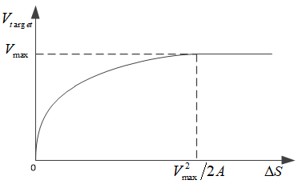
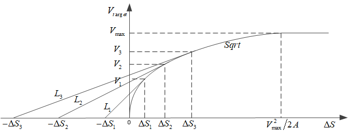
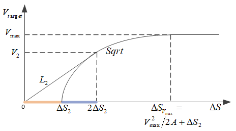

# 开方控制器sqrt-controller

* [返回上层目录](../pid-control.md)
* [开方控制器的原理](#开方控制器的原理)
* [计算ΔS2的值](#计算ΔS2的值)
* [位置控制器的参数](#位置控制器的参数)
* [总结](#总结)

一句话解释开方控制器本质：

> 开方控制器是位置环上的**变结构比例P控制器**：远处用$V=\sqrt{2A\Delta S}$（匀减速、尽量快），靠近目标改用$V=k\Delta S$（增益有界、能停稳），并把开方曲线右移$\Delta S_2$提前减速。下面用公式把「为什么是开方、斜率意味着什么、为什么还要加直线、为什么要右移」逐步推出来。

开方控制器用在位置/角度环中，输出速度/角速度设定值。为方便，下文只写位置；角度是同一套公式。

串级关系是：

$$
\Delta S \;\xrightarrow{\text{开方控制器}}\; V_{target} \;\xrightarrow{\text{速度内环}}\; \text{实际速度}V
$$

位置控制器的功能是：**根据$\Delta S$给出合理的$V_{target}$**，在快速性和能停稳之间折衷。

# 开方控制器的原理

设定位置和实际位置的偏差为$\Delta S$。下文先按$\Delta S>0$推导（向目标正向靠近）；文末再补上符号，反向同样适用。

$\Delta S$较大时，应以最大速度$V_{max}$运行。$\Delta S$小到一定程度后开始减速，减速时加速度以最大加速度$A$为上限。

## 匀减速给出开方曲线

由匀变速公式（加速度$a$为常数）

$$
v_1^2-v_2^2=2as
$$

其中$v_1$为起始速度，$v_2$为结束速度，$a$为加速度，$s$为经过的距离。

位置控制希望停在目标处，结束速度为$0$，取$a=A$，剩余距离为$\Delta S$，得到

$$
V_{target}^2-0^2=2A\Delta S
$$

$$
V_{target}=\sqrt{2A\Delta S}
$$

因此：当$\Delta S$减小到$\dfrac{V_{max}^2}{2A}$时，就必须开始以最大减速度$A$做匀减速；之后每一时刻都应把速度设定更新为

$$
V_{target}=\sqrt{2A\Delta S}
$$

这就是平方根曲线。如下图。

## 贯穿全文的关系：$a=v\dfrac{\mathrm{d}v}{\mathrm{d}s}$

匀变速公式$V^2=2aS$要求$a$为常数。更一般地，沿任意$V$–$S$曲线运动，并不要求$a$为常数：

$$
a=\frac{\mathrm{d}v}{\mathrm{d}t}=\frac{\mathrm{d}v}{\mathrm{d}s}\cdot\frac{\mathrm{d}s}{\mathrm{d}t}=v\cdot\frac{\mathrm{d}v}{\mathrm{d}s}
$$

$\dfrac{\mathrm{d}v}{\mathrm{d}s}$是$V$–$S$图上的斜率：还剩多少距离时，速度指令下降有多快。**它不是加速度**；加速度是斜率再乘上当前速度。

若希望跟踪时加速度恒为$A$，且停在原点（$S=0$时$V=0$），把$a=v\dfrac{\mathrm{d}v}{\mathrm{d}s}$里的$a$换成$A$：

$$
A=v\frac{\mathrm{d}v}{\mathrm{d}s}
\quad\Rightarrow\quad
v\,\mathrm{d}v=A\,\mathrm{d}s
$$

左边只含$v$，右边只含$s$，沿轨迹两边积分。起点是停下的原点$(s,v)=(0,0)$，终点是当前点$(S,V)$：

$$
\int_{0}^{V}v\,\mathrm{d}v=\int_{0}^{S}A\,\mathrm{d}s
\quad\Rightarrow\quad
\frac{V^2}{2}=AS
\quad\Rightarrow\quad
V=\sqrt{2AS}
$$

$\int v\,\mathrm{d}v$不是「对时间积分速度」，只是把微分方程改写成两边各自能积。物理上它就是动能定理除以质量：$\mathrm{d}(\tfrac12 v^2)=A\,\mathrm{d}s$，加速度乘路程等于单位质量的动能变化。从静止加速距离$S$、或从速度$V$匀减速停住，都是这一条。

这和上一小节是同一条曲线。对它求导：

$$
\begin{aligned}
V&=(2A\Delta S)^{1/2}\\
\frac{\mathrm{d}V}{\mathrm{d}(\Delta S)}&=\frac{1}{2}(2A\Delta S)^{-1/2}\cdot 2A
=\frac{A}{\sqrt{2A\Delta S}}
=\frac{A}{V}
\end{aligned}
$$

也可以写成

$$
\frac{\mathrm{d}V}{\mathrm{d}S}=\sqrt{\frac{A}{2\Delta S}}=\frac{1}{2}\sqrt{\frac{2A}{\Delta S}}
$$

因此跟踪开方曲线时

$$
a=V\cdot\frac{\mathrm{d}V}{\mathrm{d}S}=V\cdot\frac{A}{V}=A
$$

加速度始终是有限的$A$，**并不会因为斜率趋于无穷而变成无穷大加速度**。

开方还可以看成增益随误差变化的P控制。因为$V=K_p\Delta S$，故

$$
K_p=\frac{V}{\Delta S}=\frac{\sqrt{2A\Delta S}}{\Delta S}=\sqrt{\frac{2A}{\Delta S}}
$$

$\Delta S\to 0$时：

$$
\frac{\mathrm{d}V}{\mathrm{d}S}=\frac{A}{V}\to\infty,\qquad K_p=\sqrt{\frac{2A}{\Delta S}}\to\infty
$$

理想跟踪下，剩余$\Delta S$所需时间为

$$
\mathrm{d}t=\frac{\mathrm{d}s}{v}=\frac{\mathrm{d}s}{\sqrt{2As}}
\quad\Rightarrow\quad
T=\int_{0}^{\Delta S}\frac{\mathrm{d}s}{\sqrt{2As}}=\sqrt{\frac{2\Delta S}{A}}
$$

是**有限时间**到达，不是发散。纯开方在理想连续、无噪声、速度环能完美跟踪时，反而是受加速度约束的时间最优减速（Bang-Bang）。

## 纯开方的两个问题

真实系统里纯开方仍然不好用，原因不是「斜率无穷大所以加速度爆炸」，而是下面两条。

* **等效增益无界。** $K_p=\sqrt{2A/\Delta S}\to\infty$。位置测量的微小噪声、量化，都会变成很大的$V_{target}$跳变；串级控制里位置环增益也会超出速度内环带宽。再叠加采样和延迟，原点附近容易超调甚至抖振。$\mathrm{d}V/\mathrm{d}S\to\infty$的物理含义是：差一点点距离，速度指令就要猛变。

* **整条曲线贴死最大减速度，没有余量。** 设某一时刻$V_{target\_t}=\sqrt{2A\Delta S}$，则剩余距离刚好等于按$A$刹停所需的距离。若实际速度略大，

$$
S_{stop}=\frac{V_{actual\_t}^2}{2A}>\Delta S=\frac{V_{target\_t}^2}{2A}
$$

加速度已经是最大，不能再加大，必然超调。时间最优轨没有鲁棒性。

## 原点附近改用直线

由于以上原因，当$\Delta S$较小时改用直线，如下图。直线$L_2$与开方曲线相切于$(\Delta S_2, V_2)$，斜率为$k_2$。相切保证切换处速度连续、斜率连续，从而加速度也连续（见后文）。

当$\Delta S<\Delta S_2$时斜率恒为$k_2$，不会再随$\Delta S$变小而变陡。跟踪该曲线所需的加速度由$a=V\cdot\mathrm{d}V/\mathrm{d}S$给出，**不能再用**$V^2=2aS$（那要求$a$为常数）：

- 开方段：$V=\sqrt{2A\Delta S}$，$\dfrac{\mathrm{d}V}{\mathrm{d}S}=\dfrac{A}{V}$，故$a=A$；
- 直线段：$\dfrac{\mathrm{d}V}{\mathrm{d}S}=k_2$，故$a=k_2 V$。$V$随$\Delta S$线性变，加速度也随$\Delta S$**线性减小**。

注意：此时$L_2$不过原点。$\Delta S=0$时$V=V_2/2\neq 0$，

$$
a=k_2\cdot\frac{V_2}{2}=\frac{A}{V_2}\cdot\frac{V_2}{2}=\frac{A}{2}
$$

并不为$0$。后面将整条曲线右移$\Delta S_2$，使直线过原点后，才有$V=k_2\Delta S$、$a=k_2^2\Delta S$，在目标处加速度为$0$。

## 计算直线L的方程

先求相切处的斜率。切点$(\Delta S_2, V_2)$在开方曲线上，故

$$
V_2=\sqrt{2A\Delta S_2}
$$

开方曲线斜率为$\dfrac{\mathrm{d}V}{\mathrm{d}S}=\dfrac{1}{2}\sqrt{\dfrac{2A}{\Delta S}}$，代入切点：

$$
\begin{aligned}
\frac{1}{2}\sqrt{\frac{2A}{\Delta S_2}}
&=\frac{1}{2}\frac{\sqrt{2A}}{\sqrt{\Delta S_2}}
=\frac{1}{2}\frac{\sqrt{2A}}{\dfrac{V_2}{\sqrt{2A}}}
=\frac{1}{2}\frac{2A}{V_2}
=\frac{A}{V_2}
\end{aligned}
$$

因此切线斜率与曲线在该点的斜率相同：

$$
k_2=\frac{1}{2}\sqrt{\frac{2A}{\Delta S_2}}=\frac{A}{V_2}
$$

这不是巧合：切点仍在开方曲线上，跟踪加速度为$A$，又$a=V\cdot k_2$，故$k_2=A/V_2$。切换瞬间

$$
a=k_2 V_2=A
$$

与开方段相同，**加速度在切点连续**。若随便接一根不相切的直线，速度指令的斜率会跳变，加速度也会跳变。

设$L_2$为

$$
\begin{aligned}
V_{target}&=k_2\Delta S+b\\
&=\frac{A}{V_2}\Delta S+b
\end{aligned}
$$

过切点$(\Delta S_2, V_2)$，求$b$：

$$
\begin{aligned}
V_2&=\frac{A}{V_2}\Delta S_2+b\\
\Rightarrow b&=V_2-\frac{A}{V_2}\Delta S_2\\
&=V_2-\frac{A}{V_2}\cdot\frac{V_2^2}{2A}\qquad\text{given }V_2=\sqrt{2A\Delta S_2}\\
&=V_2-\frac{V_2}{2}\\
&=\frac{V_2}{2}
\end{aligned}
$$

所以未平移的$L_2$为

$$
\begin{aligned}
V_{target}&=k_2\Delta S+b\\
&=\frac{A}{V_2}\Delta S+\frac{V_2}{2}
\end{aligned}
$$

## 计算直线和横坐标的交点

令$V_{target}=0$：

$$
\begin{aligned}
0&=\frac{A}{V_2}\Delta S+\frac{V_2}{2}\\
\Rightarrow\Delta S&=-\frac{V_2}{2}\cdot\frac{V_2}{A}=-\frac{V_2^2}{2A}\\
&=-\frac{2A\Delta S_2}{2A}\qquad\text{given }V_2=\sqrt{2A\Delta S_2}\\
&=-\Delta S_2
\end{aligned}
$$

$L_2$与横轴交于$(-\Delta S_2,\,0)$，与纵轴交于$(0,\,V_2/2)$。

图中$L_1$、$L_3$与$L_2$同理：分别与开方曲线相切于$(\Delta S_1, V_1)$、$(\Delta S_3, V_3)$，斜率为$k_1$、$k_3$。切点越靠近原点，斜率越大（$k=A/V$，$V$更小）。

## 得到开方控制器

未平移的$L_2$在$\Delta S=0$时$V_{target}=V_2/2\neq 0$，**不能停住**。将直线$L_2$和开方曲线沿横轴正方向平移$\Delta S_2$，如下图。

平移规则是把原来公式里的$\Delta S$换成$\Delta S-\Delta S_2$，得到

$$
\left\{\begin{matrix}
V_{target}=\sqrt{2A(\Delta S-\Delta S_2)} &V_{target}>V_2\\
V_{target}=\dfrac{A}{V_2}(\Delta S-\Delta S_2)+\dfrac{V_2}{2} &V_{target}\leqslant V_2
\end{matrix}\right.
$$

再用$V_{max}$限幅。

把直线段化简。由$\Delta S_2=V_2^2/(2A)$、$k_2=A/V_2$：

$$
\begin{aligned}
V_{target}
&=\frac{A}{V_2}(\Delta S-\Delta S_2)+\frac{V_2}{2}\\
&=\frac{A}{V_2}\Delta S-\frac{A}{V_2}\cdot\frac{V_2^2}{2A}+\frac{V_2}{2}\\
&=\frac{A}{V_2}\Delta S-\frac{V_2}{2}+\frac{V_2}{2}\\
&=k_2\Delta S
\end{aligned}
$$

平移后直线过原点，原点附近就是普通P控制。再看切换点：直线$V=k_2\Delta S$与$V=V_2$相交于

$$
\Delta S=\frac{V_2}{k_2}=\frac{V_2}{A/V_2}=\frac{V_2^2}{A}=2\Delta S_2
$$

所以实际切换点是$(2\Delta S_2,\,V_2)$。直线段上

$$
a=V\cdot\frac{\mathrm{d}V}{\mathrm{d}S}=(k_2\Delta S)\cdot k_2=k_2^2\Delta S
$$

随$\Delta S$线性减到$0$。切点处$\Delta S=2\Delta S_2$，

$$
a=k_2^2\cdot 2\Delta S_2=\left(\frac{A}{V_2}\right)^2\cdot 2\cdot\frac{V_2^2}{2A}=A
$$

与开方段仍连续。等效增益$K_p=k_2$有界，不再随误差趋于$0$而发散。

开始减速的距离也提前了。纯开方从$\Delta S=V_{max}^2/(2A)$减速；平移后$V_{max}=\sqrt{2A(\Delta S_{V_{max}}-\Delta S_2)}$，故

$$
\Delta S_{V_{max}}=\frac{V_{max}^2}{2A}+\Delta S_2
$$

在$V_{target}$小于等于$V_2$后，曲线的斜率恒定。同时和下图

相比，提前开始减速，提前量为$\Delta S_2$。好处有两层：

* 开方段命令速度低于纯开方$\sqrt{2A\Delta S}$。按最大减速度$A$刹停所需距离是$V^2/(2A)=\Delta S-\Delta S_2$，比剩余距离短$\Delta S_2$。写成速度余量：只要实际速度满足

$$
V_{actual}^2 \le V_{target}^2+2A\Delta S_2
$$

仍按得住（因为$V_{target}^2+2A\Delta S_2=2A\Delta S$）。

* 进入直线段后，跟踪所需加速度$a=k_2^2\Delta S<A$（切点处相等），减速度还可以在$A$以内再加大或减小。

写成便于实现的分段（$\Delta S>0$）：

$$
V_{target}=
\begin{cases}
V_{max} & \Delta S \ge \Delta S_{V_{max}} \\
\sqrt{2A(\Delta S-\Delta S_2)} & 2\Delta S_2 < \Delta S < \Delta S_{V_{max}} \\
k_2\Delta S & \Delta S \le 2\Delta S_2
\end{cases}
$$

其中$\Delta S_{V_{max}}=V_{max}^2/(2A)+\Delta S_2$，$k_2=A/V_2$。若$V_{max}\le V_2$，则不会进入开方段，限幅后直接从匀速进线性段。

反向时对误差取符号即可：

$$
V_{target}=\mathrm{sign}(\Delta S)\cdot f(|\Delta S|)
$$

$f(\cdot)$就是上面的非负分段。

跟踪时各段对应的闭环（$\Delta S>0$，$V=V_{target}$）为：

$$
\begin{aligned}
\text{匀速段：}&\quad \dot{(\Delta S)}=-V_{max}\\
\text{开方段：}&\quad \dot{(\Delta S)}=-\sqrt{2A(\Delta S-\Delta S_2)}\\
\text{线性段：}&\quad \dot{(\Delta S)}=-k_2\Delta S
\end{aligned}
$$

线性段解为$\Delta S(t)=\Delta S(0)\,e^{-k_2 t}$，指数逼近，时间常数$1/k_2$。这就是「牺牲有限时间到达，换原点附近行为良好」。

# 计算ΔS2的值

工程上常先给定直线斜率$k$（也就是线性段的$K_p$）。平移后切点/切换点为$(2\Delta S_2,\,V_2)$，因此**$\Delta S_2$是该切点横坐标的一半**。

切点处曲线斜率等于$k$。未平移开方曲线在对应切点$(\Delta S_2, V_2)$处斜率为$A/V_2$，故

$$
\begin{aligned}
k&=\frac{A}{V_2}\\
\Rightarrow V_2&=\frac{A}{k}
\end{aligned}
$$

未平移曲线在该切点仍满足$V_2=\sqrt{2A\Delta S_2}$：

$$
\begin{aligned}
V_2&=\sqrt{2A\Delta S_2}\\
\Rightarrow \frac{A}{k}&=\sqrt{2A\Delta S_2}\\
\Rightarrow \Delta S_2&=\frac{A^2}{k^2}\cdot\frac{1}{2A}=\frac{A}{2k^2}
\end{aligned}
$$

三个量只要定一个（再加$A$），其余都定了：

$$
k=\frac{A}{V_2},\qquad
V_2=\frac{A}{k},\qquad
\Delta S_2=\frac{A}{2k^2},\qquad
2\Delta S_2=\frac{A}{k^2}=\frac{V_2}{k}
$$

$k$的量纲是$1/\text{时间}$，应明显小于速度内环带宽，否则线性段仍然跟不上。

# 位置控制器的参数

位置控制器由以下参数确定：

* $V_{max}$（最大速度）和$A$（最大加速度）；
* 切换点$(2\Delta S_2,\,V_2)$，满足$V_2=\sqrt{2A\Delta S_2}$，或等价地给定线性增益$k=A/V_2$。

调试时：

* 超调大：减小$V_{max}$或$A$（减速更早、更软），或把切换点调到更远处。例如用$(2\Delta S_3, V_3)$，即把$L_3$和开方曲线右移$\Delta S_3$。切点更远则$V_3$更大、$k_3=A/V_3$更小，提前量$\Delta S_3$更大。
* 定位太慢，或摩擦力/死区导致速度已经为$0$却还没到目标：增大$V_{max}$或$A$，或把切换点调近，例如用$(2\Delta S_1, V_1)$（$k$更大、提前量更小）。注意$k$过大又会回到「原点附近增益太高」的问题。

# 总结

把公式收成一张表：

| 区段 | $V_{target}$（$\Delta S>0$） | 斜率$\mathrm{d}V/\mathrm{d}S$ | 跟踪加速度$a=V\dfrac{\mathrm{d}V}{\mathrm{d}S}$ | 等效$K_p=V/\Delta S$ |
| --- | --- | --- | --- | --- |
| 匀速 | $V_{max}$ | $0$ | $0$ | — |
| 纯开方 | $\sqrt{2A\Delta S}$ | $A/V\to\infty$ | $A$ | $\sqrt{2A/\Delta S}\to\infty$ |
| 平移后开方 | $\sqrt{2A(\Delta S-\Delta S_2)}$ | $A/V$ | $A$（但有$\Delta S_2$距离余量） | 有界（切点处为$k$） |
| 线性 | $k\Delta S$ | $k$ | $k^2\Delta S\to 0$ | $k$ |

开方控制器就是把上表拼起来的变结构P：远处尽量走$a=A$的开方，原点附近改走增益为$k$的直线，并右移$\Delta S_2$离开那条「刚好刹停」的时间最优轨。

纯开方在$\Delta S\to 0$时斜率无穷大，等效增益无界；理想跟踪时加速度仍是$A$，连续无噪声时还是有限时间稳定，**不是斜率无穷大就把系统在物理上顶飞**。真实系统受不了无界增益（噪声、内环带宽），再加上贴死$A$没有余量，才会超调、抖振。加线性段并提前减速，代价是不再Bang-Bang时间最优：用一点快速性，换鲁棒性和可实现性。

# 参考资料

* 论文《位置控制中速度设定值的给定方法》2013年发表在《自动化技术与应用》
