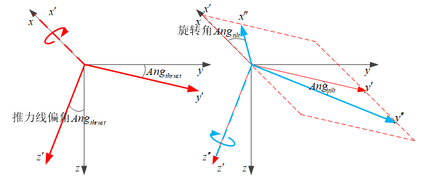
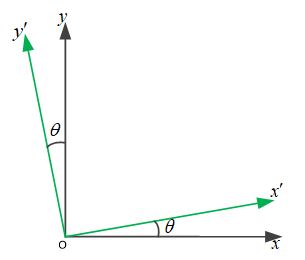
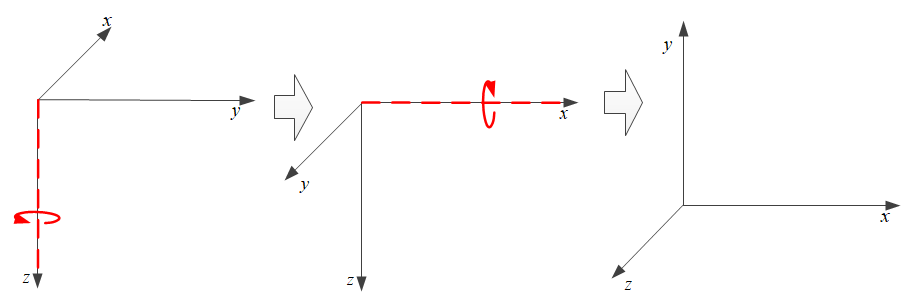
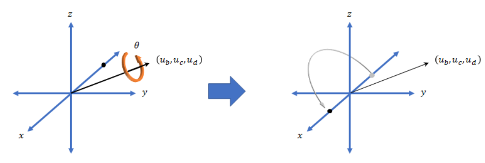

# 四元数使用手册

- [返回上层目录](../quaternion.md)
- [为什么要用四元数](#为什么要用四元数)
- [四元数表示](#四元数表示)
- [四元数乘法](#四元数乘法)
  - [乘法定义](#乘法定义)
  - [共轭四元数](#共轭四元数)
- [四元数旋转](#四元数旋转)
  - [刚体的定点转动](#刚体的定点转动)
  - [四元数连乘表示连续旋转](#四元数连乘表示连续旋转)
  - [坐标变换](#坐标变换)
    - [由四元数得到坐标变换矩阵](#由四元数得到坐标变换矩阵)
    - [由四元数直接做坐标变换与旋转变换](#由四元数直接做坐标变换与旋转变换)
  - [四元数的轴角矢量表示法的高级用法](#四元数的轴角矢量表示法的高级用法)
  - [线性插值](#线性插值)


# 为什么要用四元数

四元数的矢量部分直接对应了旋转轴，标量和矢量部分共同决定了旋转角，这是比欧拉角三个角表示旋转更为接近本质的方法。

相较于欧拉角求旋转向量坐标的方法，

* 四元数方法不需要进行求三角函数的运算，因此运算精度更高；
* 四元数不存在欧拉角的框架自锁问题

框架自锁问题如下：

欧拉角速率和机体轴角速率的关系为：
$$
\begin{aligned}
\begin{bmatrix}
\phi'\\
\theta'\\
\psi'\\
\end{bmatrix}
&=
\begin{bmatrix}
1&\tan\theta \sin\phi&\tan\theta \cos\phi\\
0&\cos\phi&-\sin\phi\\
0&\frac{\sin\phi}{\cos\theta}&\frac{\cos\phi}{\cos\theta}\\
\end{bmatrix}
\cdot
\begin{bmatrix}
p\\
q\\
r\\
\end{bmatrix}
\end{aligned}
$$
由上式可看出欧拉角表示方法存在的问题。例如，当俯仰角$\theta\rightarrow\pm90^{\circ}$时，由于方程含有$(\cos\theta)^{-1}$和$\tan\theta$项，使得横滚角变化率$\dot{\phi}$和航向角变化率$\dot{\psi}$无穷大，这种现象在工程上被称为框架自锁现象。解决这个问题的方法是采用四元数法。

# 四元数表示

四元数可看做高维版的复数：
$$
Q=q_0+q_1\overrightarrow{i}+q_2\overrightarrow{j}+q_3\overrightarrow{k}
$$
$Q$的大小（范数）为
$$
\left\|Q\right\|=q_0^2+q_1^2+q_2^2+q_3^2
$$
若$\left\|Q\right\|=1$，则$Q$称为规范化四元数，即**单位**四元数。


四元数$Q$的**共轭**四元数$Q^*$为（可类比为矩阵的转置）：
$$
\begin{aligned}
Q&=q_0+q_1\overrightarrow{i}+q_2\overrightarrow{j}+q_3\overrightarrow{k}\\
Q^*&=q_0-q_1\overrightarrow{i}-q_2\overrightarrow{j}-q_3\overrightarrow{k}
\end{aligned}
$$
则有
$$
Q\otimes Q^*=q_0^2+q_1^2+q_2^2+q_3^2=\left\| Q\right\|
$$

# 四元数乘法

## 乘法定义

两个四元数$Q_a$和$Q_b$相乘表示为
$$
Q_c=Q_a\otimes Q_b
$$
上式可写成矩阵形式
$$
\begin{aligned}
Q_c=Q_a\otimes Q_b&=
\begin{bmatrix}
q_{a_0}&-q_{a_1}&-q_{a_2}&-q_{a_3}\\
q_{a_1}&q_{a_0}&-q_{a_3}&q_{a_2}\\
q_{a_2}&q_{a_3}&q_{a_0}&-q_{a_1}\\
q_{a_3}&-q_{a_2}&q_{a_1}&q_{a_0}\\
\end{bmatrix}
\begin{bmatrix}
q_{b_0}\\
q_{b_1}\\
q_{b_2}\\
q_{b_3}\\
\end{bmatrix}
=M(Q_a)Q_b\\
&=
\begin{bmatrix}
q_{b_0}&-q_{b_1}&-q_{b_2}&-q_{b_3}\\
q_{b_1}&q_{b_0}&q_{b_3}&-q_{b_2}\\
q_{b_2}&-q_{b_3}&q_{b_0}&q_{b_1}\\
q_{b_3}&q_{b_2}&-q_{b_1}&q_{b_0}\\
\end{bmatrix}
\begin{bmatrix}
q_{a_0}\\
q_{a_1}\\
q_{a_2}\\
q_{a_3}\\
\end{bmatrix}
=M'(Q_b)Q_a\\
\end{aligned}
$$

## 共轭四元数

四元数有一个类似矩阵转置的性质（*号代表**共轭**）：
$$
(Q_a\otimes Q_b)^*=Q_b^*\otimes Q_a^*
$$
四元数的逆$Q^{-1}$满足
$$
Q\otimes Q^{-1}=1
$$
而前面已知
$$
Q\otimes Q^*=q_0^2+q_1^2+q_2^2+q_3^2=\left\| Q\right\|
$$
上面两式对比可知四元数的逆$Q^{-1}$为：
$$
Q^{-1}=\frac{Q^*}{\left\|Q\right\|}
$$
若$Q$为单位四元数，即$\left\|Q\right\|=1$，则
$$
Q^{-1}=\frac{Q^*}{\left\|Q\right\|}=Q^*=q_0-q_1\overrightarrow{i}-q_2\overrightarrow{j}-q_3\overrightarrow{k}
$$

# 四元数旋转

## 刚体的定点转动

四元数和三维向量**不能单边相乘**（$Q \otimes \mathbf{r}$ 不合法）。要作用到向量上，用后文的夹心乘法 $Q \otimes \mathbf{r} \otimes Q^*$，或先把 $Q$ 写成旋转矩阵再乘，两种写法等价。

**单位四元数描述了刚体的定点转动**，可将单位四元数$Q$写为
$$
\begin{aligned}
Q&=q_0+q_1\overrightarrow{i}+q_2\overrightarrow{j}+q_3\overrightarrow{k}\\
&=\cos\frac{\theta}{2}+\overrightarrow{u}^R\sin\frac{\theta}{2}
\end{aligned}
$$
可看做是以三维空间单位向量$\overrightarrow{u}^R$（出发点在向量出发点处）为轴，右手定则，将向量旋转$\theta$，形成旋转后的新向量。如果把固连在向量上的坐标系看做机体坐标系$b$，那就可以认为，$b$系是由$R$系（初始坐标系，可看做惯性坐标系或大地坐标系）经过无中间过程的一次性等效旋转形成的。

记住：这里说的是**轴怎么转**——大地轴系 $R$ 的三根轴，按 $Q$ 转一次，转到与机体轴系 $b$ 重合。后文公式里，**同一个** $Q$ 作为算子时，输入的是机体系坐标、输出的是大地系坐标（标成 $b \to n$）。**轴从地转到机，数从机算到地，是同一把 $Q$ 的两种读法**，不要把两个箭头当成两把不同的旋转。详见「由四元数直接做坐标变换与旋转变换」。

## 四元数连乘表示连续旋转

（和上一节一样：不能单边乘向量；夹心或先变矩阵，见后文「坐标变换」。）

如何把飞机从四元数$Q_a$表示的姿态，转到$Q_b$表示的姿态呢？

想法很简单，先给四元数$Q_a$乘以其逆$Q_a^{-1}$，逆向旋转恢复到初始姿态，然后再乘以$Q_b$，从初始姿态旋转到$Q_b$的姿态。即
$$
Q_a\otimes Q_a^{-1}\otimes Q_b=Q_b
$$
如果规定四元数$Q_a^b$代表从$Q_a$的姿态旋转到$Q_b$表示的姿态，那么有
$$
Q_a\otimes Q_a^b=Q_b
$$
比较上两式，则显然有
$$
Q_a^b=Q_a^{-1}\otimes Q_b
$$
这就是**将四元数$Q_a$的姿态旋转到$Q_b$的姿态的四元数$Q_a^b$**。

注意，该四元数$Q_a^b$标识的旋转，是基于四元数$Q_a$表示的姿态的基础上的，而不是基于初始姿态（$Q_0=\cos(0)+\sin(0)\overrightarrow{u}$），就好比$Q_a$旋转时把基础姿态$$Q_0=\cos(0)+\sin(0)\overrightarrow{u}$$当做基础姿态一样

想要更深入的理解，那就看下面的matlab代码：

即**四元数连乘，其实就和基于欧拉角连续转动是一样的**

```matlab
% 由欧拉角转换到四元数
quat_yaw = quaternion([pi/3, 0, 0], 'euler', 'ZYX', 'frame')  % 0.866+0i+0j+0.5k
quat_pitch = quaternion([0, pi/3, 0], 'euler', 'ZYX', 'frame')  % 0.866+0i+0.5j+0k
quat_roll = quaternion([0, 0, pi/3], 'euler', 'ZYX', 'frame')  % 0.866+0.5i+0j+0k

% 定义基于欧拉角的旋转[yaw=60, pitch=60, roll=0]
% 欧拉角转四元数
quat_yp = quaternion([pi/3, pi/3, 0], 'euler', 'ZYX', 'frame')  % 0.75-0.25i+0.433j+0.433k
% 四元数转欧拉角（度）
euler_zyx = eulerd(quat_yp,'ZYX', 'frame')  % [yaw=60, pitch=60, roll=0]
% 四元数转旋转矩阵（注意是大地轴系转机体轴系）
C_n2b_yp = rotmat(quat_yp, 'frame')
% [ 0.250    0.433   -0.866
%  -0.866    0.500        0
%   0.433    0.750    0.500]

% 由两个表示中间旋转过程的的四元数连乘得到最终四元数
% 先yaw旋转60度，再pitch旋转60度
quat_yp_q = quat_yaw * quat_pitch  % 0.75-0.25i+0.433j+0.433k
% 由四元数转换为欧拉角
euler_zyx_q = eulerd(quat_yp_q,'ZYX','frame')  % [yaw=60, pitch=60, roll=0]
% 四元数转为旋转矩阵（注意是大地轴系转机体轴系）
C_n2b_q = rotmat(quat_yp_q,'frame')
% [ 0.250    0.433   -0.866
%  -0.866    0.500        0
%   0.433    0.750    0.500]

% 直接从欧拉角得到坐标变换矩阵（大地轴系到机体轴系）
psi = pi/3;
theta = pi/3;
R_psi = [cos(psi)  sin(psi) 0; -sin(psi) cos(psi) 0; 0 0 1];
R_theta = [cos(theta) 0 -sin(theta); 0 1 0; sin(theta) 0 cos(theta)];
C_n2b = R_theta * R_psi  % （大地轴系到机体轴系）
% [ 0.250    0.433   -0.866
%  -0.866    0.500        0
%   0.433    0.750    0.500]
```

现在应该已经初步理解了四元数连乘表示连续旋转了吧。那么就继续接着看。

下面来深入理解一下飞控程序中倾斜和旋转分离的四元数变换，解释一下倾转分离：多旋翼的姿态控制，首先要保证俯仰角和滚转角优先达到期望姿态，然后偏航角再达到期望姿态，偏航角并不重要，因为就算偏航角有偏差，也坠毁不了。

所以我们的任务是，要把一个包换pitch和roll倾斜加yaw旋转的姿态变换，分离成单独的两个四元数变换，先进行pitch和roll倾斜的四元数变换，然后yaw旋转的四元数变换。然后对yaw旋转的角度做一个缩小限制后得到新的四元数，再把原来的倾斜四元数和缩小后的旋转四元数相乘，就得到新的旋转，这个旋转保证了飞机的倾斜角和原来的旋转一致，但是yaw旋转角小于原来的旋转，即新旧坐标变换的z轴保持一致，xy轴不一致。

那现在就开始吧。

首先定义pitch和roll倾斜，假设倾斜只旋转了滚转角，即从0转为30度，等效为推力矢量线偏转（即$Ang_{thrust}$）。

然后定义yaw旋转，yaw旋转45度（即$Ang_{tilt}$）。

也就是说，新的姿态是先roll倾斜30度，再yaw旋转45度。

对于变换后的姿态，我们要把倾斜和旋转分离，并把旋转从45度限制为30度。



使用下面一段代码验证了倾转分离的等效性，即**四元数直接的一次旋转等于先roll旋转再yaw旋转**。

```matlab
% 欧拉角转四元数（注意，为了模拟推力线倾斜和yaw旋转的作用，采用XYZ欧拉角旋转方式，即roll->pitch-yaw）
quat_ry = quaternion([pi/6, 0, pi/4], 'euler', 'XYZ', 'frame')  % 0.8924+0.23912i-0.099046j+0.36964k
% 四元数转欧拉角（度）
euler_xyz = eulerd(quat_ry,'XYZ', 'frame')  % [roll=30, pitch=0, yaw=45]
% 四元数转旋转矩阵（注意是大地轴系转机体轴系）
C_n2b_ry = rotmat(quat_ry, 'frame')
% [ 0.7071    0.6124    0.3536
%  -0.7071    0.6124    0.3536
%  -0.0000   -0.5000    0.8660]

% 由欧拉角转换到四元数
quat_roll = quaternion([pi/6, 0, 0], 'euler', 'XYZ', 'frame')  % 0.96593+0.25882i+0j+0k
quat_yaw = quaternion([0, 0, pi/4], 'euler', 'XYZ', 'frame')  % 0.92388+0i+0j+0.38268k
% 由两个表示中间旋转过程的的四元数连乘得到最终四元数
% 先roll旋转30度，再yaw旋转45度
quat_ry_q = quat_roll * quat_yaw  % 0.8924+0.23912i-0.099046j+0.36964k
% 由四元数转换为欧拉角
euler_xyz_q = eulerd(quat_ry_q,'XYZ','frame')  % [[roll=30, pitch=0, yaw=45]
% 四元数转为旋转矩阵（注意是大地轴系转机体轴系）
C_n2b_q = rotmat(quat_ry_q,'frame')
% [ 0.7071    0.6124    0.3536
%  -0.7071    0.6124    0.3536
%  -0.0000   -0.5000    0.8660]

% 直接从欧拉角得到坐标变换矩阵（大地轴系到机体轴系）
psi = pi/4;
phi = pi/6;
R_psi = [cos(psi) sin(psi) 0; -sin(psi) cos(psi) 0; 0 0 1];
R_phi = [1 0 0; 0 cos(phi) sin(phi); 0 -sin(phi) cos(phi)];
C_n2b = R_psi * R_phi  % （大地轴系到机体轴系）
% [ 0.7071    0.6124    0.3536
%  -0.7071    0.6124    0.3536
%  -0.0000   -0.5000    0.8660]
```

然后，由前面的理论

> 如果规定四元数$Q_a^b$代表从$Q_a$的姿态旋转到$Q_b$表示的姿态，那么有
> $$
> Q_a\otimes Q_a^b=Q_b
> $$
> 比较上两式，则显然有
> $$
> Q_a^b=Q_a^{-1}\otimes Q_b
> $$
> 这就是**将四元数$Q_a$的姿态旋转到$Q_b$的姿态的四元数$Q_a^b$**。

这里$Q_a=Q_{roll}$，$Q_a^b=Q_{yaw}$，$Q_b=Q_{ry}$，即有
$$
Q_{roll}\otimes Q_{yaw} = Q_{ry}
$$
则可知$Q_{yaw}=Q_{roll}^{-1}\otimes Q_{ry}$

下面用matlab来实现上面的公式

```matlab
% 根据quat_ry_q = quat_roll * quat_yaw，已知quat_ry_q和quat_roll，求quat_yaw
% 方法就是quat_yaw = inv(quat_roll) * quat_ry_q
% 已知quat_ry_q = 0.8924+0.23912i-0.099046j+0.36964k
%     quat_roll = 0.96593+0.25882i+0j+0k
%     quat_yaw = 0.92388+0i+0j+0.38268k
% 嗯，和预想的一样
quat_yaw_q = quat_roll' * quat_ry_q  % 0.92388+0i+0j+0.38268k
euler_xyz = eulerd(quat_yaw_q,'XYZ', 'frame')  % [roll=0, pitch=0, yaw=45]
```

现在我们成功地将yaw的四元数给分离出来了，并且验证了分离出来的yaw四元数可以转换成欧拉角。

下面我们把分离出来的yaw四元数转换成轴角，并进行缩小，然后又转换成yaw四元数，再和roll四元数连乘，就是新的缩小yaw角后的tilt减小的四元数了，再把该四元数转到欧拉角，可以清楚地看到yaw角被缩小成了30度，不再是原来的45度了。该过程的具体matlab代码如下：

```matlab
% 转为轴角
yaw_vec = rotvecd(quat_yaw_q)  % [0 0 45]
yaw_vec = [0 0 30]
quat_yaw_vec = quaternion(yaw_vec,'rotvecd')  % 0.96593+0i+0j+0.25882k
% 由四元数转换为欧拉角
euler_xyz_q = eulerd(quat_yaw_vec, 'XYZ', 'frame')  % [[roll=0, pitch=0, yaw=30]

% 重新计算新的四元数quat_ry_q = quat_roll * quat_yaw
quat_ry_q = quat_roll * quat_yaw_vec  % 0.93301+0.25i-0.066987j+0.25k
% 看，就是我们想要的欧拉姿态角：[roll=30, pitch=0, yaw=30]，roll和pitch没变，yaw变为了30度
euler_xyz = eulerd(quat_ry_q, 'XYZ', 'frame')  % [roll=30, pitch=0, yaw=30]
```

总结：

要**正确理解四元数连乘的作用**，就要认识到：四元数连乘和欧拉角旋转矩阵连乘是同一件事——把多次旋转合成一次。单独一个四元数不能和三维向量单边相乘；要对向量做这次合成旋转，用后文的夹心 $Q \otimes \mathbf{r} \otimes Q^*$，或先把合成后的 $Q$ 写成矩阵。

## 坐标变换

前面反复出现一句话：“四元数乘法相当于坐标转换，但不能直接和向量相乘，必须先变成旋转矩阵。”这句话只说对了一半：四元数和三维向量**不能单边相乘**（$Q \otimes \mathbf{r}$ 在代数上不合法）。真正的直接算法是**夹心乘法** $\mathbf{r}' = Q \otimes \mathbf{r} \otimes Q^*$；先把 $Q$ 写成旋转矩阵再乘向量，只是同一种变换的另一种写法，不是“唯一合法路径”。

下面两种方式完全等价：先变矩阵，或直接夹心。

### 由四元数得到坐标变换矩阵

$$
C_b^n=
\begin{bmatrix}
1-2(q_2^2+q_3^2)&2(q_1q_2-q_0q_3)&2(q_1q_3+q_0q_2)\\
2(q_1q_2+q_0q_3)&1-2(q_1^2+q_3^2)&2(q_2q_3-q_0q_1)\\
2(q_1q_3-q_0q_2)&2(q_2q_3+q_0q_1)&1-2(q_1^2+q_2^2)\\
\end{bmatrix}
$$

注意：前面说 $Q$ 把系从 $n$ 转到 $b$，指的是**轴的旋转方向**（地轴转到机轴）。下面这个矩阵 $C_b^n$ 做的是**坐标换算**：$\mathbf{v}_n = C_b^n \mathbf{v}_b$。两者是同一把旋转，箭头看起来相反——轴从地到机，数从机到地。详见后文「口语觉得地转到机，公式却写成 $b \to n$」。

这就好比，旋转矩阵
$$
\begin{aligned}
R_b^n=
\begin{bmatrix}
\cos(\theta)&-\sin(\theta)\\
\sin(\theta)&\cos(\theta)
\end{bmatrix}
\end{aligned}
$$
可以将$xoy$系的向量$r$绕$z$轴旋转$\theta$角。



以$xoy$系的向量$[1,0]$为例，旋转$\theta$角的过程为
$$
\begin{aligned}
\begin{bmatrix}
\cos(\theta)\\
\sin(\theta)
\end{bmatrix}
=
\begin{bmatrix}
\cos(\theta)&-\sin(\theta)\\
\sin(\theta)&\cos(\theta)
\end{bmatrix}
\end{aligned}
\begin{bmatrix}
1\\
0
\end{bmatrix}
$$
注意，这是在$xoy$系旋转向量，还不涉及坐标转换。

然后，如果需要把$x'oy'$系的向量的坐标变换到$xoy$系，类似于从$b$系变到$n$系，则可使用该矩阵：
$$
\begin{aligned}
\begin{bmatrix}
\cos(\theta)\\
\sin(\theta)
\end{bmatrix}
=
\begin{bmatrix}
\cos(\theta)&-\sin(\theta)\\
\sin(\theta)&\cos(\theta)
\end{bmatrix}
\end{aligned}
\begin{bmatrix}
1\\
0
\end{bmatrix}
$$
注意，上式的向量$[1,0]^T$是在$x'oy'$系中的坐标，然后该向量在$xoy$系中的坐标，就是$[\cos(\theta), \sin(\theta)]^T$。

上面两段算式是**同一个矩阵、同一组数**，不是抄重了。第一段读成「在 $xoy$ 里把向量转 $\theta$」；第二段读成「把 $x'oy'$ 的坐标算成 $xoy$ 的坐标」。这就是后文「轴从地转到机、数从机算到地」的二维预演：转轴和算数用的是同一把旋转。

### 由四元数直接做坐标变换与旋转变换

后文只反复使用下面两对公式。先钉在这里，读的时候对照，就不会和前面“轴从地转到机”的旧表述拧着：

| 变换对象 | 想得到大地系表达 | 想得到机体系表达 |
| :--- | :--- | :--- |
| 三维向量 $\mathbf{r}$ | $\mathbf{r}_n = Q \otimes \mathbf{r}_b \otimes Q^*$ | $\mathbf{r}_b = Q^* \otimes \mathbf{r}_n \otimes Q$ |
| 旋转动作 $q$ | $q_n = Q \otimes q_b \otimes Q^*$ | $q_b = Q^* \otimes q_n \otimes Q$ |

记忆口诀：**想得到哪一系的表达，外侧就用哪一侧的门**——得到 $n$ 用 $Q \ldots Q^*$，得到 $b$ 用 $Q^* \ldots Q$。向量和旋转动作长得一模一样；差别只在中间夹的是三维向量（补 0 的纯虚四元数）还是一个完整的旋转四元数。

#### 1. 物理本质与几何直觉

##### (1) 姿态（状态）与旋转（算子）的一体两面性

许多初学者常有疑问：“四元数 $Q$ 明明是飞机的姿态（一个状态），为什么它能像动作一样直接去‘旋转’向量或坐标？”

在现代刚体运动学与李群理论中：
> **“姿态（状态）”与“旋转（动作/算子）”在数学上是完全相同的同一个几何对象！**
> **所谓“姿态”，本质就是刚体“从大地零姿态基准出发，经历的那次三维空间旋转动作”。**

通过三个递进的台阶可以彻底看透其一体两面性：

1. **一维空间（位置 vs 位移）**：
   - 数值 $x = 5$ 既表示“停在 5 米处的位置状态”（相对于原点 $0$）；
   - 同时它也是一个“向右平移 $+5$ 米的动作算子”（把原点 $0$ 加 $5$ 得到当前位置，给任意点 $p$ 加 $5$ 即将其平移 $5$ 米）。
2. **二维平面（朝向 vs 复数旋转算子）**：
   - 复数 $z = e^{i 90^\circ} = 0 + 1i$ 既代表复平面上正北 $90^\circ$ 的朝向状态；
   - 同时它也是一个旋转算子：二维平面上任意向量（复数）$v = x + iy$，只要乘以 $i$（$v \cdot i$），就会在几何上被逆时针旋转 $90^\circ$。
3. **三维空间（四元数姿态 vs 四元数旋转算子）**：
   - 三维空间中没有孤立的姿态，飞机的姿态 $Q$ 必须相对于大地零姿态基准（NED：机头向北、机翼向东、机腹朝地平放）；
   - **飞机当前的姿态 $Q$，在定义上就是“将飞机从大地零基准，绕空间某轴 $\mathbf{u}$ 旋转 $\theta$ 角到达当前朝向所经历的空间旋转动作”**；
   - 当飞机经历旋转 $Q$ 转到现在的位置时，飞机上固连的所有物理部件（机头、机翼、推力线等）在几何上也必然随之经历了完全相同的旋转变换 $Q$；
   - 四元数通过代数上的夹心乘法 $\mathbf{r}_n = Q \otimes \mathbf{r}_b \otimes Q^*$，直接把这个旋转动作作用在任意物理向量上！

**核心结论**：并不是“静态的姿态标签居然有旋转功能”，而是“**四元数天生就是一个三维空间旋转器，飞控用它转动大地零基准后记录下来的状态，就叫做姿态**”。

---

##### (2) 主动旋转与被动旋转（互逆镜像本质）

在深入具体的数学公式之前，必须首先理清三维空间几何中两个极易混淆的概念：
1. **主动旋转（Active Rotation / 向量旋转）**：坐标系不动，把物理向量/物体在同一个参考系内旋转一个角度。
2. **被动旋转（Passive Rotation / 坐标系变换）**：物理向量/物体在空间中固定不动，把观察它的参考坐标系转动了一个角度。

> **为什么它们天然互为逆操作（互为镜像）？**
> 想象观察者坐在转椅上（机体坐标系 $b$），房间是大地坐标系 $n$：
> - **主动旋转**：观察者面朝正北不动，无人机从正北向右移动到正东（顺时针 $+90^\circ$），在观察者眼里无人机处于 $+90^\circ$ 方向；
> - **被动旋转**：无人机在正北不动，观察者自己向右转脸（顺时针 $+90^\circ$ 面朝正东），此时静止在正北的无人机在观察者眼里变成了处于**正左侧（$-90^\circ$）**！
> 
> **核心结论**：观察者坐标系自身正向旋转 $+\theta$，其眼中一切静止物体的坐标投影数值上恰好等于**逆向旋转 $-\theta$**。
>
> 后面「轴从地转到机、数从机算到地」不必再对一套主动/被动的名字。只要记住：转轴和算数互为另一面，用的是**同一把** $Q$。

---

#### 2. 跨坐标系变换的数学推导与计算法则

##### (1) 三维物理向量的跨坐标系变换（纯向量坐标转换）

设 $Q$ 为飞机当前的**姿态四元数**。飞控里把它标成 $b \to n$，意思只有一件事：把**同一个物理向量**的机体系坐标，算成大地系坐标
$$
\mathbf{r}_n = Q \otimes \mathbf{r}_b \otimes Q^*
$$

> **深度解析：口语觉得“地转到机”，公式却写成 $b \to n$，到底卡在哪？**
>
> 日常说“飞机姿态”时，脑子里想的是**轴怎么转**；飞控公式标记的是**数怎么算**。这两件事用的是**同一把** $Q$，方向看起来却相反：
>
> 1. **轴怎么转（几何：地轴转到机轴）**
>    空间里先有大地三根轴（北-东-地，即 $n$ 系）。把这三根轴按姿态 $Q$ 转一次，刚好转到当前机体三根轴（前-右-下，即 $b$ 系）上。所以口语会说：“姿态不就是把大地坐标系转到和飞机对齐吗？”
>
> 2. **数怎么算（代数：机体系坐标算成大地系坐标，$b \to n$）**
>    机体轴既然是地轴被 $Q$ 转出来的，那么“沿着机体 $x$ 轴的那根箭头”（机头，飞行员眼里永远是 $\mathbf{r}_b = [1,0,0]^T$），在大地上的指向，**正好等于把大地系里的 $[1,0,0]^T$ 用同一把 $Q$ 转一次的结果**。算的时候因此是：输入 $b$ 坐标，输出 $n$ 坐标。
>
> 用偏航 $+90^\circ$（机头朝东；从天上往下看是绕铅垂轴顺时针 $90^\circ$）把两句话钉死：
>
> | | 机体系坐标 $\mathbf{r}_b$ | 大地系坐标 $\mathbf{r}_n = Q \otimes \mathbf{r}_b \otimes Q^*$ | 几何含义（地轴被 $Q$ 转到哪） |
> | :--- | :--- | :--- | :--- |
> | 机头 | $[1,0,0]^T$ | $[0,1,0]^T$（东） | 大地北轴被 $Q$ 转到正东 $=$ 当前机体 $x$ 轴 |
> | 右翼 | $[0,1,0]^T$ | $[-1,0,0]^T$（南） | 大地东轴被 $Q$ 转到正南 $=$ 当前机体 $y$ 轴 |
>
> **一句话看穿**：
> $$
> \begin{aligned}
> &\text{转轴：} && n\text{ 的三根轴} && \xrightarrow{\ Q\ } && \text{转到与 } b \text{ 重合} \\
> &\text{算数：} && b\text{ 的坐标} && \xrightarrow{\ Q\ } && \text{得到 } n \text{ 的坐标}
> \end{aligned}
> $$
>
> 所以下面两句话描述的是**同一个** $Q$（也就是同一个旋转矩阵 $R_b^n$）：
> - 使几何坐标轴从大地系 $n$ 转到与机体系 $b$ 重合的那个旋转；
> - 把向量坐标从机体系 $b$ 算成大地系 $n$ 的那个四元数 $Q_{b \to n}$。
>
> 飞控把它标成 $b \to n$，只因为它作为算子时：**输入是 $\mathbf{r}_b$，输出是 $\mathbf{r}_n$**。不要把“轴从哪转到哪”和“坐标从哪算到哪”混成一个箭头。

四元数是四维的，三维向量 $\mathbf{r} = [x, y, z]^T$ 可扩充为纯虚四元数（零标量）$\mathbf{r} = [0, x, y, z]^T$。

- **机体系坐标 $\to$ 大地系坐标（$b \to n$）**：
  将机体上固连的物理矢量（如机头方向 $[1,0,0]^T_b$、推力线 $[0,0,1]^T_b$）变换到地面坐标系表达：
  $$
  \mathbf{r}_n = Q \otimes \mathbf{r}_b \otimes Q^*
  $$

  > **真正要记住的核心就这一式，其余都是它的变体，不是新公式。**
  > - **反过来**（想要机体系）：左右乘 $Q^*$、$Q$ 把两边消掉，得到 $\mathbf{r}_b = Q^* \otimes \mathbf{r}_n \otimes Q$。只是把 $Q$ 和 $Q^*$ 对调。
  > - **中间夹的不是向量、而是旋转动作** $q$：写法一模一样，$q_n = Q \otimes q_b \otimes Q^*$，再反解就是 $q_b = Q^* \otimes q_n \otimes Q$。因为旋转四元数拆开后，变的只是转轴 $\mathbf{u}$，而 $\mathbf{u}$ 就是上面那个三维向量。
  >
  > 收成一句：**想得到大地系表达，用 $Q \ldots Q^*$ 夹一下；想得到机体系表达，改成 $Q^* \ldots Q$。** 中间夹向量就是坐标变换，夹旋转四元数就是动作换系。$Q$ 本身是飞机姿态；这一式是**怎么用 $Q$ 去算东西**。轴从地转到机，是同一把 $Q$ 的几何读法，不是另一条公式。

- **大地系坐标 $\to$ 机体系坐标（$n \to b$）**：
  将地面上固连的物理矢量（如地球重力加速度 $[0,0,1]^T_n$、地磁场矢量）变换到机载飞行员/传感器座舱坐标系表达：
  $$
  \mathbf{r}_b = Q^* \otimes \mathbf{r}_n \otimes Q
  $$
  这一式不是另写一套，就是把上一式两边的 $Q$、$Q^*$ 消掉。$Q$ 是单位四元数，$Q^* \otimes Q = Q \otimes Q^* = 1$。从
  $$
  \mathbf{r}_n = Q \otimes \mathbf{r}_b \otimes Q^*
  $$
  出发，最左侧乘 $Q^*$、最右侧乘 $Q$：
  $$
  \begin{aligned}
  Q^* \otimes \mathbf{r}_n \otimes Q
  &= Q^* \otimes \big(Q \otimes \mathbf{r}_b \otimes Q^*\big) \otimes Q \\
  &= \underbrace{\big(Q^* \otimes Q\big)}_{1} \otimes \mathbf{r}_b \otimes \underbrace{\big(Q^* \otimes Q\big)}_{1} \\
  &= \mathbf{r}_b
  \end{aligned}
  $$
  于是立刻得到
  $$
  \mathbf{r}_b = Q^* \otimes \mathbf{r}_n \otimes Q
  $$
  和后面 $q_n$ 从 $q_b$ 反解出来的手法完全一样：成对公式只是把 $Q$ 与 $Q^*$ 对调。

---

##### (2) 旋转动作/算子的跨坐标系变换（旋转四元数的基底变换）

在飞控高级控制算法中（如推力线与航向分离控制、云台控制等），常常面临更深入的需求：
> **一个旋转动作（例如绕大地重力铅垂轴偏航 $30^\circ$，或在大地系下通过叉乘算出的推力纠偏转动）是在大地系（$n$ 系）下定义的，飞控必须计算出该旋转在机体座舱视角（$b$ 系）下对应是多少，飞控才能知道该让舵面和电机如何偏转。**

设：
- $Q$：飞机当前的机体姿态四元数（$b \to n$）；
- $q_n$：在大地系（$n$ 系）下描述的旋转动作四元数；
- $q_b$：在机体系（$b$ 系）下描述的同一个物理旋转动作四元数。

###### 数学推导（目标：用 $Q$ 和 $q_n$ 写出 $q_b$）

要找的是：大地系里那个旋转 $q_n$，换到机体系里该写成哪个 $q_b$。思路不是对 $q_b$ 做代数变形，而是：**先在大地系写下“向量怎么转”，再全部换成机体系坐标，看夹心中间剩下什么。**

**第 1 步：大地系里，这个旋转长什么样（定义）**

任意向量 $\mathbf{v}$ 转完变成 $\mathbf{w}$。在大地系下按夹心定义就是
$$
\mathbf{w}_n = q_n \otimes \mathbf{v}_n \otimes q_n^*
$$

**第 2 步：把 $\mathbf{v}_n$、$\mathbf{w}_n$ 都换成机体系坐标**

上一节已经有核心公式 $\mathbf{r}_n = Q \otimes \mathbf{r}_b \otimes Q^*$，所以
$$
\mathbf{v}_n = Q \otimes \mathbf{v}_b \otimes Q^*, \qquad \mathbf{w}_n = Q \otimes \mathbf{w}_b \otimes Q^*
$$
代回第 1 步：
$$
Q \otimes \mathbf{w}_b \otimes Q^* = q_n \otimes \big(Q \otimes \mathbf{v}_b \otimes Q^*\big) \otimes q_n^*
$$

**第 3 步：两边剥掉外侧的 $Q$、$Q^*$，把 $\mathbf{w}_b$ 留在左边**

$Q$ 是单位四元数，$Q^* \otimes Q = Q \otimes Q^* = 1$。对第 2 步的等式最左侧乘 $Q^*$、最右侧乘 $Q$。

左边先消：
$$
Q^* \otimes \big(Q \otimes \mathbf{w}_b \otimes Q^*\big) \otimes Q
= \underbrace{\big(Q^* \otimes Q\big)}_{1} \otimes \mathbf{w}_b \otimes \underbrace{\big(Q^* \otimes Q\big)}_{1}
= \mathbf{w}_b
$$

右边原样接上，再把括号拆开、按结合律重新分组：紧挨 $\mathbf{v}_b$ 左边的 $Q$ 并进左团，紧挨 $\mathbf{v}_b$ 右边的 $Q^*$ 并进右团（这两处 $Q$、$Q^*$ 并不相消）：
$$
\begin{aligned}
&Q^* \otimes q_n \otimes \big(Q \otimes \mathbf{v}_b \otimes Q^*\big) \otimes q_n^* \otimes Q \\
&= Q^* \otimes q_n \otimes Q \otimes \mathbf{v}_b \otimes Q^* \otimes q_n^* \otimes Q \\
&= \big(Q^* \otimes q_n \otimes Q\big) \otimes \mathbf{v}_b \otimes \big(Q^* \otimes q_n^* \otimes Q\big)
\end{aligned}
$$

右边最后一团再用共轭法则 $(A \otimes B \otimes C)^* = C^* \otimes B^* \otimes A^*$（取 $A=Q^*$、$B=q_n$、$C=Q$，并注意 $(Q^*)^*=Q$）：
$$
\big(Q^* \otimes q_n \otimes Q\big)^* = Q^* \otimes q_n^* \otimes Q
$$
于是整式已经是标准夹心：
$$
\mathbf{w}_b = \big(Q^* \otimes q_n \otimes Q\big) \otimes \mathbf{v}_b \otimes \big(Q^* \otimes q_n \otimes Q\big)^*
$$

到这里，**机体系里“向量怎么转”已经算完了**。夹心中间那个四元数是 $Q^* \otimes q_n \otimes Q$，还没有给它起名字。

**第 4 步：和机体系里旋转的定义对上号（不是再算一步，是认出来）**

机体系里，同一个物理旋转按定义本来就写成
$$
\mathbf{w}_b = q_b \otimes \mathbf{v}_b \otimes q_b^*
$$
和第 3 步的结果并排：
$$
\begin{aligned}
\mathbf{w}_b &= \underbrace{\big(Q^* \otimes q_n \otimes Q\big)}_{\text{第 3 步算出来的}} \otimes \mathbf{v}_b \otimes \underbrace{\big(Q^* \otimes q_n \otimes Q\big)^*}_{\text{第 3 步算出来的}} \\
\mathbf{w}_b &= \underbrace{q_b}_{\text{定义里的名字}} \otimes \mathbf{v}_b \otimes \underbrace{q_b^*}_{\text{定义里的名字}}
\end{aligned}
$$
两式对**任意** $\mathbf{v}_b$ 都成立，左边都是同一个 $\mathbf{w}_b$，夹心结构也一样，因此中间那个四元数就是 $q_b$ 要表示的那个旋转：
$$
q_b = Q^* \otimes q_n \otimes Q
$$

> 这里**没有**从 $q_b \otimes \mathbf{v}_b \otimes q_b^*$ 把 $q_b$ 解出来。第 3 步已经算出夹心中间是 $Q^* \otimes q_n \otimes Q$；第 4 步只是给它对上定义里的名字 $q_b$。
> （四元数表示旋转时 $q$ 与 $-q$ 是同一次转动，飞控取标量部为正的那一个即可。）

**反过来：已知 $q_b$，求 $q_n$**

不是另起一套推导，而是把刚得到的 $q_b = Q^* \otimes q_n \otimes Q$ 两边的 $Q^*$、$Q$ 消掉。最左侧乘 $Q$、最右侧乘 $Q^*$：
$$
\begin{aligned}
Q \otimes q_b \otimes Q^*
&= Q \otimes \big(Q^* \otimes q_n \otimes Q\big) \otimes Q^* \\
&= \underbrace{\big(Q \otimes Q^*\big)}_{1} \otimes q_n \otimes \underbrace{\big(Q \otimes Q^*\big)}_{1} \\
&= q_n
\end{aligned}
$$
于是立刻得到逆变换（与上面成对，只是 \(Q\) 与 \(Q^*\) 对调）：
$$
\mathbf{q_n = Q \otimes q_b \otimes Q^*}
$$

例如：机载相机相对机身低头 \(15^\circ\)，这是 \(q_b\)；地面站要看这次低头在大地上等价于绕哪根轴转多少，用的就是这一式。

###### 物理本质与几何意义（一句话看透）：
> **四元数 $q = \big[\cos\frac{\theta}{2}, \ \sin\frac{\theta}{2}\mathbf{u}\big]$ 的跨坐标系变换，本质就是【转角 $\theta$ 大小绝对保持不变，三维旋转轴单位向量 $\mathbf{u}$ 按普通物理矢量做跨坐标系投影】。**
> 
> **$Q \otimes q_b \otimes Q^*$（以及 $Q^* \otimes q_n \otimes Q$）是一个不可分割的整体算子，它的物理意义不是“分三步转来转去”，而是“保持旋转角度 $\theta$ 不动，把三维旋转轴 $\mathbf{u}$ 从一个坐标系视角直接投影到另一个坐标系视角”。**

四元数由**标量部（转角 $\theta$）**和**矢量部（三维单位转轴 $\mathbf{u}$）**构成。三维单位转轴 $\mathbf{u} = [u_x, u_y, u_z]^T$ 在四元数代数中扩充为标量部补 0 的**纯虚四元数** $\mathbf{u} = [0, u_x, u_y, u_z]^T$：
$$
q_n = \begin{bmatrix} \cos\frac{\theta}{2} \\ \sin\frac{\theta}{2} u_{nx} \\ \sin\frac{\theta}{2} u_{ny} \\ \sin\frac{\theta}{2} u_{nz} \end{bmatrix} 
= \cos\frac{\theta}{2} \underbrace{\begin{bmatrix} 1 \\ 0 \\ 0 \\ 0 \end{bmatrix}}_{\text{实数单位 } 1} + \sin\frac{\theta}{2} \underbrace{\begin{bmatrix} 0 \\ u_{nx} \\ u_{ny} \\ u_{nz} \end{bmatrix}}_{\mathbf{u}_n (\text{四维纯虚四元数})}
$$

将旋转动作四元数拆开为实部和纯虚部，利用四元数乘法分配律即可清晰看透其代数本质：
$$
\begin{aligned}
q_b &= Q^* \otimes q_n \otimes Q \\
    &= Q^* \otimes \left( \cos\frac{\theta}{2} \cdot \mathbf{1} + \sin\frac{\theta}{2} \mathbf{u}_n \right) \otimes Q \\
    &= \cos\frac{\theta}{2} \underbrace{\big(Q^* \otimes \mathbf{1} \otimes Q\big)}_{Q^* \otimes Q = 1} + \sin\frac{\theta}{2} \underbrace{\big(Q^* \otimes \mathbf{u}_n \otimes Q\big)}_{\mathbf{u}_b} \\
    &= \cos\frac{\theta}{2} + \sin\frac{\theta}{2} \mathbf{u}_b
\end{aligned}
$$

> **关键细节：三维转轴与纯虚四元数的自动补 0 与无缝重组**
> 1. **进入乘法前（自动补 0）**：三维空间向量无法直接参与四元数运算，必须在标量部补 0 形成纯虚四元数 $\mathbf{u}_n = [0, u_{nx}, u_{ny}, u_{nz}]^T$；
> 2. **夹心变换中（实部守恒为 0）**：由于 $Q$ 为单位四元数（$Q \otimes Q^* = 1$），纯虚四元数经夹心变换后其标量部严格守恒保持为 0，即计算出的 $\mathbf{u}_b = Q^* \otimes \mathbf{u}_n \otimes Q = [0, u_{bx}, u_{by}, u_{bz}]^T$ 依然是纯虚四元数，其虚部恰好就是机体系下的三维转轴分量；
> 3. **最后组装（完美拼装）**：不变的标量 $\cos\frac{\theta}{2}$ 与变换后的纯虚部 $\sin\frac{\theta}{2}\mathbf{u}_b$ 重新组合，立刻形成机体系下的完整四元数 $q_b = [\cos\frac{\theta}{2}, \ \sin\frac{\theta}{2}u_{bx}, \ \sin\frac{\theta}{2}u_{by}, \ \sin\frac{\theta}{2}u_{bz}]^T$。

从上述代数展开可以看出：
1. **转角大小** $\theta$ 作为纯标量，乘上 $Q^* \otimes Q = 1$ 后完全不受坐标系变换影响，**绝对保持不变**；
2. **旋转轴** $\mathbf{u}_n = [0, u_{nx}, u_{ny}, u_{nz}]^T$ 是一个零标量纯虚四元数，它严格遵循普通物理矢量的跨坐标系变换法则：
   - **大地系转轴 $\to$ 机体系转轴**：
     $$
     \mathbf{u}_b = Q^* \otimes \mathbf{u}_n \otimes Q \implies \mathbf{q_b = Q^* \otimes q_n \otimes Q}
     $$
   - **机体系转轴 $\to$ 大地系转轴**：
     $$
     \mathbf{u}_n = Q \otimes \mathbf{u}_b \otimes Q^* \implies \mathbf{q_n = Q \otimes q_b \otimes Q^*}
     $$

因此，对旋转动作四元数的夹心变换，在物理上绝不是“把参考系转过去、执行动作、再转回来”这般分三步折腾，而是一个**不可分割的整体投影变换**——仅仅是**将该旋转动作的旋转轴向量，改写成目标坐标系下的坐标分量表达**！



---

#### 3. 跨坐标系变换速查表与仿真验证

##### (1) 跨坐标系变换速查对照表

| 变换类型 | 物理对象 | 初始坐标系 | 目标坐标系 | 数学公式 | 典型物理应用场景 |
| :--- | :--- | :--- | :--- | :--- | :--- |
| **向量坐标变换** | 三维物理向量 $\mathbf{r}$ | 机体系 ($b$) | 大地系 ($n$) | $\mathbf{r}_n = Q \otimes \mathbf{r}_b \otimes Q^*$ | 机头朝向、推力线在地面 NED 系下的空间指向 |
| **向量坐标变换** | 三维物理向量 $\mathbf{r}$ | 大地系 ($n$) | 机体系 ($b$) | $\mathbf{r}_b = Q^* \otimes \mathbf{r}_n \otimes Q$ | 地球重力加速度、地磁矢量在机体传感器座舱系下的投影 |
| **旋转算子变换** | 旋转四元数 $q$ | 机体系 ($b$) | 大地系 ($n$) | $q_n = Q \otimes q_b \otimes Q^*$ | 机载云台相对机身的转动动作，在大地系下的等效旋转 |
| **旋转算子变换** | 旋转四元数 $q$ | 大地系 ($n$) | 机体系 ($b$) | $q_b = Q^* \otimes q_n \otimes Q$ | 大地系下规划的转动动作（如推力纠偏、定轴旋转），转为机体舵面执行动作 |

##### (2) MATLAB 仿真与代码验证

```matlab
% 1. 定义飞机的姿态四元数 Q (机体系相对大地系偏航 90 度，俯仰 0 度，横滚 -90 度)
Q_b2n = quaternion([pi/2, 0, -pi/2], 'euler', 'ZYX', 'frame');

% 2. 在大地系 (n系) 下定义一个旋转动作：绕大地 x 轴旋转 30 度
%    对应四元数: cos(15°) + sin(15°)i = 0.96593 + 0.25882i + 0j + 0k
q_n = quaternion([30, 0, 0], 'rotvecd');

% 3. 将该大地系旋转动作转换到机体系 (b系) 视角表达：q_b = Q* * q_n * Q
q_b = Q_b2n' * q_n * Q_b2n;
% 计算结果: 0.96593 + 0i + 0j - 0.25882k

% 4. 验证解析：
%    在大地系下绕大地 x 轴转 30 度的动作，在当前机体视角下等价于绕机体 z 轴旋转 -30 度！
euler_zyx_b = eulerd(q_b, 'ZYX', 'frame');  % [yaw=-30, pitch=0, roll=0]
```

## 四元数的轴角矢量表示法的高级用法

轴角法的轴和角如下图：



地轴系下，先绕$x$轴（roll）旋转$30^{\circ}$，然后绕$z$轴（yaw）旋转$45^{\circ}$。注意，这里是按照XYZ的顺序旋转的欧拉角，不是我们平时使用的ZYX顺序的欧拉角。这里这么做的目的是为了简单起见。


然后我们想做的就是，把这两次旋转用四元数表示，即

* 先绕$x$轴（roll）旋转$30^{\circ}$，对应四元数为

  ```matlab
  quat_roll = quaternion([pi/6, 0, 0], 'euler', 'XYZ', 'frame')  
  % 0.96593+0.25882i+0j+0k 注意：cosd(30/2)=0.96593, sind(30/2)=0.25882
  ```

* 然后绕$z$轴（yaw）旋转$45^{\circ}$。

  ```matlab
  quat_yaw = quaternion([0, 0, pi/4], 'euler', 'XYZ', 'frame')
  % 0.92388+0i+0j+0.38268k
  ```

然后把这两个旋转合成为一个旋转，即可以用四元数相乘：

```matlab
%  get final quat from two middle quat
%  roll 30 deg, then yaw 45 deg
quat_ry_q = quat_roll * quat_yaw  
% 0.8924+0.23912i-0.099046j+0.36964k
```

来验证下这个合成后的四元数对不对，将该四元数转换成欧拉角（注意是XYZ顺序）进行验证

```matlab
% from quat to euler (XYZ)
euler_xyz_q = eulerd(quat_ry_q,'XYZ','frame')  
% [roll=30, pitch=0, yaw=45]
```

结果显示就是先绕roll转$30^{\circ}$，然后绕yaw转$45^{\circ}$。说明组合的旋转是对的。其次，又再次验证了四元数的旋转和旋转坐标的旋转是一样的。

下面将这个合成的四元数，转换成轴角表示：

```matlab
% get angle (NOT euler angel) with no order
angle_xyz = rotvecd(quat_ry_q)
% 28.4280  -11.7753   43.9459
```

可以看出，先绕roll转$30^{\circ}$，然后绕yaw转$45^{\circ}$，这种按顺序的欧拉角旋转，等效于按照矢量[x=28.4280  y=-11.7753   z=43.9459]​进行一次旋转，其中，该矢量的方向代表旋转轴，各轴分量代表旋转轴在各轴分量上的旋转角度。

此外，该矢量[x=28.4280  y=-11.7753   z=43.9459]也可以认为是**姿态控制中的角度误差**，而不能是欧拉角表示的[x=30  y=-0   z=45]，因为该角度不是一次旋转而成的，而是按顺序旋转得到的。实际控制的时候，肯定会同时转，而不是按欧拉角顺序转。欧拉角顺序只是数学上表示姿态的方式，实际的旋转都是一次旋转到位的。

`rotvecd(quat_ry_q)` 输出的这三个数，即矢量[x=28.4280  y=-11.7753   z=43.9459]，是那个等效旋转轴在大地坐标系（$n$系）下的 $X, Y, Z$ 轴分量大小。

上述代码总结如下：

```matlab
% from XYZ euler to quat
quat_roll = quaternion([pi/6, 0, 0], 'euler', 'XYZ', 'frame')  % 0.96593+0.25882i+0j+0k
quat_yaw = quaternion([0, 0, pi/4], 'euler', 'XYZ', 'frame')  % 0.92388+0i+0j+0.38268k
%  get final quat from two middle quat
%  roll 30 deg, then yaw 45 deg
quat_ry_q = quat_roll * quat_yaw  % 0.8924+0.23912i-0.099046j+0.36964k
% from quat to euler (XYZ)
euler_xyz_q = eulerd(quat_ry_q,'XYZ','frame')  % [roll=30, pitch=0, yaw=45]
% get angle (NOT euler angel) with no order
angle_xyz = rotvecd(quat_ry_q) % 28.4280  -11.7753   43.9459
```

## 线性插值

请查看matlab中的四元数的slerp函数。

# 参考资料


===

* [一个对四元数旋转的简单推导](https://zhuanlan.zhihu.com/p/166674954)
* [Understanding Quaternions 中文翻译《理解四元数》](https://www.qiujiawei.com/understanding-quaternions/)

四元数旋转与插值（slerp）。

* [四元数与三维旋转](https://krasjet.github.io/quaternion/quaternion.pdf)

这个讲四元数旋转讲的很详细。

* [3Blue1Brown四元数的可视化](https://www.bilibili.com/video/BV1SW411y7W1)

* [3Blue1Brown四元数和三维转动](https://www.bilibili.com/video/BV1Lt411U7og)，[可互动的探索式视频](https://eater.net/quaternions)

直观认识四元数，不过比较难以想象四维空间。。

* [四元数的定义与性质](https://blog.csdn.net/wxc_1998/article/details/119038069)

Graßmann积。纯四元数有一个很重要的特性：如果有两个纯四元数

* [一文详解四元数、欧拉角、旋转矩阵、轴角如何相互转换](https://mp.weixin.qq.com/s?__biz=MzU0NjgzMDIxMQ==&mid=2247487439&idx=1&sn=da8c277d40911b114038a415f5873ac9&chksm=fb56ed23cc216435c3bac0429620492e6b4380a63f30f026c8377f37bd81577a320188e1a404&scene=27)

* [三维旋转：欧拉角、四元数、旋转矩阵、轴角之间的转换](https://zhuanlan.zhihu.com/p/45404840)

