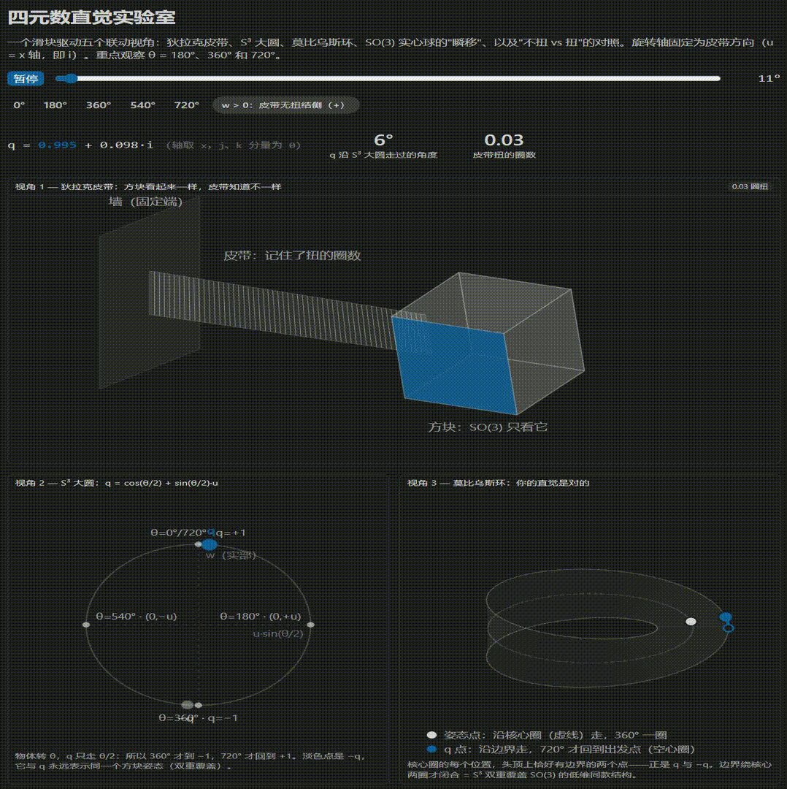
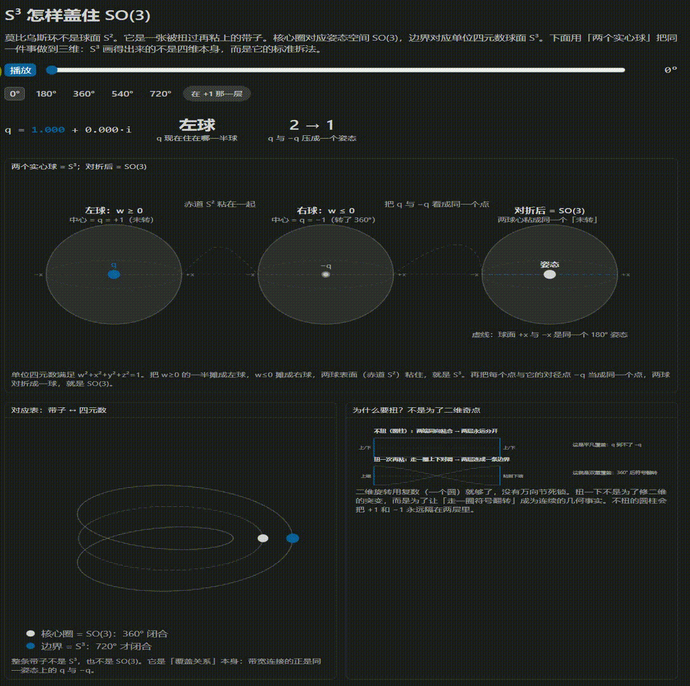

# 四元数的本质与直觉理解

- [返回上层目录](../quaternion.md)
- [终极心智模型：四元数的三层理解阶梯（随时回顾）](#终极心智模型四元数的三层理解阶梯随时回顾)
  - [第一层：认清三维旋转的真实物理世界（“病灶在哪里？”）](#第一层认清三维旋转的真实物理世界病灶在哪里)
  - [第二层：四元数在几何与拓扑上的角色（“升维解套”）](#第二层四元数在几何与拓扑上的角色升维解套)
  - [第三层：夹心乘法 $q P q^{-1}$ 的力学本质（“算术引擎”）](#第三层夹心乘法-q-p-q-1-的力学本质算术引擎)
  - [终极一句话归纳](#终极一句话归纳)
- [困惑的源头：为什么 3 个自由度要用 4 个数？](#困惑的源头为什么-3-个自由度要用-4-个数)
  - [旋转向量（轴角法）的天然直觉与致命缺陷](#旋转向量轴角法的天然直觉与致命缺陷)
  - [孤立刚体外观 vs 刚体+空间连接系统](#孤立刚体外观-vs-刚体空间连接系统)
  - [哈密顿的困境：为什么“三元数”在数学上不可能？](#哈密顿的困境为什么三元数在数学上不可能)
- [物理证据与空间拓扑：狄拉克皮带与 720° 周期](#物理证据与空间拓扑狄拉克皮带与-720-周期)
  - [纸带与夹子实验：亲手验证 360° 为什么不等于 0°](#纸带与夹子实验亲手验证-360-为什么不等于-0)
  - [为什么空间平移公转一圈，会产生整整 2 圈（720°）的扭曲？](#为什么空间平移公转一圈会产生整整-2-圈720的扭曲)
  - [为什么这是三维特有的性质？（二维与三维的本质区别：转轴的连续翻转）](#为什么这是三维特有的性质二维与三维的本质区别转轴的连续翻转)
  - [$\mathbb{Z}/2$ 拓扑群：奇偶守恒的扭结](#mathbbz2-拓扑群奇偶守恒的扭结)
- [几何模型与升维展开：莫比乌斯环、$\mathbb{RP}^2$、$\mathbb{RP}^3$ 与 $S^3$](#几何模型与升维展开莫比乌斯环mathbbrp2mathbbrp3-与-s3)
  - [核心真相：$SO(3)$ 旋转群就是高维立体版的莫比乌斯环！](#核心真相so3-旋转群就是高维立体版的莫比乌斯环)
  - [拓扑递进阶梯：从一维线段、二维圆盘（$\mathbb{RP}^2$）到三维实心球（$SO(3) \cong \mathbb{RP}^3$）](#拓扑递进阶梯从一维线段二维圆盘mathbbrp2到三维实心球so3-cong-mathbbrp3)
  - [经典拓扑解剖：$\mathbb{RP}^2 = \text{莫比乌斯带} \cup \text{圆盘帽子}$ 及其三维浸入「交叉帽（Cross-Cap）」](#经典拓扑解剖mathbbrp2--text莫比乌斯带-cup-text圆盘帽子-及其三维浸入交叉帽cross-cap)
  - [莫比乌斯环的精确低维样本（核心圈 vs 边界）](#莫比乌斯环的精确低维样本核心圈-vs-边界)
  - [为什么要“扭一下”？（平凡覆盖 vs 双重覆盖）](#为什么要扭一下平凡覆盖-vs-双重覆盖)
  - [两个实心球模型：在三维中直观看见 $S^3$ 与 $SO(3)$ 的对应](#两个实心球模型在三维中直观看见-s3-与-so3-的对应)
  - [深度释疑：为什么 $(0, +\vec{u})$ 与 $(0, -\vec{u})$ 之间必须隔着一条弧？](#深度释疑为什么-0-vecu-与-0--vecu-之间必须隔着一条弧)
- [代数力学与夹心乘法：半角 $\theta/2$ 与 $q P q^{-1}$ 的必然性](#代数力学与夹心乘法半角-theta2-与-q-p-q-1-的必然性)
  - [为什么公式里必须写成 $\cos(\theta/2) + u\sin(\theta/2)$？](#为什么公式里必须写成-costheta2--usintheta2)
  - [为什么必须两边夹心乘法 $q P q^{-1}$？（四维等斜旋转的抵消与叠加）](#为什么必须两边夹心乘法-q-p-q-1四维等斜旋转的抵消与叠加)
  - [负号是如何在夹心乘法中被“吸收”的？（$q$ 与 $-q$ 的关系）](#负号是如何在夹心乘法中被吸收的q-与--q-的关系)
  - [动手验算一次：五行代数见证纯净的三维旋转](#动手验算一次五行代数见证纯净的三维旋转)
- [实用工程指南：四元数在计算中的威力](#实用工程指南四元数在计算中的威力)
  - [四元数与旋转矩阵、欧拉角的转换](#四元数与旋转矩阵欧拉角的转换)
  - [球面线性插值（SLERP）的数学优雅](#球面线性插值slerp的数学优雅)
  - [旋转复合与角速度微分（机体坐标系 vs 世界坐标系）](#旋转复合与角速度微分机体坐标系-vs-世界坐标系)
- [四元数的终极本质三位一体](#四元数的终极本质三位一体)
  - [拓扑、几何、代数三重视角的全景统一](#拓扑几何代数三重视角的全景统一)
  - [常见直觉误区澄清速查表](#常见直觉误区澄清速查表)

**核心结论先验**：

三维空间刚体的「静态姿态」本身只需 3 个自由度；但三维空间中的「连续旋转系统」天然具有 **720°（2 圈）才真正闭合的拓扑结构**（$\mathbb{Z}/2$ 拓扑）。

**四元数并不是凭空创造的第四个物理维度，它是三维旋转空间最平滑、无奇点、无折痕的展开图（四维单位超球面 $S^3$）上的坐标。四元数乘法是这张展开图上的算术。**

建立直觉：



看什么（按顺序试一遍）：

* 拖到 360°：方块和 0° 时一模一样——只看方块的 $SO(3)$ 说"回来了"。但皮带多了一圈解不掉的扭，$q$ 走到了 −1，莫比乌斯上的 $q$ 点停在出发点的正对面。"姿态复原"和"一切复原"是两回事，差的那一位信息就写在 $w$ 的符号里。

* 再拖到 720°：$q$ 回到 +1，莫比乌斯边界点回到出发点。此时皮带上的两圈扭，可以在完全不转动方块的情况下，把皮带整体从方块上方绕过去解掉（狄拉克皮带戏法）；而 360° 的那一圈扭无论如何都解不掉。

* 盯住淡色的 $−q$ 点：任何时刻 $q$ 和 $−q$ 都对应同一个方块姿态。$S^3$ 给每个姿态准备了两个点——这就是"双重覆盖"，和莫比乌斯环边界绕核心圈两圈是同一个结构。

拿一条真皮带验证：

一端压在书下，另一端夹住手机。转 360°：怎么绕都解不开。转 720°：完全不转手机，把皮带整体从手机上方翻过去——扭结消失。你的手正在验证 $\pi_1(SO(3))=\mathbb{Z}/2$。

# 终极心智模型：四元数的三层理解阶梯（随时回顾）

要彻底理解四元数，你只需要在脑海中牢牢建立起这三层阶梯认知：

## 第一层：认清三维旋转的真实物理世界（“病灶在哪里？”）

1. **孤立姿态只需 3 个自由度，但连续旋转空间天生是“扭曲”的**：
   - 我们的直觉以为三维旋转空间是平坦的，可以用 3 个数（如旋转向量、欧拉角）无损平铺。
   - 但在真实物理世界中，转 360° 会在空间连接介质（纸带）中留下一个**无法收缩消除的拓扑死结**（$\mathbb{Z}/2$ 拓扑）。
   - 只有转 **720°（2 圈）**，系统才真正回到无扭结的初态。
2. **为什么三维姿态空间 $SO(3)$ 是扭曲的？**
   - 因为绕轴 $+\vec{u}$ 转 180° 和绕轴 $-\vec{u}$ 转 180° 是同一个物理姿态。
   - 这迫使三维姿态实心球的最外层球壳，**所有对径点必须全部颠倒粘合在一起（实射影空间 $\mathbb{RP}^3$）**。
   - **$SO(3)$ 在拓扑上就是高维立体版的莫比乌斯环！** 它的二维赤道切片 $\mathbb{RP}^2$ 在数学上精确等于「莫比乌斯带 $\cup$ 圆盘帽子」。
   - 这种莫比乌斯式的对径粘合在三维内部造出了无法单连通收缩的回路。如果强行用 3 个数去描述它，就必然会遭遇**边界撕裂跳变（180° 跳跃）**或**维度坍塌（万向节死锁）**。

## 第二层：四元数在几何与拓扑上的角色（“升维解套”）

既然把对径点粘合在一起会导致撕裂和死锁，数学家的解决办法极其霸气——**升维展开（双重覆盖）**：

1. **多出来的第 4 个数到底是什么？**
   - 它不是物理空间里的第四个长宽高方向，而是**一个将对折粘合的外壳“撑开”的展开维度**（四维超球面 $S^3$）。
   - 标量实部 $w$ 的正负号（$+1$ 和 $-1$），精确充当了**三维空间拓扑缠绕奇偶性的指示灯**。
2. **双重覆盖（Double Covering）消除了一切奇点**：
   - 在四维超球面 $S^3$ 上，每个三维姿态被工工整整地印了**两份（$q$ 与 $-q$）**。
   - $S^3$ 是一个完美封闭、光滑、没有任何边界的四维超球面。刚体在三维空间无论怎么复杂地翻滚，四元数在四维球面上只是在**毫无阻碍、毫无突变、极其平滑地沿着大圆滑行**。
   - 所有的万向锁、边界跳变、数值发散，在升维到四维球面的瞬间荡然无存。

## 第三层：夹心乘法 $q P q^{-1}$ 的力学本质（“算术引擎”）

为什么四元数旋转物体要写成两边夹心？为什么角度要除以 2？

1. **半角 $\theta/2$**：
   - 因为三维真实空间的拓扑周期是 720°。
   - 为了让公式在转满 720° 时才回到起点 $+1$（转 360° 时到达对面的 $-1$），三角函数自变量必须写成 **$\theta/2$**。
2. **夹心乘法 $q P q^{-1}$（四维等斜旋转的抵消与合成）**：
   - 在四维空间里，左乘 $q$ 会同时在两个正交平面各旋转半角 $\theta/2$：一个转物理空间，一个转虚实混合空间（多余的第四维）。
   - 如果只做左乘，三维向量就会被甩出三维空间，产生第四维杂质。
   - **两边夹心乘法**是宇宙中最精密的力学抵消机制：
     - **在多余的第四维平面**：左乘转 $+\theta/2$，右乘逆向转 $-\theta/2$，两者精确抵消为 **$0$**（保住了纯净的三维物理世界）；
     - **在三维物理旋转平面**：左乘转 $+\theta/2$，右乘同向转 $+\theta/2$，两者完美叠加为 **$\theta$**（精确完成了物理旋转）。
3. **负号自愈**：
   - 当物体转了 360° 时，$q = -1$。代入夹心乘法：$(-1)P(-1) = \mathbf{+1}P = P$。
   - 物体在三维中的视觉坐标完全复原，而四元数自身保留了 $-1$，记录了空间的拓扑结。

## 终极一句话归纳

> **四元数，本质上就是数学家为了不在三维空间里撕裂和死锁，把带有 720° 周期和对径粘合扭曲的三维姿态空间，光滑展开在四维超球面 $S^3$ 上之后，所得到的一套「带奇偶防扭指示灯的四维半角旋转算子」。**
>
> - **复数（$\mathbb{C}$）**：升到 2 维单位圆 $S^1$，完美无缝地用乘法统治了 **1 个自由度的二维平面旋转**。
> - **四元数（$\mathbb{H}$）**：升到 4 维单位超球 $S^3$，完美无缝地用夹心乘法统治了 **3 个自由度的三维空间旋转**。

# 困惑的源头：为什么 3 个自由度要用 4 个数？

## 旋转向量（轴角法）的天然直觉与致命缺陷

任何人对三维旋转最直观的设想，都是**旋转向量（Axis-Angle Vector / 李代数 $\mathfrak{so}(3)$）**：

- 用一个三维矢量 $\vec{v} \in \mathbb{R}^3$；
- 其**方向**表示单位旋转轴 $\vec{u} = \frac{\vec{v}}{\|\vec{v}\|}$；
- 其**模长** $\|\vec{v}\| = \theta$ 表示绕该轴旋转的角度。

这种表示法只有 3 个分量，完全没有维度冗余。但在工程计算（如机器人姿态控制、物理引擎、三维动画插值）中，如果只用 3 个数来连续表示姿态，会遭遇两个根本性缺陷：

**缺陷 1：边界突变与拓扑撕裂（$\pi$ 边界跳跃）**

旋转具有周期对称性：绕轴 $+\vec{u}$ 旋转 $+180^\circ$（$\pi$ 弧度），与绕轴 $-\vec{u}$ 旋转 $+180^\circ$（或者说逆时针 $-180^\circ$），到达的**物理姿态完全相同**。

如果我们把旋转向量限制在一个半径为 $\pi$ 的实心球体内：

- 球心 $(0,0,0)$ 代表未旋转（$0^\circ$）；
- 球体内部任意一点 $(x,y,z)$ 代表一个确定姿态；
- 但在球壳最外侧表面上，**北极点 $+\pi\vec{u}$ 和南极点 $-\pi\vec{u}$ 代表的是同一个物理姿态！**

```
                  [ 北极点: +π u ]
                         ▲
                         │
                      (球心 0°)
                         │
                         ▼
                  [ 南极点: -π u ]
          (物理上是同一个姿态，几何上却相距 2π)
```

当刚体在空间中做极其平滑的连续旋转越过 $180^\circ$ 时，三维参数必须**瞬间从北极点“闪现”到南极点**。这种跳跃会导致导数发散、数值积分崩溃，在控制系统中会产生极大的不稳定冲击。

**缺陷 2：复合旋转运算极其复杂**

两个旋转的叠加，**绝不是简单的向量相加**（$\vec{v}_3 \neq \vec{v}_1 + \vec{v}_2$）。在三维向量下计算两个旋转的复合，必须调用著名的 **罗德里格斯公式（Rodrigues' Rotation Formula）** 或 **BCH 公式（Baker-Campbell-Hausdorff）**：

$$\vec{v}_3 = \vec{v}_1 + \vec{v}_2 + \frac{1}{2}[\vec{v}_1, \vec{v}_2] + \frac{1}{12}[\vec{v}_1, [\vec{v}_1, \vec{v}_2]] + \cdots$$

其中包含大量的向量叉乘、反正弦/反余弦、平方根以及奇异点分支判断，计算极其低效且误差累积严重。

## 孤立刚体外观 vs 刚体+空间连接系统

为什么 3 维参数一定会产生“撕裂”或“死锁（欧拉角万向锁）”？

因为我们日常的直觉犯了一个根本性错误：**只盯着那个孤立的旋转刚体本身（外观），忽略了刚体与周围宿主空间的拓扑纠缠。**

- **外观视角（孤立刚体）**：刚体转了 360°，它的每一个顶点坐标都回到原处，看起来和 0° 毫无区别；
- **系统视角（刚体 + 连接介质）**：刚体转了 360°，它与周围空间构成的连接网络被绞出了一个**无论如何都无法抚平的拓扑结**。

只有当刚体连续旋转 **720°（2 圈）** 时，刚体与空间的整体系统才真正恢复初态。三维旋转的真实状态空间，周期天然就是 720°。

## 哈密顿的困境：为什么“三元数”在数学上不可能？

爱尔兰数学家威廉·哈密顿（William Rowan Hamilton）在 1843 年之前的十多年间，试图将二维平面的复数乘法推广到三维：

- 复数 $z = a + bi$ 可以用乘法完美表示二维平面的旋转与伸缩（$|z_1 z_2| = |z_1| |z_2|$，模长相乘，辐角相加）；
- 哈密顿设想，能不能构建一种“三元数” $z = a + bi + cj$，用乘法来直接计算三维旋转？

他发现三元数无论怎么定义乘法，系统都会崩溃：

1. **模长不保**：想要 $|z_1 z_2| = |z_1| |z_2|$，在三维下展开代数项，交叉项（如 $ij$）无法被封闭在 $1, i, j$ 三个基底内；
2. **存在零因子**：两个非零的三元数相乘可能等于零，这意味着无法定义除法与逆元。

现代代数学的经典定理——**弗罗贝尼乌斯定理（Frobenius Theorem）** 严格证明了：

> **实数域上的有限维结合实除法代数（Normed Division Algebra），只有且仅有四种：**
>
> 1. 1 维：实数集 $\mathbb{R}$
> 2. 2 维：复数集 $\mathbb{C}$
> 3. 4 维：四元数集 $\mathbb{H}$
> 4. 8 维：八元数集 $\mathbb{O}$（失去结合律）
>
> **在数学上，绝对不存在任何 3 维的除法代数！**

1843 年 10 月 16 日，哈密顿在走过都柏林布鲁厄姆桥（Brougham Bridge）时顿悟：必须引入第 4 个分量，设置三个虚数基底 $i, j, k$，满足著名的基础关系：

$$i^2 = j^2 = k^2 = ijk = -1$$

**基础关系的秒级推导：**

从 $ijk = -1$ 出发：

- 两边右乘 $k$：$(ijk)k = -k \implies ij(k^2) = -k \implies ij(-1) = -k \implies \mathbf{ij = k}$
- 两边左乘 $i$、右乘 $j$：同理可得 $\mathbf{jk = i}, \ \mathbf{ki = j}$
- 反向相乘：$\mathbf{ji = -k}, \ \mathbf{kj = -i}, \ \mathbf{ik = -j}$

三维空间的旋转，必须在四维代数结构中才能获得无缝、连续、结合律完备的乘法群结构。

# 物理证据与空间拓扑：狄拉克皮带与 720° 周期

## 纸带与夹子实验：亲手验证 360° 为什么不等于 0°

为了避开人体手臂肌肉骨骼的生理限制，我们可以用最纯粹的物理道具来亲手做这个实验：

**准备道具**

- 一根柔软的扁平纸带（或皮带、扁平数据线）；
- 一个夹子（夹在纸带末端，夹子正表面贴上醒目标记，作为“刚体”）；
- 纸带左端用胶带死死固定在桌面上（作为“世界坐标系”基准）。

```
[桌面固定端] ════════════════════════════════════ [夹子 (标记表面朝上)]
```

**动作 1：旋转 360°（第 1 圈）**

1. 捏住夹子，顺时针将夹子旋转 360°；
2. 此时，夹子正表面的标记重新朝上（**夹子外观完全复原**）；
3. **观察纸带**：纸带上被清晰地绞出了整整一圈螺旋扭纹（**累积了 360° 扭结**）；
4. **规则挑战**：**夹子标记表面死死保持朝上，绝对不允许自转！** 你可以在三维空间中任意拉扯、移动、弯曲纸带；
5. **物理结果**：你会发现，**无论怎么绕纸带，只要不转动夹子本身，这个扭纹绝对解不开！** 它在三维空间中形成了一个拓扑死结。

**动作 2：继续同向旋转到 720°（第 2 圈）**

1. 保持相同方向，抓住夹子再转 360°（累计旋转 720°）；
2. 夹子标记依然朝上，纸带上累积了整整两圈扭纹；
3. **奇迹时刻**：同样**夹子标记死死朝上、绝对不自转**，你只需要把这段被严重扭曲的纸带，像套绳圈一样，**整体从夹子上方（或下方）翻跨过去**，然后拉直；
4. **物理结果**：**整条纸带瞬间变得完全平整，所有的扭纹凭空彻底消失！**

```
转 0°:    纸带平整   ──(顺时针转 360°)──>  纸带 1 圈扭结 (不可解)
                                                 │
                                           (再顺时针转 360°)
                                                 │
                                                 ▼
转 720°:  纸带恢复完全平整 <──(翻过夹子)──  纸带 2 圈扭结 (可解)
```

这个实验以不可辩驳的物理事实证明：

> **在三维物理世界中，围绕任意轴旋转 360° 的路径在拓扑上是一个“不可收缩的死结”；只有旋转 720° 的路径，才能在空间中平滑收缩为一个点（等价于未旋转）。**

## 为什么空间平移公转一圈，会产生整整 2 圈（720°）的扭曲？

在上面的实验中，很多人会产生极大的疑惑：

> “我把夹子从纸带上方翻过去一圈，夹子在空间里明明只是平移公转了 **1 个闭合环（360° 环绕）**，为什么纸带上的扭曲度却改变了整整 **2 圈（720°）**（从 $+1$ 圈直接变成了 $-1$ 圈，净变动量为 2 圈）？”

**几何深度拆解：两次 180° 空间掉头**

请观察纸带的**两个边缘（左边缘和右边缘）**在空间中的三维走向。

一个闭合的「空间套圈」轨迹，在空间几何上必然由两个正交维度的 180° 空间掉头构成：

```
                    【前半程：翻到上方】
              夹子向前上方升起，越过纸带
                        ╭──────╮
                        │      │
       [夹子起点] ───────╯      ╰─────── [到达纸带后方]
       (面对你)                         (背对你)
                        ╭──────╮
                        │      │
       [夹子终点] ───────╯      ╰─────── [从纸带下方绕回]
                    【后半程：绕回下方】
```

1. **前半程（从前翻到后，180° 拱形轨道）**：
   - 夹子自身的绝对朝向（标记朝上）被死死冻结；
   - 纸带中心线的延伸方向发生了 **180° 空间掉头**（从向前延伸变为向后延伸）；
   - **「端点朝向冻结」+「连线方向掉头 180°」**，强行逼迫纸带的左边缘与右边缘在空间中跨越彼此一次 $\Longrightarrow$ **对纸带注入了第 1 圈（360°）相对扭转**。
2. **后半程（从后绕回前，另 180° 拱形轨道）**：
   - 夹子从下方绕回胸前起点；
   - 纸带中心线再次发生 **第二次 180° 空间掉头**（从向后延伸变回向前延伸）；
   - 同样因为端点朝向冻结，左右两边缘在同方向上再次互相缠绕跨越一次 $\Longrightarrow$ **对纸带注入了第 2 圈（360°）相对扭转**。

两次空间掉头合成：

$$360^\circ (\text{前半程}) + 360^\circ (\text{后半程}) = 720^\circ (\text{整整 2 圈})！$$

**算式完全闭环：**

- 纸带初始状态：$+1$ 圈扭曲；
- 空间套圈动作：自带 $-2$ 圈扭曲注入；
- 最终状态：$+1 - 2 = -1$ 圈！
- 如果初始状态是 $+2$ 圈：$+2 - 2 = 0$ 圈（完全平整）！

**三维空间的公转套圈，天然自带 720°（2 圈）的扭曲代数！**

## 为什么这是三维特有的性质？（二维与三维的本质区别：转轴的连续翻转）

为什么二维平面里没有这种现象，三维空间才有？

**二维世界的局限（$\pi_1(SO(2)) = \mathbb{Z}$）**

- 在二维平面上，旋转只能绕着垂直于纸面的单一法向量进行；
- 旋转轴只有固定的“垂直朝外”这一个方向，**无法倾斜，更无法在纸面内翻转**；
- 如果有一条二维纸带，它就像一堵硬墙挡在平面内，夹子**无法离开纸面从纸带上方翻过去**；
- 因此在二维平面里：转 1 圈就是 1 圈，转 2 圈就是 2 圈，转 -1 圈就是 -1 圈，每一个圈数都是彼此独立的整数状态，拓扑群是整数集 $\mathbb{Z}$。

**三维维度的“升维通道”（$\pi_1(SO(3)) = \mathbb{Z}/2$）**

- 在三维空间中，旋转轴可以指向三维球面上的任意方向；
- 空间拥有了足够的厚度，允许转轴**平滑地倾斜、倒转 180°**（大拇指从指右平滑扫到指左）；
- **转轴倒转 180°，在几何上精确对应着夹子从纸带上方画拱形跨过**；
- 这条三维通道直接把「顺时针转 360°」与「逆时针转 360°（即 -360°）」平滑连接成同一个拓扑等价类！

## $\mathbb{Z}/2$ 拓扑群：奇偶守恒的扭结

由上述几何事实，三维空间中所有的闭合旋转运动，在拓扑上被彻底归并为两类：

1. **偶数圈闭环（0°, 720°, 1440°...）**：可以通过三维空间中的路径变形，在**完全不移动刚体**的前提下平滑消除为 0°（记为拓扑元 $0$ 或 $+1$）；
2. **奇数圈闭环（360°, 1080°...）**：无论如何变形都无法消除，只能在正转与反转之间切换（记为拓扑元 $1$ 或 $-1$）。

这就是数学中著名的代数拓扑定理：
$$\pi_1(SO(3)) = \mathbb{Z}/2$$

**纸带扭数的绝对值可以改变（每次变动 $\pm 2$），但扭数的「奇偶性（$\mathbb{Z}/2$）」在连续变形下绝对守恒！**

# 几何模型与升维展开：莫比乌斯环、$\mathbb{RP}^2$、$\mathbb{RP}^3$ 与 $S^3$

## 核心真相：$SO(3)$ 旋转群就是高维立体版的莫比乌斯环！

当我们说“三维旋转群 $SO(3)$ 天生具有扭曲的拓扑结构”时，这不仅是一个形象的比喻，而是一个在现代微分几何与代数拓扑上完全同构的严格事实——**$SO(3)$ 就是高维立体版的莫比乌斯环**。

你可以把 $SO(3)$ 理解为：**把莫比乌斯环那种“走一圈翻转、走两圈复原”的扭曲机制，做成了一个三维立体的旋转姿态空间。**

**莫比乌斯环 vs $SO(3)$ 旋转群的「逐项严密对照表」**

| 对比维度                   | 莫比乌斯环（二维低维世界）                                   | $SO(3)$ 旋转群（三维物理世界）                               |
| :------------------------- | :----------------------------------------------------------- | :----------------------------------------------------------- |
| **几何空间是几维的？**     | 二维带状曲面（带有一条闭合边界）                             | 三维实射影空间 $\mathbb{RP}^3$（无边界的紧致三维流形）       |
| **空间为什么会扭曲？**     | 纸带两端被**旋转 180° 颠倒粘合**                             | 姿态实心球的最外层球壳，对径点（$+180^\circ$ 与 $-180^\circ$）被**强制颠倒粘合** |
| **转 1 圈（360°）**        | 蚂蚁沿着中心线走一圈回到原位，但**头顶法向量颠倒了**（走到了纸带背面） | 刚体转 360° 外观完全复原，但**四元数符号翻转（$+1 \rightarrow -1$）**，外部皮带留下死结 |
| **转 2 圈（720°）**        | 蚂蚁再走一圈（累计 2 圈），**头顶法向量才真正复原**，回到最初起点 | 刚体转 720°，四元数**负负得正回到 $+1$**，外部皮带扭结完全解开 |
| **双重覆盖空间（展开图）** | 莫比乌斯环的外侧单侧连续边界（一维圆周 $S^1$）               | 四元数四维超球面（三维球面 $S^3 \cong SU(2)$）               |
| **拓扑基本群**             | $\pi_1(\text{Möbius}) = \mathbb{Z}$（平面无法翻转转轴）      | $\pi_1(SO(3)) = \mathbb{Z}/2$（三维转轴可连续翻转）          |

**莫比乌斯带对应 $SO(3)$，那什么对应 $S^3$？（带子视角 vs 全维覆盖流形阶梯）**

如果把 $SO(3)$ 比作扭转 180° 粘合的莫比乌斯带，那么 $S^3$ 对应的到底是什么？

1. **带子视角（展平无扭曲的圆柱带）**：
   - 莫比乌斯带（$SO(3)$）的周长为 $L$（360°），正反面被强行扭转粘合；
   - 将其完全解开并平铺展开后，得到的是一条**长度为 $2L$（720°）、完全平整无扭曲的圆柱带（Annulus / Cylinder）**；
   - 在这条平整带子上，**正面区域清晰对应四元数的 $+q$（$w > 0$），背面区域对应四元数的 $-q$（$w < 0$）**，两者被双倍长度光滑隔开，不再混淆。

2. **全维度的「双重覆盖升维阶梯」**：

| 维度 | 底层扭曲/对径粘合空间（被覆盖空间） | 顶层光滑展开空间（双重覆盖空间） | 几何状态与周期特征 |
| :--- | :--- | :--- | :--- |
| **1 维** | **一维圆周 $S^1$（$\mathbb{RP}^1 \cong S^1$）** | **双倍长的一维大圆周 $S^1$** | 走 360° 相位颠倒（白天变黑夜 $-1$），走 720° 回到起点白天（$+1$） |
| **2 维** | **实射影平面 $\mathbb{RP}^2$**<br>（*核心骨架即莫比乌斯带*） | **标准的二维普通球面 $S^2$**<br>（*如地球表面*） | 北极点（$+1$）与南极点（$-1$）被二维球面光滑隔开 |
| **3 维** | **三维实射影空间 $\mathbb{RP}^3 \cong SO(3)$**<br>（*三维姿态空间，立体莫比乌斯体*） | **四维空间里的三维超球面 $S^3$**<br>（*即单位四元数群 $\mathbb{H}_1 \cong SU(2)$*） | $+1$ 球心与 $-1$ 球心被四维超球面光滑隔开，全向无缝展开 |

3. **为什么 $S^3$ 必须是一个“超球面”而不是平坦带子？**
   - 因为三维物理空间的旋转是**全向对称（各向同性）**的：刚体不仅能绕 $z$ 轴旋转，还能绕任意方向的单位向量 $\vec{u}$ 旋转；
   - 空间中每一个旋转轴向，都包含一条类似莫比乌斯带的 720° 展开圆弧；
   - 将所有无穷多个方向的 720° 展开圆弧无缝缝合在一起，在数学上唯一的完美封闭几何形态，就是**四维欧氏空间中的三维单位超球面 $S^3$**（$w^2+x^2+y^2+z^2=1$）。

## 拓扑递进阶梯：从一维线段、二维圆盘（$\mathbb{RP}^2$）到三维实心球（$SO(3) \cong \mathbb{RP}^3$）

为了真正理解三维姿态空间为什么是“三维莫比乌斯环”，我们可以顺着维度的阶梯一步步往上观察：

```
【1 维空间】 一维线段 [-π, +π]  ──(两端点对径粘合)──>  一维圆周 S¹
【2 维空间】 二维实心圆盘 D²    ──(边缘对径点全部颠倒粘合)──>  实射影平面 ℝℙ² (包含莫比乌斯带)
【3 维空间】 三维实心球体 B³    ──(球面外壳对径点全部颠倒粘合)──>  实射影空间 ℝℙ³ ≅ SO(3)
```

1. **一维线段 $[- \pi, +\pi]$**：
   - 将两个端点 $-\pi$ 与 $+\pi$ 粘合在一起，就得到了普通的一维圆周 $S^1$。
2. **二维实心圆盘 $D^2$（半径为 $\pi$）**：
   - 规定圆盘边缘上的每一个点 $(\pi, \phi)$ 都与它正对面的对径点 $(\pi, \phi + \pi)$ 粘合在一起；
   - 这样生成的二维流形就是著名的 **实射影平面 $\mathbb{RP}^2$**。一只蚂蚁从圆盘右上边缘走出去，会立刻从左下对径点走回来，且左右方向颠倒！
3. **三维实心球体 $B^3$（半径为 $\pi$）**：
   - 这是三维旋转向量的世界：球心是 $0^\circ$，球面最外层是 $180^\circ$（$\pi$）；
   - 因为绕轴 $+\vec{u}$ 转 180° 与绕轴 $-\vec{u}$ 转 180° 姿态相同，球壳上所有的对径点 $+\pi\vec{u}$ 与 $-\pi\vec{u}$ 必须全部颠倒粘合；
   - 这样生成的流形就是 **三维实射影空间 $\mathbb{RP}^3$**，也就是三维旋转群 $SO(3)$ 的精确数学本体！

**维度辨析：手里拿的莫比乌斯纸带，属于 1 维还是 2 维？**

- 手里的莫比乌斯纸带是标准的 **二维流形（带 1 条闭合边界）**，因为它既有长度也有宽度，蚂蚁在上面爬需要两个局部坐标 $(u, v)$；
- 普通纸带拥有 2 条边界（上边缘与下边缘），而扭转 180° 粘合后，上下边缘连成了一条连续闭合的单侧边界线（一维圆周 $S^1$）；
- 它就是实射影平面 $\mathbb{RP}^2$ 挖掉一个圆盘帽子后剩下的**非定向扭曲核心骨架**。

**1 维圆周 $S^1$ 怎么“扭曲”？线段无正反面时的「挂钟模型」**

很多人会疑惑：“一维线段只有长度，没有厚度和法向量，根本无法区分正反面，一维圆周怎么可能像莫比乌斯带一样拥有双重覆盖结构呢？”

答案是：**双重覆盖的拓扑本质从来不是‘翻面’，而是‘对径状态翻转（$+1 \rightarrow -1$）’。**

以我们日常生活中的 **12 小时制挂钟表盘（一维圆周 $S^1$）** 为例：
- **第一圈（时针旋转 360°）**：时针从 12 点走了一圈回到 12 点。虽然时针在几何外观上完全重合，但系统状态发生了反转——**从「中午 12:00（白天 +1）」变成了「午夜 24:00（黑夜 -1）」**；
- **第二圈（时针再走 360°，累计 720°）**：时针再次走完一圈，系统才真正回到次日的**「中午 12:00（白天 +1）」**。

时针的轨迹是一维的线，没有任何正反面，但它天然具备“走 1 圈变黑夜（$-1$）、走 2 圈迎黎明（$+1$）”的 720° 周期结构！

## 经典拓扑解剖：$\mathbb{RP}^2 = \text{莫比乌斯带} \cup \text{圆盘帽子}$ 及其三维浸入「交叉帽（Cross-Cap）」

“$SO(3)$ 肚子里装着莫比乌斯环”不仅是一个形象比喻，还有一个震撼人心的硬核拓扑学定理：

> **数学定理**：如果你把三维旋转群 $SO(3)$（即 $\mathbb{RP}^3$）沿着任意一个二维赤道平面切一刀，切出来的二维截面就是实射影平面 $\mathbb{RP}^2$。  
> 而实射影平面 $\mathbb{RP}^2$ 在拓扑上可以被精确地拆解为：
> $$\mathbb{RP}^2 = \text{一个标准的莫比乌斯带} \ \cup \ \text{一个普通的二维圆盘（帽子）}$$

```
                ┌────────────────────────────────────────────┐
                │        实射影平面 ℝℙ² (SO(3) 的二维赤道切片)   │
                └──────────────────────┬─────────────────────┘
                                       │
                    ┌──────────────────┴──────────────────┐
                    ▼                                     ▼
           【核心骨架：莫比乌斯带】                 【平坦补丁：圆盘帽子】
       沿边缘对径粘合剥离出来的不可定向带子     将莫比乌斯带的唯一单侧边界封口的圆盘
      (承载了“走一圈翻转、两圈复原”的扭曲源)     (内部没有任何扭曲，平坦光滑)
```

**动手困境：为什么在三维里用橡皮膜封口莫比乌斯带必然自我穿透？（四维立交桥原理）**

当你试图在三维物理空间中，用一张圆形橡胶薄膜（圆盘帽子）去严丝合缝地缝合莫比乌斯带唯一的单侧边界时，你会发现一个不可抗拒的物理事实：**薄膜的一半必须强行穿透自己的另一半！**

- **拓扑学铁律**：实射影平面 $\mathbb{RP}^2$ **绝对无法无自交地“嵌入（Embedding）”到三维欧几里得空间 $\mathbb{R}^3$ 中**；
- **交叉帽（Cross-Cap）与自交线**：在三维空间中强行缝合产生的三维浸入体被称为交叉帽（Cross-Cap），它必然包含一条**自相交线（Self-intersection line）**以及两个极具破坏性的**折叠尖点奇异点（Whitney 伞）**；
- **四维立交桥的救赎**：在二维平面上相撞的两条十字公路，通过三维立交桥在空中跨过即可互不相撞；同样地，在三维空间中被迫自我穿透的薄膜，只要引入第四个坐标维度 $w$，让其中一层在 $w > 0$ 穿行，另一层在 $w < 0$ 穿行，曲面就**完全没有任何自相交和穿透**，极其光滑地展开为一个完美的二维球面 $S^2$！

**深度拷问：既然曲面自相交了，为什么不能假装看不见顺着切线走？——从几何自交到万向节死锁与控制崩溃的 3 个致命死穴**

直觉上常有人提出反问：*“哪怕两层曲面在三维里相交了，就像两条火车铁轨十字交汇一样，系统顺着原来的切线方向继续开过去不就行了吗？为什么非要停在自交点上崩溃？”*

在没有外界干预的理想被动滑行下，质点确实可以沿着切线穿过。但在真实的刚体控制、飞行器姿态解算和机械臂动力学中，系统面临着 **3 个无法逃避的致命死穴**：

1. **死穴一：切空间坍塌（惠特尼伞 Pinch Point 尖点捏合）**
   - 交叉帽的自相交不是横平竖直的十字路口。在自交线的尽头，两层曲面被死死压扁、捏合成了同一张纸；
   - 在尖点奇异点处，原本独立的两个切平面重合为一，局部维度**从 2 维直接坍塌为 1 维**，系统在这一瞬间失去了各自独立的导数方向。

2. **死穴二：主动控制视角下的物理旋转自由度丢失（万向节死锁 Gimbal Lock）**
   - 控制系统不是“被动看风景的火车”，而是拥有 3 个转向舵面、必须能随时向任意三维方向机动的主动控制机长；
   - 当飞行器机头垂直朝天（欧拉角 $\text{Pitch} = 90^\circ$，对应自交死锁点）时，**偏航轴（Yaw）与滚转轴（Roll）在三维空间中完全重合共线**；
   - 此时无论怎么转动偏航环还是滚转环，飞机都只能做机身自转。如果此时突遇横风需要**向侧方横滚**，机长看遍所有控制舵，会绝望地发现**没有任何一个通道能输出侧向转矩——物理旋转自由度永久丢失了 1 个！**

3. **死穴三：逆运动学与雅可比矩阵求逆遭遇除以零（$\frac{1}{\cos(\text{Pitch})} = \frac{1}{0} = \infty$ 数值发散）**
   - 飞控计算机每毫秒都在根据陀螺仪角速度求逆解以输出电机转速：$\dot{\boldsymbol{\theta}} = J^{-1} \boldsymbol{\omega}$；
   - 欧拉角雅可比逆矩阵 $J^{-1}$ 中包含分母项 $\cos(\text{Pitch})$；
   - 当 $\text{Pitch} = 90^\circ$ 时，$\cos(90^\circ) = 0 \implies \frac{1}{0} = \infty$！计算机瞬间遭遇**除以零溢出（NaN）**，控制指令瞬间饱和打满，舵机剧烈振荡，飞控算法直接崩溃坠机。

4. **四元数超球面 $S^3$ 的终极救赎**
   - 四元数通过第四维度 $w$，把挤压在三维自交点处的两层曲面在四维空间中优雅拉开；
   - 在四维单位超球面 $S^3$ 上，**任何姿态点处的切空间永远是完整满秩的 3 维切空间，雅可比变换行列式恒为 1，分母永远不为零**，从数学底层彻底消灭了万向节死锁与数值发散的根源。

## 莫比乌斯环的精确低维样本（核心圈 vs 边界）

莫比乌斯环（Möbius strip）是三维旋转双重覆盖拓扑最完美的低维几何模型：

```
           [莫比乌斯环截面]
             q   (位于外侧单侧边界上: +1 态)
             │
             ●   (核心中心圈上的点: 刚体视觉姿态)
             │
            -q   (位于同一边界经过 360° 后的对立侧: -1 态)
```

| 维度对比             | 低维模型：莫比乌斯环       | 三维真实世界：四元数流形                 | 拓扑/几何含义                                                |
| :------------------- | :------------------------- | :--------------------------------------- | :----------------------------------------------------------- |
| **底层流形（姿态）** | **核心中心圈 $S^1$**       | **姿态空间 $SO(3) \cong \mathbb{RP}^3$** | 刚体的视觉朝向，走 360° 即闭合回到原点                       |
| **顶层流形（展开）** | **外侧单侧连续边界 $S^1$** | **单位四元数超球面 $S^3 \cong SU(2)$**   | 沿边界走 360° 到达正对面（$-q$），走 720° 才闭合回到起点（$+q$） |
| **连接关系**         | **莫比乌斯带宽**           | **双重覆盖映射（$2:1$ 覆盖）**           | 每个姿态上方，恰好对应四维超球面上的两个对称点 $q$ 与 $-q$   |

## 为什么要“扭一下”？（平凡覆盖 vs 双重覆盖）

- **如果做成不扭的普通圆柱环（平凡覆盖 $\mathbb{Z}$）**：
  - 纸带两端直接同向粘合；
  - 走一圈 360° 回到自身，上层永远是上层，下层永远是下层；
  - 这种结构无法表达「转完 360° 符号翻转、留下不可消除拓扑结」的物理现实。
- **扭转 180° 后粘合（莫比乌斯带 / 双重覆盖 $\mathbb{Z}/2$）**：
  - 走一圈 360°，坐标从 $+1$ 侧连续滑到了 $-1$ 侧；
  - 再走一圈 360°（总计 720°），才顺着单侧连续边界滑回起点 $+1$；
  - **“扭一下”的唯一几何目的，是让「转 360° 发生符号翻转并回到对径点」成为连续、无断裂的几何事实。**

## 两个实心球模型：在三维中直观看见 $S^3$ 与 $SO(3)$ 的对应

单位四元数满足四维球面方程：
$$w^2 + x^2 + y^2 + z^2 = 1$$

虽然人类无法直接脑补四维直角坐标系，但数学家发明了极其直观的**双实心球拆解法**（Heegaard Splitting）：

我们将四维超球面 $S^3$ 按实部 $w$ 的正负切成两半：

1. **左实心球（$w \ge 0$）**：球心是 $q = (+1, 0, 0, 0)$（未旋转状态）；
2. **右实心球（$w \le 0$）**：球心是 $q = (-1, 0, 0, 0)$（旋转了 360° 的扭结状态）；
3. **两个球的表面（$w = 0$）**：是同一个二维球面 $S^2$（赤道面），两球沿表面严丝合缝粘合在一起 $\Longrightarrow$ **这就是完整的 $S^3$ 超球面！**

```
      【左半球: w ≥ 0】                    【右半球: w ≤ 0】
     ┌──────────────────┐                ┌──────────────────┐
     │      (S²赤道)     │                │      (S²赤道)    │
     │   ●           ●  │                │   ●           ●  │
     │      球心:+1      │   赤道表面粘合   │      球心:-1     │
     │    (未旋转 0°)    │ <────────────> │    (旋转 360°)   │
     │   ●           ●  │                │   ●           ●  │
     └──────────────────┘                └──────────────────┘
              │                                   │
              └───────────────┬───────────────────┘
                              ▼
                     【对折重叠: SO(3)】
                     把 q 与 -q 识别为同一个点
                     两个球心重叠为同一个姿态
```

**物体连续旋转 720° 的四维球内轨迹：**

- $\theta = 0^\circ$：位于**左球球心** $q = (+1, 0, 0, 0)$；
- $\theta = 180^\circ$：从球心向外辐射，穿出左球表面，到达赤道点 $(0, +\vec{u})$；
- $\theta = 360^\circ$：穿过赤道面平滑进入右球，一路向内滑到**右球球心** $q = (-1, 0, 0, 0)$；
- $\theta = 540^\circ$：从右球球心向外辐射，穿过赤道对面点 $(0, -\vec{u})$；
- $\theta = 720^\circ$：穿过赤道重新回到**左球球心** $q = (+1, 0, 0, 0)$。

**$SO(3)$ 姿态空间是如何生成的：**

如果我们将左右两个球**对折重叠粘合**（在代数上强制规定 $q \sim -q$ 为同一点）：

- 两个球心（$+1$ 和 $-1$）重叠为一个点（未旋转姿态）；
- 赤道上的对顶点（$+\vec{u}$ 与 $-\vec{u}$）重叠为一个点（180° 翻转姿态）；
- 得到的几何体，正是三维实射影空间 $\mathbb{RP}^3 \cong SO(3)$！



拖滑块时盯这三件事：

* 0° → 360°：右图 $SO(3)$ 的黑点走完一圈回到球心（姿态复原）。左图的 $q$ 从左球心走到右球心（+1 变成 −1）。莫比乌斯上：核心圈闭合，边界停在出发点对面。

* 360° → 720°：$SO(3)$ 的黑点把同一条路再走一遍——你看姿态，完全是重复。$q$ 则从右球心走回左球心。两层叠在同一个 $SO(3)$ 上，这就是双重覆盖。

* 任何时刻的虚线：$q$ 和 $−q$ 永远射向同一个姿态点。$S^3$ 给每个姿态准备了两个点；$SO(3)$ 把它们捏成一个。

$S^3$ 本身为什么画不全？

$S^3$ 是四维空间里的三维球面，不能在三维里无损展开，就像地球表面不能无损印成平面地图。两个实心球是标准的「地图册」：每张地图是三维的，两张沿球面粘好，整本就是 $S^3$。你已经能看见全部结构，缺的只是第四个坐标轴的直视。

## 深度释疑：为什么 $(0, +\vec{u})$ 与 $(0, -\vec{u})$ 之间必须隔着一条弧？

在学习四元数时，常有人提出一个极其深刻的反问：

> “绕 $+\vec{u}$ 转 180°（点 $(0, +\vec{u})$）与绕 $-\vec{u}$ 转 180°（点 $(0, -\vec{u})$），在三维外观上明明是完全相同的同一个姿态，为什么四元数在四维球面上要把它们分成两个距离很远的点，而且中间还隔着一条弧线？难道不能瞬间切换过去吗？”

**答案：因为几何姿态的演化必须保持连续性！**

如果想让一个刚体的状态从 $(0, +\vec{u})$ 变成 $(0, -\vec{u})$，在三维物理世界中，**你有且仅有两条平滑的姿态演化路径**：

```
                【路径一：原路倒退】
         (0, +u) ──(角度减小)──> (+1, 0) ──(反向增加)──> (0, -u)
         [180°态]               [0°未转态]             [180°态]

                【路径二：继续向前转】
         (0, +u) ──(角度增加)──> (-1, 0) ──(继续增加)──> (0, -u)
         [180°态]               [360°结态]             [540°态]
```

1. **路径一（原路倒退）**：把旋转角从 180° 连续减小回到 0°（回到未旋转点 $+1$），再换到 $-\vec{u}$ 轴，角度从 0° 连续增加到 180° $\Longrightarrow$ **在四维球面上经过 $+1$ 滑过去**；
2. **路径二（继续向前演变）**：保持旋转方向不变，角度继续增加 180° $\rightarrow$ 270° $\rightarrow$ 360°（到达扭结态 $-1$），再继续转到 540° $\Longrightarrow$ **在四维球面上经过 $-1$ 滑过去**。

在几何流形上，**绝对不存在任何“不经过中间姿态而直接在 $(0, +\vec{u})$ 与 $(0, -\vec{u})$ 之间瞬间瞬移”的平滑路径**。中间隔着的弧线，正是刚体在空间中平滑运动所必须经历的真实物理历程！

# 代数力学与夹心乘法：半角 $\theta/2$ 与 $q P q^{-1}$ 的必然性

## 为什么公式里必须写成 $\cos(\theta/2) + u\sin(\theta/2)$？

三角函数 $\cos(\theta)$ 的天然数学周期是 360°（$2\pi$）：

- **如果公式不除以 2，直接写成 $q = \cos(\theta) + \vec{u}\sin(\theta)$**：
  - $\theta = 0^\circ \Longrightarrow q = \cos(0^\circ) = +1$
  - $\theta = 360^\circ \Longrightarrow q = \cos(360^\circ) = +1$
  - 数学公式会强制将 360°（有拓扑结）与 0°（无拓扑结）判定为同一个数 $+1$。这会粗暴地抹杀三维空间的真实物理拓扑。

- **将角度除以 2，写成 $q = \cos(\theta/2) + \vec{u}\sin(\theta/2)$**：
  - $\theta = 0^\circ \Longrightarrow q = \cos(0^\circ) = \mathbf{+1}$（无扭结）
  - $\theta = 360^\circ \Longrightarrow q = \cos(180^\circ) = \mathbf{-1}$（**精确用负号标识出 360° 扭结！**）
  - $\theta = 720^\circ \Longrightarrow q = \cos(360^\circ) = \mathbf{+1}$（**负负得正，扭结解开，闭合回到起点！**）

**半角 $\theta/2$ 是为了让代数载体的周期（720°）严丝合缝地匹配真实空间的拓扑周期！**

## 为什么必须两边夹心乘法 $q P q^{-1}$？（四维等斜旋转的抵消与叠加）

既然四元数 $q$ 内部只存储了半角 $\frac{\theta}{2}$，为什么用它去旋转一个纯三维向量 $P = (0, \vec{p})$ 时，必须写成两边夹心的形式：

$$P' = q \cdot P \cdot q^{-1}$$

**四维几何力学：等斜旋转（Isoclinic Rotation）**

在四维欧几里得空间中，四元数左乘与右乘是四维旋转中最特殊的一类——**等斜旋转（Isoclinic Rotation）**。它会同时在两个相互正交的二维平面上以完全相同的角速度进行旋转：

设四元数 $q = \cos\alpha + \vec{u}\sin\alpha$（其中 $\alpha = \theta/2$）：

1. **左乘 $q$（左等斜旋转 $L_q: P \mapsto q P$）**：
   - 在**虚实混合平面**（由实轴 $1$ 与转轴 $\vec{u}$ 张成的二维平面 A）上：旋转角度 **$+\alpha$**；
   - 在**三维物理旋转平面**（垂直于 $\vec{u}$ 的三维空间子平面 B）上：旋转角度 **$+\alpha$**。
     *(注意：如果只做左乘，实轴分量会变成非零值，原本的三维向量会被旋转出三维物理空间，产生第四维虚分量！)*
2. **右乘 $q^{-1}$（右等斜旋转 $R_{q^{-1}}: P \mapsto P q^{-1}$）**：
   - 在**虚实混合平面 A** 上：旋转角度 **$-\alpha$**；
   - 在**三维物理旋转平面 B** 上：旋转角度 **$+\alpha$**。

**夹心乘法 $q P q^{-1}$ 的最终合成效果：**

$$\text{平面 A（虚实混合面）的旋转量：} +\alpha - \alpha = \mathbf{0} \quad \Longrightarrow \text{实部严格保持为 0，保住纯三维空间！}$$
$$\text{平面 B（物理旋转面）的旋转量：} +\alpha + \alpha = \mathbf{2\alpha = \theta} \quad \Longrightarrow \text{精确完成完整的 } \theta \text{ 旋转！}$$

```
                左乘 q                右乘 q⁻¹               夹心合成 qPq⁻¹
  虚实混合面:    +θ/2      +          -θ/2        =        0 (实部分量抵消为 0)
  物理旋转面:    +θ/2      +          +θ/2        =        θ (物理角度完整合成)
```

**夹心乘法不是人为设计的繁琐语法，它是四维旋转代数在保持三维空间纯净性的唯一力学必然！**

## 负号是如何在夹心乘法中被“吸收”的？（$q$ 与 $-q$ 的关系）

当刚体旋转了 360° 时，四元数变为 $q = -1$。将其代入夹心乘法公式计算三维物体的坐标变换：

$$P' = (-1) \cdot P \cdot (-1)^{-1} = (-1) \cdot P \cdot (-1) = \mathbf{+1} \cdot P = P$$

- **对被旋转的三维物体坐标 $P$**：两个负号相乘得正（$(-1) \times (-1) = +1$），物体坐标完全复原，符合视觉直觉；
- **对四元数自身 $q$**：它忠实地保留着 $-1$ 符号，记录着系统所携带的不可消除拓扑结。

**$q$ 与 $-q$ 作用于三维刚体时，给出的旋转变换矩阵完全相同；但它们在四维代数球面上代表着不同拓扑历史的两个对顶点。**

## 动手验算一次：五行代数见证纯净的三维旋转

为了彻底消除对四元数乘法的黑箱感，我们在草稿纸上亲手验算一个最经典的三维旋转案例：

**目标：**

将 $y$ 轴方向的单位向量 $\vec{p} = (0, 1, 0)$（对应纯四元数 $P = 0 + 0i + 1j + 0k = j$），绕 $x$ 轴（$\vec{u} = i$）顺时针旋转 **90°**。  
*直觉预期：$y$ 轴绕 $x$ 轴转 90°，必然会变成 $z$ 轴正方向（即期望结果为 $k$）。*

**演算步骤：**

1. **构造旋转四元数 $q$**（转角 $\theta = 90^\circ$，半角 $\theta/2 = 45^\circ$）：

   $$q = \cos(45^\circ) + i\sin(45^\circ) = \frac{1}{\sqrt{2}} + \frac{1}{\sqrt{2}}i = \frac{1+i}{\sqrt{2}}$$

2. **计算其逆元 $q^{-1}$**（单位四元数的逆即共轭）：

   $$q^{-1} = \frac{1-i}{\sqrt{2}}$$

3. **计算左乘半部分 $q \cdot P$**（利用哈密顿乘法表 $ij = k$）：

   $$q P = \left(\frac{1+i}{\sqrt{2}}\right) j = \frac{j + ij}{\sqrt{2}} = \frac{j + k}{\sqrt{2}}$$

4. **计算夹心右乘 $(q P) \cdot q^{-1}$**：

   $$P' = \left(\frac{j+k}{\sqrt{2}}\right) \left(\frac{1-i}{\sqrt{2}}\right) = \frac{1}{2} \Big( j(1-i) + k(1-i) \Big) = \frac{1}{2} \Big( j - ji + k - ki \Big)$$

5. **代入四元数乘法表（$ji = -k, \ ki = j$）化简**：

   $$P' = \frac{1}{2} \Big( j - (-k) + k - (j) \Big) = \frac{1}{2} \Big( j + k + k - j \Big) = \frac{2k}{2} = \mathbf{k}$$

**实部完全抵消消失为 0，结果纯净无比：$y$ 轴方向的 $j$ 干净利落地旋转到了 $z$ 轴方向的 $k$！**

# 实用工程指南：四元数在计算中的威力

## 四元数与旋转矩阵、欧拉角的转换

设单位四元数 $q = w + xi + yj + zk$，满足 $w^2 + x^2 + y^2 + z^2 = 1$。

**1. 四元数 $\rightarrow$ $3 \times 3$ 旋转矩阵 $R$**

将夹心乘法 $P' = q P q^{-1}$ 展开为矩阵形式：

$$R(q) = \begin{bmatrix}
1 - 2(y^2 + z^2) & 2(xy - wz) & 2(xz + wy) \\
2(xy + wz) & 1 - 2(x^2 + z^2) & 2(yz - wx) \\
2(xz - wy) & 2(yz + wx) & 1 - 2(x^2 + y^2)
\end{bmatrix}$$

*优势：完全不需要计算任何三角函数（$\sin, \cos$），只需要简单的乘法和加减法，计算极快！*

**2. 旋转轴角 $(\vec{u}, \theta) \rightarrow$ 四元数 $q$**

$$q = \left[ \cos\left(\frac{\theta}{2}\right), \ u_x \sin\left(\frac{\theta}{2}\right), \ u_y \sin\left(\frac{\theta}{2}\right), \ u_z \sin\left(\frac{\theta}{2}\right) \right]$$

## 球面线性插值（SLERP）的数学优雅

在三维动画、无人机轨迹规划中，我们需要在两个姿态 $q_1$ 和 $q_2$ 之间做平滑过渡（插值参数 $t \in [0, 1]$）。

- **若使用欧拉角插值**：路径会出现扭曲、角速度忽快忽慢，并在万向锁附近发生失控；
- **使用四元数球面线性插值（SLERP, Spherical Linear Interpolation）**：四元数插值是沿着四维超球面 $S^3$ 上的**大圆测地线（最短弧线）**以恒定角速度滑行：

$$\text{SLERP}(q_1, q_2; t) = \frac{\sin((1-t)\Omega)}{\sin\Omega} q_1 + \frac{\sin(t\Omega)}{\sin\Omega} q_2$$

其中 $\cos\Omega = q_1 \cdot q_2 = w_1 w_2 + x_1 x_2 + y_1 y_2 + z_1 z_2$。

*工程技巧：若 $q_1 \cdot q_2 < 0$，说明两个四元数在四维球面上相距大于 90°，只需将 $q_2$ 取反为 $-q_2$（它们代表同一个物理姿态），即可保证走最短圆弧路径。*

## 旋转复合与角速度微分（机体坐标系 vs 世界坐标系）

**1. 连续旋转复合**

- **在当前局部（机体）坐标系下连续旋转**：右乘
  $$q_{\text{new}} = q_{\text{current}} \cdot q_{\text{delta}}$$
- **在固定的全局（世界）坐标系下旋转**：左乘
  $$q_{\text{new}} = q_{\text{delta}} \cdot q_{\text{current}}$$

**2. 四元数姿态运动学微分方程**

在惯性导航、飞行器飞控算法与 SLAM 状态估计中，角速度与四元数导数之间具有极为优美的线性微分关系：

- **机体坐标系角速度 $\vec{\omega}_b = (\omega_x, \omega_y, \omega_z)$（陀螺仪直接读数）**：

  $$\dot{q} = \frac{1}{2} q \cdot \boldsymbol{\omega}_b$$

- **世界坐标系角速度 $\vec{\omega}_w$**：

  $$\dot{q} = \frac{1}{2} \boldsymbol{\omega}_w \cdot q$$

其中 $\boldsymbol{\omega} = (0, \omega_x, \omega_y, \omega_z)$ 为纯虚四元数。无需解算复杂的非线性三角方程，计算机数值积分（如 Runge-Kutta 法）极其稳定高效。

# 四元数的终极本质三位一体

## 拓扑、几何、代数三重视角的全景统一

```
             ┌──────────────────────────────────────────────────┐
             │                     四元数的本质                   │
             └──────────────────────────────────────────────────┘
                                      │
         ┌────────────────────────────┼─────────────────────────────┐
         ▼                            ▼                             ▼
  【拓扑学视角】                   【几何学视角】                   【代数学视角】
三维旋转群 SO(3) 的              嵌入四维空间的                   由 1, i, j, k 构成的
无折痕双重覆盖群 SU(2)           三维单位超球面 S³                唯一 4 维实除法代数 ℍ
         │                           │                                │
 区分奇偶圈数缠绕                 无奇点、无撕裂、                 通过四维等斜旋转与夹心乘法
 (消除 360° 拓扑死锁)            大圆测地线平滑插值 (SLERP)       实现高效、纯净的 3D 旋转
```

## 常见直觉误区澄清速查表

| 常见直觉误区                                                 | 几何拓扑真相                                                 |
| :----------------------------------------------------------- | :----------------------------------------------------------- |
| **误区 1**：四元数记录了整个空间介质每个微元的形变历史。     | **真相**：四元数坐标本身是一个确定的点，不含连续微观历史；是物体旋转的**路径提升到 $S^3$ 后的终点符号（$\pm 1$）**，精准记录了宏观缠绕的奇偶性（$\mathbb{Z}/2$）。 |
| **误区 2**：$(0, +\vec{u})$ 和 $(0, -\vec{u})$ 是同一个姿态，四维空间把它们拉开是多此一举。 | **真相**：四元数是「带轴向符号的旋转指令」。绕 $+\vec{u}$ 转 180° 与绕 $-\vec{u}$ 转 180° 是两条不同的旋转指令（指令相乘复合必须保留轴向），只是执行结果碰巧重合。 |
| **误区 3**：三维空间是平坦的，姿态空间也应该是平坦的三维空间。 | **真相**：三维姿态空间 $SO(3)$ 本质是高维莫比乌斯流形（实射影空间 $\mathbb{RP}^3$），其内部二维切片就是莫比乌斯带。用线性 3 维参数硬套必然导致撕裂跳变（边界突变）或维度坍塌（万向节死锁）。 |
| **误区 4**：角度除以 2（$\theta/2$）是数学家硬凑的技巧。     | **真相**：三维空间做一次公转套圈天然贡献 720° 相对扭曲，$\theta/2$ 是为了匹配 720° 拓扑周期，并由四维等斜旋转抵消虚实混合面旋转的力学推导所严格决定的。 |
| **误区 5**：四元数的第四个维度是一个物理空间方向。           | **真相**：第四个维度不是物理空间中的新坐标轴，而是为了让弯曲封闭的姿态空间在代数上获得自由乘法运算能力所引入的展开维度。 |