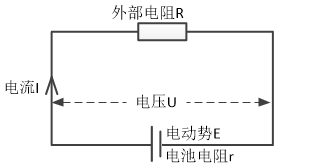

# 通过电流计测量电池电动势用于pwm压降补偿

* [返回上层目录](../ammeter.md)
* [计算电池的内部电阻和电动势](#计算电池的内部电阻和电动势)
* [高压大电流传感器类型](#高压大电流传感器类型)

整个飞控系统供电电路我们可以化简看成

# 计算电池的内部电阻和电动势

只需要知道电流计测量的电压和电流，就能算出电池的内阻和电动势。

电池的内部电阻等于，电流计测得的电池两端的电压变化$\Delta U$，除以，电流计测得的电流变化$\Delta I$，再乘以负号。

具体证明如下：

飞控的外接电阻基本上就是电调的电阻了，而电调随着动力输出的不同是在不断变化的，所以，外接电阻是不断变化的，我们可以利用外阻不断变化的特点来计算电池本身的内阻及其电动势。

当外接电阻为$R_1$时
$$
\begin{aligned}
I_1&=\frac{E}{R_1+r}\\
U_1&=I_1R_1=\frac{E}{R_1+r}R_1
\end{aligned}
$$
当外接电阻为$R_2$时
$$
\begin{aligned}
I_2&=\frac{E}{R_2+r}\\
U_2&=I_1R_1=\frac{E}{R_2+r}R_2
\end{aligned}
$$
那么
$$
\begin{aligned}
&\frac{\Delta U}{\Delta I}\\
=&\frac{U_2-U_1}{I_2-I_1}\\
=&\frac{\frac{E}{R_2+r}R_2-\frac{E}{R_1+r}R_1}{\frac{E}{R_2+r}-\frac{E}{R_1+r}}\\
=&\frac{\frac{1}{R_2+r}R_2-\frac{1}{R_1+r}R_1}{\frac{1}{R_2+r}-\frac{1}{R_1+r}}\\
=&\frac{(R_1+r)R_2-(R_2+r)R_1}{(R_1+r)-(R_2+r)}\\
=&\frac{rR_2-rR_1}{R_1-R_2}\\
=&\frac{r(R_2-R_1)}{R_1-R_2}\\
=&-r
\end{aligned}
$$
所以，电池的内阻$r$就等于
$$
r=-\frac{\Delta U}{\Delta I}
$$
注意，有**负号**，因为如果外部电路中的电阻$R$变小，则$\Delta I$为正，$\Delta U$为负，这两个变量变化趋势是相反的，所以要加负号。

现在我们知道了电池内阻，那就能知道整个电路的电动势$E$，由于电路电动势$E$等于电池两端电压加上电池内阻消耗的电压，所以，
$$
E=U+I\cdot r=U-I \cdot \frac{\Delta U}{\Delta I}
$$

# 高压大电流传感器类型

大动力的电流计并不大，它通常也就一个火柴盒或者麻将牌大小（重量几十克），完全不需要担心装不下。

你之前在 APM 上见到的那种小电路板（例如标准的 3DR Power Module / PM02），是专为 3S~6S 小型无人机（电流 < 30A~60A） 设计的“分流电阻式”电源板。

但在你的系统里，动力电池是 12S（电压高达 44V~50.4V，电流动辄 80A~200A+），这种大动力系统有专门的高压大电流传感器方案。目前行业内（工业级/大载重无人机）主流有以下 3 种形态：

## 穿孔式霍尔电流计（工业级大机最推荐、最安全）

- 外观与尺寸：大约 3cm × 3cm × 2cm 的绝缘塑料方块（像一个带圆孔的小方块），重量约 30~50g。
- 工作原理：利用霍尔效应感应电磁场测量电流，不需要把动力电源线剪断焊接，直接把动力电池的粗主电源线（如 8AWG / 10AWG 硅胶线）从中间的圆孔穿过去即可。
- 为什么大动力最适合它？ 
  1. 完全电气隔离：传感器和高压强电完全没有物理接触，哪怕飞控端短路，也绝不会引爆 12S 动力电池；
  2. 零发热、不降压：没有分流电阻的焦耳发热损耗（几百安电流经过分流电阻会发热极重），可靠性极高；
  3. 耐压极高：因为是绝缘穿孔，耐压几百伏都没问题。
- 代表产品：Mauch（瑞士著名无人机电源品牌）的 Hall Sensor 系列、CUAV 的大功率霍尔模块、工控用的 LEM（莱姆）霍尔传感器等。

## 高压大电流 CAN PMU / 分电板（一体化金属壳模块）

- 外观与尺寸：大约 4cm × 5cm × 1.5cm，通常带有铝合金CNC外壳帮助散热。
- 工作原理：内部采用高精度低阻值合金铜排（分流器），通常支持 12S~14S 高压，额定持续电流 100A~200A，瞬时可达 300A。
- 特点：
  - 除了测电流电压，往往还内置了高压降压电路（DCDC），给飞控提供纯净的双路 5.3V 冗余供电。
  - 采用 CAN 总线数字通信（而不是以前 APM 的模拟量细导线），因为 12S 大电流在机身内部有极强的电磁干扰，CAN 数字总线抗干扰能力远强于模拟 ADC 信号。
- 代表产品：CUAV HV_PM / CAN PMU、Holybro PM08D-CAN 等。

## 智能电调（ESC Telemetry 回传，免装独立传感器）

- 如果你的飞机用的是现代工业级电调（例如好盈 Hobbywing 乐天/高压系列、T-Motor 泰格 Flame / Alpha 系列、海盈等）：
- 很多高压电调自身就集成了高精度电流采样芯片。电调通过一条数字信号线（CAN 或 UART / DShot 遥测）把每个电机的实时电流发给飞控，飞控把几个电机的电流加起来就是总电流。
- 这种方案完全不需要额外加装任何电流计硬件，走软件通信即可拿到电流。

## 选型建议与注意事项

1. 千万不能用 APM 传统小电源板： 老式 APM/Pixhawk 赠送的蓝色/黑色小插头电源板耐压通常只有 25V（6S），接上 12S（50V）会瞬间炸管冒烟。
2. 推荐方案：
   - 如果想接线最安全、最省事：选一个 12S/14S 穿孔式霍尔电流计（电源线直接穿过去，信号线接飞控 ADC 或 CAN 模块）。
   - 如果飞控支持 CAN 总线：选一个 高压 CAN PMU（12S/200A 级），既解决了电流计，又解决了高压供电问题。

# 参考资料

* APM开源飞控中的`update_resistance_estimate()`函数。

