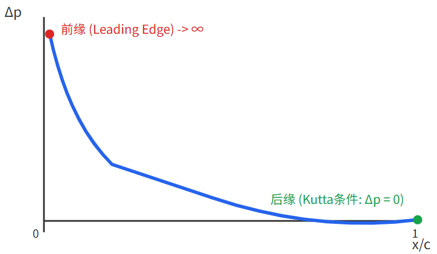

# 飞机纵向焦点（气动中心）与压心第一性原理剖析

- [返回上层目录](../aerodynamics.md)
- [前言：总体设计与飞控工程中的深层物理困惑](#前言：总体设计与飞控工程中的深层物理困惑)
- [薄翼理论下的单翼焦点本质](#薄翼理论下的单翼焦点本质)
  - [焦点的严格定义与流场分解](#焦点的严格定义与流场分解)
  - [零升弯度流场（流场 A）的第一性原理：为什么普通翼型的零升力矩恒定为负（低头）？](#零升弯度流场（流场 A）的第一性原理：为什么普通翼型的零升力矩恒定为负（低头）？)
  - [纯平板增量流场（流场 B）：为什么增量升力作用点永远钉死在0.25c？（严密数学积分证明）](#纯平板增量流场（流场 B）：为什么增量升力作用点永远钉死在0.25c？（严密数学积分证明）)
  - [澄清直觉误区：为什么人们总觉得“升力往前挤”？](#澄清直觉误区：为什么人们总觉得“升力往前挤”？)
  - [单翼压心的力学本质与“力的平移定理逆过程”](#单翼压心的力学本质与“力的平移定理逆过程”)
  - [从二维到三维与超音速：马赫数与后掠角引起的焦点迁移](#从二维到三维与超音速：马赫数与后掠角引起的焦点迁移)
- [从单翼到全机：中性点与全机压心](#从单翼到全机：中性点与全机压心)
  - [全机中性点的物理本质](#全机中性点的物理本质)
  - [全机中性点与全机压心的空间相对位置：纯配平几何视角](#全机中性点与全机压心的空间相对位置：纯配平几何视角)
  - [飞行机动中的全机压心动态迁移](#飞行机动中的全机压心动态迁移)
  - [气动布局横向拓展：鸭式布局与无尾飞翼布局的配平几何哲学](#气动布局横向拓展：鸭式布局与无尾飞翼布局的配平几何哲学)
- [大迎角与失速全包线：焦点概念的瓦解与平板力学接管](#大迎角与失速全包线：焦点概念的瓦解与平板力学接管)
  - [势流假设破裂与焦点的失效](#势流假设破裂与焦点的失效)
  - [牛顿分离流与压心向中弦点（0.5c）的转移](#牛顿分离流与压心向中弦点（0.5c）的转移)
- [总结：概念辨析与第一性原理速查](#总结：概念辨析与第一性原理速查)
  - [核心力学概念对齐与本质区别（理论力学主矢与主矩视角）](#核心力学概念对齐与本质区别（理论力学主矢与主矩视角）)
  - [纵向关键力学点参数速查表](#纵向关键力学点参数速查表)

# 前言：总体设计与飞控工程中的深层物理困惑

在飞行器总体设计与飞控算法开发领域，纵向气动力分布是决定飞机稳定性与操纵性的基石。然而，许多工程师以及总体设计专业人员常年在以下几个核心概念上存在直觉与公式的冲突：

1. **焦点的起源与 25% 弦长的数学必然**：为什么迎角变化时，升力增加了，力矩对某一个固定点（气动中心 / 焦点）的变化率却恰好为零？大自然为何会刚好在 25% 弦长处安排这样一个神奇的点？
2. **零升力矩的符号与物理本质**：普通正弯度翼型在零升迎角下，明明合力为零，为什么其俯仰力矩不仅不为零，而且恒定是负的（低头力矩）？中弧线上拱直觉上应该往上“吸”，为什么不仅没有把机头往上吸（抬头），反而形成了一个强烈的低头力偶？
3. **升力分布“往前挤”的视觉与形心固定的矛盾**：风洞试验和 CFD 压力云图中，随着迎角增加，吸力峰明显向前缘汇聚，这是否意味着增量升力分布在往前移动？如果增量升力往前挤，为什么它的合力作用点仍能死死焊在 25% 弦长处？
4. **升力源泉与压心迁移的直觉死锁**：若带弯度机翼在零升迎角下不贡献任何净升力（只维持恒定低头力偶），而纯平板机翼贡献了全部的升力增量且其形心恒定在 0.25c，那么总升力的作用点（压心）为什么不在 0.25c？它为什么能够随着迎角从机翼后部向前移动？
5. **压心与焦点的相对位置错觉**：为什么常说“单翼的压心在焦点之后”，但在全机平飞稳态配平时，“全机压心却在全机中性点（全机焦点）之前”？

本文从流体力学势流理论的第一性原理出发，剥离纯数学代数的抽象包装，用清晰透彻的物理图像逐一剖析上述问题，给出严密的机理阐述。

本文聚焦于机翼焦点、全机中性点与压力中心的**流体动力学形成机理、积分证明与纯静力学几何力系平衡**。

# 薄翼理论下的单翼焦点本质

## 焦点的严格定义与流场分解

在空气动力学中，翼型的气动中心（Aerodynamic Center，工程上常俗称机翼焦点$x_{ac}$）定义为：**俯仰力矩对迎角的变化率为零的点**，即：

$$
\frac{dC_m}{d\alpha} = 0
$$

这一特性并非巧合，而是不可压缩不可分离势流（薄翼理论 Thin Airfoil Theory）在线性小迎角条件下的必然数学与物理结果。

根据势流理论的拉普拉斯方程线性叠加原理，带弯度的薄翼型在迎角$\alpha$下的绕流场，可以严格拆解为两个独立流动状态的线性叠加：

$$
\text{实际流动} = \text{流场 A（零升弯度流场）} + \text{流场 B（纯平板对称迎角流场）}
$$

```
              实际翼型流场 (迎角 α)
                     ||
                     \/
   【流场 A：零升弯度流场】      +      【流场 B：纯平板迎角流场】
   (翼型处于零升迎角 α_L0)              (平板处于有效迎角 α - α_L0)
   · 净升力 L_A = 0                     · 贡献全机所有增量升力 ΔL
   · 产生固定纯力偶 M_0                 · 几何形状严格冻结，乘数线性放大
   · 对空间任意点力矩恒定               · 面积形心（合力作用点）严格钉在 0.25c
```

### 流场 A：零升弯度流场（Pure Couple）
- 将翼型置于零升迎角$\alpha_{L0}$下，此时翼型积分总升力严格为零（$L_A = 0$）；
- 此时机翼处于负迎角俯冲姿态，机翼前半部承受负迎角向下受压（产生局部负升力），机翼后半部受中弧线下弯后缘的下洗作用向上托举（产生局部正升力），在空间形成一个**内生性的纯低头力偶矩**（Pure Couple），定义为零升力矩$M_0$（无量纲化系数为$C_{m0} < 0$）；
- **力学第一性公理**：纯力偶对空间中任意参考点的力矩完全相同，与参考点在机头、机尾还是无穷远处无关。

### 流场 B：纯平板对称迎角流场（Linear Growth）



- 将中弧线拉直为平板，置于有效迎角$\alpha_e = \alpha - \alpha_{L0}$下；
- 该流场贡献了迎角变化引起的全部升力增量$\Delta L$；
- **涡层强度解析解的物理推导来源**：根据理想流体不可穿透边界条件（物面上流体法向相对速度必为零），板上由涡层分布$\gamma(\xi)$诱导的法向速度，必须在任意弦长位置$x$精确抵消平行来流的法向投影$V_\infty \sin\alpha_e \approx V_\infty \alpha_e$：
$$
  w(x) = -\frac{1}{2\pi} \int_0^c \frac{\gamma(\xi)}{x - \xi} \, d\xi = -V_\infty \alpha_e
$$
  这是一个典型的一阶柯西奇异积分方程（Cauchy Singular Integral Equation）。施加尖后缘平滑脱体且压差归零的**库塔条件（Kutta Condition，即$\gamma(c) = 0$）**作为唯一性定解边界，薄翼理论严格求解出的平板附着涡层强度分布为：
$$
  \gamma(x) = 2 V_\infty \alpha_e \sqrt{\frac{1 - x/c}{x/c}}
$$

将平板表面压差分布$\Delta p(x) = \rho V_\infty \gamma(x)$展开，其沿弦长分布函数可写为：

$$
\Delta p_B(x) = \left( 2 \rho V_\infty^2 \alpha_e \right) \cdot \sqrt{\frac{1 - x/c}{x/c}}
$$

## 零升弯度流场（流场 A）的第一性原理：为什么普通翼型的零升力矩恒定为负（低头）？

在航空工程与流体力学教学中，几乎所有经典教材都会直接给出一个冷冰冰的结论：**常规正弯度翼型（中弧线上凸）的零升力矩系数$C_{m0}$恒为负，即 $C_{m0} < 0$（低头力矩，Nose-down Moment）**。

许多工程师在此困扰十余年：

> 既然是“零升”状态，说明机翼受到的总升力严格为零，向上和向下的气动力正好抵消，凭什么力矩不能是 0？更重要的是，正弯度翼型中弧线上凸，直觉上上方流速快、下方流速慢，上方产生的吸力不是应该把机翼往上拉吗，为什么非但没有把机头往上吸（抬头），反而形成了一个强烈的低头力矩？！

为了彻底驱散这一直觉死锁，我们从**真实迎角姿态、压差物理分布、襟翼等效思想实验、薄翼理论解析积分与涡流角动量**五个维度，建立彻底、透彻、不可动摇的物理闭环。

### 物理根源一：零升状态下的机翼究竟处于什么姿态？（打破“水平放置”的认知陷阱）
困扰工程师十余年的首要直觉陷阱，在于潜意识里把“零升状态”想象成了机翼平平正正地水平放置在来流中（即几何迎角$\alpha = 0$）。

然而对于正弯度翼型（Cambered Airfoil）：
- **几何迎角$\alpha = 0$时**：由于中弧线向上隆起、后缘向下倾斜，气流顺着弯度流过时已经被迫发生下洗偏转，机翼早已产生相当可观的正升力（$C_L > 0$）；
- **要让总升力严格归零（$C_L = 0$）**：飞行员或风洞试验必须将机翼**狠狠地低头压下去**，置于一个**负迎角**——即**零升迎角$\alpha_{L0} < 0$**（常规凸翼型通常在$-2^\circ \sim -4^\circ$左右）。

**请在脑海中定格这个真实的物理姿态**：机翼此时绝不是水平放置的，而是以机头朝下的负迎角姿态（如$-3^\circ$）向前俯冲迎风！

### 物理根源二：前后弦气流的“冰火两重天”（负迎角与下偏后缘）
在这样一个低头俯冲姿态下，迎面而来的水平气流在流经机翼前后各段时，经历了截然相反的流体动力学过程：

1. **机翼前半段（前缘至约 30% 弦长处）：承受强烈的局部负迎角**
   - 整个机翼机头下俯，迎面而来的来流迎头打在**机翼前部的上表面**；
   - 流体驻点（Stagnation Point）从正常的下表面转移到了**上表面前部**；
   - 气流为了绕过下表面前缘加速，导致机翼前部下表面的静压低于上表面（或上表面承受气流直冲的高静压）；
   - **前半段受力结果**：**向下推（产生局部负升力，Downforce$\Downarrow$）**！

2. **机翼后半段（约 50% 弦长至后缘）：中弧线下弯形成的天然“下偏襟翼”**
   - 尽管机头低垂，但常规翼型的中弧线向后是急剧下弯的（后缘朝下抠）；
   - 对于机翼后半段的局部型面切线而言，它相对于来流方向依然具有强烈的正倾角；
   - 下表面对气流产生阻挡增压（正压托举区），上表面气流顺着下弯表面流动形成向心加速度吸力（负压区），强迫气流向下偏转（Downwash）；
   - **后半段受力结果**：**向上托（产生局部正升力，Upforce$\Uparrow$）**！

```
         零升迎角姿态 (α = α_L0 < 0，机头低垂俯冲)
                 来流 V_inf ====>

                 前部承受负迎角               后部中弧线下弯
                 驻点在上，压力下压            强迫气流下洗，向上托举
                       |                             |
                       V                             ^
                 [ 前半段负升力 ]              [ 后半段正升力 ]
                     (向下 -F)                     (向上 +F)
                       |                             |
                       v                             |
              ===============================================
              前缘 0c                     重心/焦点 0.25c          后缘 1.0c
                       |                             |
                       +-----------------------------+
                                      |
                                      V
                        【顺时针纯力偶 M_0 < 0 (强烈低头)】
```

3. **宏观合力与合力矩的严密自洽**：
   - **合力为零（Zero Net Force）**：机翼前半段向下的负升力，与机翼后半段向上的正升力，沿弦长积分后面积绝对值完全相等、方向相反：
   $$
     L_{\text{总}} = (-F) + (+F) \equiv 0
   $$
   - **合力矩非零且为力偶（Pure Couple）**：
     向下的负升力打在机翼前方（约$0.15c$处），向上的正升力打在机翼后方（约$0.70c$处）。
     **一个在前面往下拉，一个在后面往上抬！**
     这对大小相等、方向相反但不在同一作用线上的气动力，在空间中构成了一个完美的**顺时针纯力偶（Pure Couple）**！
   - **力偶矩符号严格为负**：
     在航空与力学通用坐标系中，抬头（Counter-Clockwise / 逆时针）定义为正（$+$），**低头（Clockwise / 顺时针）定义为负（$-$）**。
     这一力偶永远试图把机头往下压、把机尾往上掀，因此其力矩系数在数学和物理上**绝对、恒定为负（$C_{m0} < 0$）**！

### 直观思想实验：下偏后缘襟翼（Flap Analogy）
如果对连续曲率的中弧线仍感到抽象，有一个具备绝对冲击力的物理等价模型——**带平直襟翼的平板翼型**：
1. 取一块完全平直对称的平板翼型，此时中弧线为直线，$C_{m0} = 0$；
2. 将后缘 25% 的襟翼向下偏转$10^\circ$（这相当于人工赋予机翼后半段极大的局部正弯度）；
3. 襟翼放下瞬间，后缘直接兜住气流，尾部被狠狠向上托起，飞机瞬间获得巨大的低头力矩，同时全机总升力暴增；
4. 现在，请试着把**总升力消除到零**：飞行员必须往前大幅推杆，让飞机进入深度俯冲的负迎角姿态；
5. 在该负迎角下，前面的平板段承受负迎角向下受压，正好抵消后缘襟翼向上的正托力，使得升力计读数精确归零；
6. 但此时此刻，尾部的襟翼依然在强力下偏推气流、向上抬尾，机头依然在被下压迎面气流砸向下方——**低头力偶不仅没有消失，反而在升力归零的背景下被纯粹地孤立暴露出来！**
7. 常规正弯度翼型，本质上就是一段沿着弦长“天然固化了下偏后缘襟翼”的刚性翼型！其后半段下垂的几何特征，决定了它在零升平衡态下必然具备“前压后抬”的内生低头力偶。

### 薄翼理论的严格数学闭环推导：$C_{m0} = -\pi \epsilon$
薄翼势流理论（Thin Airfoil Theory）的傅里叶分析为这一现象给出了无可辩驳的纯数学解析解析解。

设中弧线高度函数为$z_c(x)$，其局部斜率沿弦长分布为$\frac{dz_c}{dx}$。

引入 Glauert 坐标变换：$x = \frac{c}{2}(1 - \cos\theta)$，其中$\theta \in [0, \pi]$。

中弧线斜率可展开为标准的傅里叶余弦级数：
$$
\frac{dz_c}{dx} = (\alpha - A_0) + \sum_{n=1}^\infty A_n \cos(n\theta)
$$
其中傅里叶系数$A_n$仅由中弧线几何斜率决定：
$$
A_n = \frac{2}{\pi}\int_0^\pi \frac{dz_c}{dx} \cos(n\theta) \, d\theta
$$

根据薄翼理论积分定理，绕 25% 弦长点（气动焦点）的力矩系数与迎角完全无关，恒定等于零升力矩：
$$
C_{m,c/4} \equiv C_{m0} = \frac{\pi}{4}(A_2 - A_1)
$$
请特别注意这个经典的代数关系式：**零升力矩的正负与大小，完全由傅里叶系数差值$(A_2 - A_1)$唯一锁定！**

为了获得极致透彻的解析解，我们考察工程中最经典的**对称抛物线拱形中弧线**（对应 NACA 4 位数字翼型中最大弯度位于 50% 弦长的基准情形）：
$$
z_c(x) = 4 \epsilon \, c \cdot \left(\frac{x}{c}\right) \left(1 - \frac{x}{c}\right)
$$
其中$\epsilon = \frac{z_{c,\max}}{c} > 0$为机翼最大相对弯度（例如 2% 弯度则$\epsilon = 0.02$）。

对中弧线求导获取表面斜率分布：
$$
\frac{dz_c}{dx} = 4\epsilon \left(1 - 2\frac{x}{c}\right)
$$
将 Glauert 变换$\frac{x}{c} = \frac{1 - \cos\theta}{2}$代入，奇迹出现了：
$$
1 - 2\frac{x}{c} = 1 - (1 - \cos\theta) = \cos\theta
$$
斜率函数化为一个纯粹的单频余弦函数：
$$
\frac{dz_c}{dx} = 4\epsilon \cos\theta
$$

现在直接利用三角函数正交性计算傅里叶系数：
1. **$A_1$阶系数**（基频余弦分量，代表整体拱起）：
$$
   A_1 = \frac{2}{\pi} \int_0^\pi (4\epsilon \cos\theta) \cos\theta \, d\theta = \frac{8\epsilon}{\pi} \int_0^\pi \cos^2\theta \, d\theta = \frac{8\epsilon}{\pi} \cdot \frac{\pi}{2} = 4\epsilon
$$
2. **$A_2$阶系数及更高阶分量**（二次及以上谐波，代表曲率波动）：
$$
   A_2 = \frac{2}{\pi} \int_0^\pi (4\epsilon \cos\theta) \cos(2\theta) \, d\theta \equiv 0 \quad (\text{三角函数正交积分严格为零})
$$
   同理，对任意$n \ge 2$，高阶项全部严格恒等于零（$A_n \equiv 0$）。

将$A_1 = 4\epsilon$与$A_2 = 0$代回薄翼力矩公式：
$$
C_{m0} = \frac{\pi}{4}(A_2 - A_1) = \frac{\pi}{4}(0 - 4\epsilon) \equiv -\pi \epsilon
$$

**这就是空气动力学中最经典、最优美的解析定律之一：**
$$
\mathbf{C_{m0} = -\pi \epsilon}
$$
- 对于**正弯度翼型**（$\epsilon > 0$）：$C_{m0} = -\pi \epsilon < 0$，**力矩在数学上绝对严格为负（低头力矩）**！
  - 若最大相对弯度为 2%（$\epsilon = 0.02$），则理论$C_{m0} = -\pi \times 0.02 \approx -0.0628$；
  
  - 若最大相对弯度为 4%（$\epsilon = 0.04$），则理论$C_{m0} = -\pi \times 0.04 \approx -0.1257$；
  
    该数值与 NACA 官方风洞测试实测数据（如 NACA 4412 测得$C_{m0} \approx -0.09$）在数量级和趋势上高度吻合；
  
- 对于**对称翼型**（$\epsilon = 0$）：$C_{m0} \equiv 0$；

- 对于**反弯 / 下凹中弧线**（$\epsilon < 0$）：$C_{m0} = -\pi (-|\epsilon|) = +\pi |\epsilon| > 0$（自然形成抬头力矩）。

### 流体角动量守恒与涡流偶极子（流体动力学第一性原理解析）
从全局流体控制体（Control Volume）的动量与角动量守恒定理审视：
- 在零升迎角下，上下翼面的附着环量积分相互抵消：
$$
  \Gamma_{\text{总}} = \oint_{\partial \Omega} \vec{V} \cdot d\vec{s} = \int_0^c \gamma(x) \, dx = 0
$$
  因此无限远处的尾流场没有整体向下的净动量（净升力严格为零）；
- 但是，机翼前半部附着的是**顺时针涡层**（$\gamma(x) < 0$），后半部附着的是**逆时针涡层**（$\gamma(x) > 0$）。机翼在中弧线引导下，向流场中注入了一对**涡偶极子（Vortex Dipole）**；
- 水平来流进入控制体，在翼型弯曲型面强迫下形成“先下沉、再上翘下偏”的局部流动，流体在离开控制体时携带着**逆时针方向的净流体角动量（Counter-Clockwise Angular Momentum）**；
- 根据角动量守恒定律与牛顿第三旋转定律，流体获得了逆时针角动量，就必然对机翼施加一个等大反向的**顺时针反作用力矩（Clockwise Reaction Torque）**；
- 顺时针旋转力矩在航空坐标系中正是**负力矩（低头力矩）**！

### 反向工程印证：为什么无尾飞翼必须使用“反弯翼型”（Reflexed Airfoil）？
对上述第一性原理最绝妙的反向工程验证，正是航空史上**无尾飞翼（Tailless / Flying Wing）**的诞生历程：
- 常规带尾翼飞机，机翼自带低头力偶（$C_{m0} < 0$），完全依靠机尾后方的平尾提供向下压的负升力（形成抬头配平力矩）来取得纵向力矩平衡；

- 但飞翼没有尾翼！如果无尾飞翼贸然使用常规正弯度翼型，机翼自带的$C_{m0} < 0$低头力偶在空中无人制衡，飞机会在离地后瞬间不可逆转地向前翻滚俯冲栽地（Tuck-under）；

- 为了让飞翼在无尾状态下自主配平，气动先驱们根据薄翼力矩公式$C_{m0} = \frac{\pi}{4}(A_2 - A_1)$，发明了**反弯翼型（Reflexed Airfoil，如 NACA 8-H-12 等 S 型翼型）**：
  
  将机翼后缘向上翘起（使后缘局部$\frac{dz_c}{dx} > 0$）。后缘上翘使尾部受下压负升力、机头受正托力，强迫系数差值$A_2 - A_1 > 0$，从而**在翼型内部凭空制造出了正的零升力矩（$C_{m0} > 0$，内生抬头力矩）**！
  正零升力矩与重心位于焦点前方产生的升力低头力矩（$-C_L \cdot (x_{ac} - x_{cg})$）完美对消，飞翼才得以在没有任何尾翼辅助的情况下实现稳定的俯仰平飞。

**至此，困扰工程界十余年的$C_{m0} < 0$物理谜团实现完全闭环：**

正弯度翼型的低头力矩，本质是**“机头负迎角向下推”与“后缘天然下偏襟翼向上托”构成的内生纯力偶**；它是中弧线上拱与尾部下弯的流体必然，数学上严格正比于最大相对弯度（$C_{m0} = -\pi \epsilon$）。

## 纯平板增量流场（流场 B）：为什么增量升力作用点永远钉死在0.25c？（严密数学积分证明）

### 纯平板压差分布解析解及其四大物理特征
薄翼理论对处于有效迎角$\alpha_e$下的纯平板对称流场（流场 B），给出的表面附着涡层强度分布为：
$$
\gamma(x) = 2 V_\infty \alpha_e \sqrt{\frac{1 - x/c}{x/c}}
$$
结合库塔-儒可夫斯基关系定理，上下翼面压差分布$\Delta p_B(x) = \rho V_\infty \gamma(x)$可严格表示为：
$$
\Delta p_B(x) = \left( 2 \rho V_\infty^2 \alpha_e \right) \cdot \sqrt{\frac{1 - x/c}{x/c}}
$$
定义归一化弦长坐标$\xi = \frac{x}{c} \in [0, 1]$，无量纲几何形态函数为：
$$
g(\xi) = \sqrt{\frac{1 - \xi}{\xi}}
$$

请仔细审视这个纯粹的解析数学表达式：
**迎角$\alpha_e$是作为一个全局乘法常数放在括号最外面的！**
几何形态函数$g(\xi) = \sqrt{\frac{1 - \xi}{\xi}}$内部完全不包含$\alpha_e$这个变量。这意味着迎角只控制压差分布的**峰值幅值（纵轴高低）**，而**绝对不改变压差分布的任何几何形状与相对比例（横轴分布）**。

归一化压差分布曲线的几何与物理特征呈现如下：

```
归一化压差 g(ξ)
  ^
10|  * (前缘奇异性: ξ -> 0 时压差趋于无穷大)
 8|   \
 6|    \
 4|     *
 2|      \     *
 0+------*----------*---------> 弦长归一化位置 ξ = x/c
  0     0.2        0.6     1.0 (后缘: 库塔条件，压差严格归零 Δp = 0)
```

这条曲线具备四个不可动摇的物理基石特性：
1. **前缘奇异性（Leading-Edge Singularity）**：当$\xi \to 0$时，分母趋近于零，导致$g(\xi) \to \infty$。这是无粘流体绕过无限薄尖锐前缘时的势流数学必然结果（实际粘性流动中会钝化为有限吸力峰或发生局部流动分离）；
2. **前半段急剧跌落**：压差在离开前缘极小区间内呈平方根反比衰减，大部分升力高度集中在机翼前半段；
3. **后缘库塔条件（Kutta Condition）**：当$\xi = 1$（后缘）时，分子$1 - \xi = 0$，使得$\Delta p_B(1) \equiv 0$。气流在锐后缘平滑离开，上下翼面静压在此完美重合，压差严格闭合于零；
4. **线性几何缩放（Linear Scaling）**：迎角从$2^\circ$增加到$4^\circ$，整条曲线在纵轴上等比例拉高一倍，但其在各弦长位置的无量纲相对形状函数$g(\xi)$纹丝不动。

### 压差分布曲线下方围成区域的重心（形心）积分方程
无论从纯粹平面图形几何形心（Centroid）的角度，还是从流体动力学总升力合力作用点（压力中心$x_{cp}$）的角度，其数学第一性原理均是一致的——**合力作用点等于一阶面积矩（对前缘的力矩）与零阶面积矩（总面积 / 总升力）的比值**：

$$
\bar{\xi} = \frac{\bar{x}}{c} = \frac{\int_0^1 \xi \cdot \Delta p_B(\xi) \, d\xi}{\int_0^1 \Delta p_B(\xi) \, d\xi}
$$

将全局乘法常数$2\rho V_\infty^2 \alpha_e$提出并分子分母约去，迎角项完全消掉，形心位置完全简化为无量纲纯几何积分：

$$
\bar{\xi} = \frac{\int_0^1 \xi \cdot \sqrt{\frac{1-\xi}{\xi}} \, d\xi}{\int_0^1 \sqrt{\frac{1-\xi}{\xi}} \, d\xi} \equiv \frac{I_1}{I_0}
$$

其中：
- 零阶矩（分母）$I_0 = \int_0^1 \sqrt{\frac{1-\xi}{\xi}} \, d\xi$，对应总升力无量纲面积；
- 一阶矩（分子）$I_1 = \int_0^1 \xi \sqrt{\frac{1-\xi}{\xi}} \, d\xi$，对应绕前缘俯仰力矩无量纲面积。

### 严密微积分换元求解过程
为了解析求解该带根号奇异性的定积分，采用**三角换元法**（直观且对消最简），令：
$$
\xi = \sin^2\theta, \quad d\xi = 2\sin\theta\cos\theta \, d\theta
$$
当$\xi = 0$时，$\theta = 0$；当$\xi = 1$时，$\theta = \frac{\pi}{2}$。积分区间变换为$\theta \in \left[0, \frac{\pi}{2}\right]$。

被积函数中的平方根项转化为纯三角函数比值：
$$
\sqrt{\frac{1-\xi}{\xi}} = \sqrt{\frac{1 - \sin^2\theta}{\sin^2\theta}} = \sqrt{\frac{\cos^2\theta}{\sin^2\theta}} = \frac{\cos\theta}{\sin\theta}
$$

现在分别进行分母与分子的严密逐步积分：

**1、分母$I_0$（零阶矩 / 归一化总升力）的解析积分**

代入换元式及微分项：
$$
I_0 = \int_0^{\pi/2} \frac{\cos\theta}{\sin\theta} \cdot \left( 2\sin\theta\cos\theta \right) \, d\theta
$$
分母中的$\sin\theta$与微分项中的$\sin\theta$精确相消：
$$
I_0 = 2 \int_0^{\pi/2} \cos^2\theta \, d\theta
$$
利用降幂二倍角公式$\cos^2\theta = \frac{1 + \cos(2\theta)}{2}$：
$$
I_0 = 2 \int_0^{\pi/2} \frac{1 + \cos(2\theta)}{2} \, d\theta = \int_0^{\pi/2} 1 \, d\theta + \int_0^{\pi/2} \cos(2\theta) \, d\theta
$$
计算各子项：
$$
\int_0^{\pi/2} 1 \, d\theta = \frac{\pi}{2}, \quad \int_0^{\pi/2} \cos(2\theta) \, d\theta = \left[ \frac{\sin(2\theta)}{2} \right]_0^{\pi/2} = 0 - 0 = 0
$$
因此分母严格得出：
$$
I_0 = \frac{\pi}{2}
$$
*（物理注记：将物理量代回总升力公式$L = \int_0^c \Delta p_B(x) dx = (2\rho V_\infty^2 \alpha_e c) \cdot I_0 = (2\rho V_\infty^2 \alpha_e c) \cdot \frac{\pi}{2} = \pi \rho V_\infty^2 c \alpha_e$，无量纲化后即为平板升力线斜率$C_{L\alpha} = 2\pi$！）*

**2、分子$I_1$（一阶矩 / 归一化前缘力矩）的解析积分**

将$\xi = \sin^2\theta$连同根式与微分项一并代入：
$$
I_1 = \int_0^{\pi/2} \sin^2\theta \cdot \frac{\cos\theta}{\sin\theta} \cdot \left( 2\sin\theta\cos\theta \right) \, d\theta
$$
消去$\sin\theta$，整理为三角函数积的形式：
$$
I_1 = 2 \int_0^{\pi/2} \sin^2\theta \cos^2\theta \, d\theta
$$
利用二倍角公式$\sin\theta\cos\theta = \frac{1}{2}\sin(2\theta)$，将高次三角积收缩：
$$
I_1 = 2 \int_0^{\pi/2} \left[ \frac{1}{2}\sin(2\theta) \right]^2 \, d\theta = \frac{2}{4} \int_0^{\pi/2} \sin^2(2\theta) \, d\theta = \frac{1}{2} \int_0^{\pi/2} \sin^2(2\theta) \, d\theta
$$
再次利用二倍角降幂公式$\sin^2(u) = \frac{1 - \cos(2u)}{2}$（令$u = 2\theta$）：
$$
\sin^2(2\theta) = \frac{1 - \cos(4\theta)}{2}
$$
代入积分中：
$$
I_1 = \frac{1}{2} \int_0^{\pi/2} \frac{1 - \cos(4\theta)}{2} \, d\theta = \frac{1}{4} \left[ \int_0^{\pi/2} 1 \, d\theta - \int_0^{\pi/2} \cos(4\theta) \, d\theta \right]
$$
其中余弦震荡项全周期积分为零：
$$
\int_0^{\pi/2} \cos(4\theta) \, d\theta = \left[ \frac{\sin(4\theta)}{4} \right]_0^{\pi/2} = 0
$$
因此分子严格得出：
$$
I_1 = \frac{1}{4} \times \frac{\pi}{2} = \frac{\pi}{8}
$$

**两式相除与最终结论**

将分子$I_1$与分母$I_0$的积分结果相除，求得增量升力分布的无量纲形心位置：
$$
\bar{\xi} = \frac{I_1}{I_0} = \frac{\frac{\pi}{8}}{\frac{\pi}{2}} = \frac{1}{4} \equiv \mathbf{0.25}
$$
还原为物理坐标：
$$
x_{\text{形心}} = \bar{\xi} \cdot c = \mathbf{0.25 c}
$$

### 对照验证：经典的 Glauert 坐标变换法
为了让结论具备无可辩驳的普适性，我们使用空气动力学奠基人 Glauert 的经典薄翼理论变换：

令$x = \frac{c}{2}(1 - \cos\phi)$，其中$\phi \in [0, \pi]$，微分项为$dx = \frac{c}{2}\sin\phi \, d\phi$。

此时形态函数转换为：
$$
\sqrt{\frac{1 - x/c}{x/c}} = \sqrt{\frac{1 + \cos\phi}{1 - \cos\phi}} = \frac{1 + \cos\phi}{\sin\phi}
$$
其一阶矩与零阶矩积分分别如下：
1. **零阶矩**：
$$
   \int_0^c \Delta p_B(x) \, dx = (2\rho V_\infty^2 \alpha_e) \cdot \frac{c}{2} \int_0^\pi \frac{1 + \cos\phi}{\sin\phi} \sin\phi \, d\phi = \rho V_\infty^2 \alpha_e c \int_0^\pi (1 + \cos\phi) \, d\phi = \pi \rho V_\infty^2 c \alpha_e
$$
2. **一阶矩**：
$$
   \int_0^c x \Delta p_B(x) \, dx = (2\rho V_\infty^2 \alpha_e) \cdot \frac{c^2}{4} \int_0^\pi (1 - \cos\phi)(1 + \cos\phi) \, d\phi = \frac{1}{2} \rho V_\infty^2 \alpha_e c^2 \int_0^\pi (1 - \cos^2\phi) \, d\phi
$$
   由于$\int_0^\pi \sin^2\phi \, d\phi = \frac{\pi}{2}$，一阶矩为：
$$
   \frac{1}{2} \rho V_\infty^2 \alpha_e c^2 \cdot \frac{\pi}{2} = \frac{\pi}{4} \rho V_\infty^2 c^2 \alpha_e
$$
3. **形心计算**：
$$
   x_{\text{形心}} = \frac{\frac{\pi}{4} \rho V_\infty^2 c^2 \alpha_e}{\pi \rho V_\infty^2 c \alpha_e} = \frac{1}{4} c \equiv \mathbf{0.25 c}
$$

无论采用三角纯代数换元还是气动力学傅里叶角度换元，数学解析解完全等价。

### 这一数学证明对飞行力学的第一性原理启示
这一积分推导展示了以下底层物理事实：
1. **0.25c 并非工程经验，而是纯数学与几何拓扑必然**：它源于前缘反比平方根奇异性$\frac{1}{\sqrt{\xi}}$与后缘库塔闭合条件$\sqrt{1-\xi}$在一维线段上的加权平均重心。只要满足势流控制方程，这一数值就被绝对固定在 0.25，不随任何物理气动参数漂移；
2. **流场 B 的增量升力合力作用线在空间中被永久“焊死”**：无论迎角增加多少，流场 B 产生的升力合力线永远、无条件地穿过 25% 弦长处；
3. **空气动力学焦点的数学诞生**：因为流场 B 的升力恒过 0.25c，所以当对 0.25c 点计算俯仰力矩时，流场 B 的力臂严格为零（$\text{力臂} = 0.25c - 0.25c = 0$），其升力增量无法对 0.25c 贡献任何力矩。这就彻底证明了**对 0.25c 点的俯仰力矩与迎角完全无关（$\frac{dC_m}{d\alpha} = 0$）**——这就是机翼纵向空气动力学焦点（Aerodynamic Center）落在 25% 弦长的根本数学证明！

## 澄清直觉误区：为什么人们总觉得“升力往前挤”？

工程技术人员在观测真实压力分布（如风洞压孔或 CFD 云图）时，随迎角增大，前缘吸力峰越来越高，直觉上会产生“压力整体往前缘汇聚、往前挤”的强烈印象。

这一现象是客观真实的，但它属于**总流场（流场 A + 流场 B）**，而非流场 B 自身：

1. **在接近零升迎角的小迎角状态**：流场 B 幅值极弱，翼面压力由流场 A 主导。对于常规凸起翼型，其最大弯度位置多位于 35%~45% 弦长处，后部常有下弯，流场 A 的负压区平缓分布在中后弦，全翼合力压心靠后；
2. **迎角增大状态**：流场 A（背景常数场）保持原样不变，而流场 B 前缘处具有$\frac{1}{\sqrt{x}}$奇异性的尖锐吸力峰拔地而起；
3. **总场呈现的视觉效应**：前缘的高峰以极快速度压倒中后部平缓的弯度场。在视觉与几何积分上，总升力确实从机翼中后部被迅速向前“拉扯”，压心一路前移；
4. **两者的逻辑统一**：
   - 流场 B 本身的形心始终钉在$0.25c$；
   - 正因为流场 B 钉在$0.25c$，当它在总升力中所占的比重越来越大时，总流场的形心（压心）才会被逐渐拉向$0.25c$。

## 单翼压心的力学本质与“力的平移定理逆过程”

### 直觉死锁：看似无法调和的两个客观事实
在学习机翼受力时，工程人员常陷入严重的思维死锁，脑海中同时出现两个看似互斥的严密论断：
- **事实 1（总场观测）**：实际机翼受到的气压合力（总升力），其合力作用点（总压心$x_{cp}$）在飞行中是不断移动的。迎角越小压心（Center of Pressure）越靠后，迎角越大压心越向前移动，逐渐向焦点靠拢；
- **事实 2（流场分解）**：根据薄翼势流理论，带弯度翼型在零升迎角下不贡献任何净升力（净力为 0，只有力偶$M_0$）；而全部增量升力完全由纯平板流场提供，且纯平板流场的升力形心**永远被焊死在 0.25c 处**。

**直觉拷问**：既然带弯度流场没有贡献哪怕 1 牛顿的净升力，全机全部升力完完全全打在 0.25c 处，为什么总升力的作用点（压心）却不在 0.25c，反而会随着迎角到处跑？！

### 理论力学破局：瓦里农合力矩定理与“力的平移定理逆过程”
这一看似矛盾的根源，在于直觉中忽略了理论力学最基础的力系简化法则：**一个力加上一个净力为零的力偶，等效于该力在空间中发生物理平移！**

设想一个经典的理论力学思想实验——**长 1 米的轻质木棍**（坐标 0 为前端，1.0 为后端）：
1. **纯平板流场（流场 B）的作用**：迎角产生了一个向上的垂直升力$F = 10\,\text{N}$，其作用点严格钉死在$x = 0.25\,\text{m}$处；
2. **零升弯度流场（流场 A）的作用**：前半截向下压 5 N，后半截向上抬 5 N。**其总合力严格为 0 N**，但形成了一个固定的顺时针纯力偶矩$M_0 = -1.0\,\text{N}\cdot\text{m}$（低头力矩）。

现在，工程师希望用**一只手（单一等效合力）**在木棍某个位置$x_{cp}$向上顶住木棍，以完全等效上述两个流场的共同作用：
- **手的提力大小**：由于弯度流场净力为 0，手只需要向上提供$F_{\text{总}} = 10\,\text{N} + 0\,\text{N} = 10\,\text{N}$。这与“总升力完全等于平板升力”完全吻合；
- **手能顶在 0.25 m 处吗？** 
  若手顶在 0.25 m，向上 10 N 的力确实平衡了，但手对 0.25 m 的力臂为 0，那$1.0\,\text{N}\cdot\text{m}$的低头力偶谁来提供？此时木棍将立刻绕着手发生强烈的低头旋转翻车！
- **手必须顶在哪里？**
  为了制造出那$1.0\,\text{N}\cdot\text{m}$的低头力偶，手**必须向后移动到 0.25 m 之后**！向上顶的合力在后方，自然对 0.25 m 产生低头力矩：
$$
  F_{\text{总}} \cdot (x_{cp} - 0.25) = |M_0| \implies 10\,\text{N} \cdot (x_{cp} - 0.25) = 1.0\,\text{N}\cdot\text{m}
$$
  解得：
$$
  x_{cp} - 0.25 = 0.1\,\text{m} \implies x_{cp} = \mathbf{0.35\,\text{m}}
$$

这就是理论力学中**力的平移定理逆过程**：
$$
\text{【单一集中力在 } x_{ac} \text{】} + \text{【净力为 0 的纯力偶 } M_0 \text{】} \equiv \text{【同一个集中力，作用点平移至 } x_{ac} + \frac{|M_0|}{L} \text{】}
$$
**物理结论彻底澄明**：
虽然带弯度流场没有贡献净升力，但它贡献的纯力偶，通过杠杆原理硬生生把向上提的总升力作用点（压心）向后推移到了 0.25c 之后！

### 压心随迎角迁移的物理全景：等效平移力臂的动态缩水
基于上述等效机理，我们建立严格的数学推导。利用理论力学合力矩定理（瓦里农定理），机翼气动力对焦点$x_{ac}$的力矩可以通过压心力臂直接表达：

$$
M_{ac} = - L \cdot (x_{cp} - x_{ac})
$$

同时，焦点的第一性定义要求其受力矩不随迎角变化，恒定等于零升力矩：
$$
M_{ac} \equiv M_0
$$

联立两式，立即解出压心到焦点的物理距离：
$$
x_{cp} - x_{ac} = \frac{-M_0}{L} = \frac{-C_{m0}}{C_L} \cdot c
$$

对亚音速正弯度翼型（后缘下弯），其零升力矩为低头力矩（$C_{m0} < 0$，故$-C_{m0} > 0$）。随着飞行迎角改变，压心的运动全貌清晰展现：
1. **小迎角状态（升力微弱，如$L = 5\,\text{N}$）**：
   
   低头力偶依然维持在$1.0\,\text{N}\cdot\text{m}$。为了用微弱的 5 N 升力制造出 1.0 的力偶，平移力臂必须极长：
$$
   \Delta x = \frac{1.0}{5} = 0.2\,\text{m} \implies x_{cp} = \mathbf{0.45\,\text{m}}
$$
   压心大幅度退缩到机翼中后部；
2. **中大迎角状态（升力迅速上升，如$L = 20\,\text{N} \to 100\,\text{N}$）**：
   
   平板贡献的升力暴涨，但弯度力偶$M_0$分毫未增。平移力臂发生剧烈缩水：
$$
   \Delta x = \frac{1.0}{20} = 0.05\,\text{m} \implies x_{cp} = \mathbf{0.30\,\text{m}}
$$
$$
   \Delta x = \frac{1.0}{100} = 0.01\,\text{m} \implies x_{cp} = \mathbf{0.26\,\text{m}}
$$
   压心犹如被绳索牵引一般，从后方迅速逼近 0.25c 焦点；
3. **极限状态**：
   - 只要有正升力（$L > 0$），由于$-M_0 > 0$，距离$x_{cp} - x_{ac}$永远为正，**单翼压心永远在焦点的后方，渐近线逼近但绝不可能跨越焦点**；
   - 当飞机俯冲至零升迎角（$L \to 0$）时，分母趋于零，单一合力无法等效纯力偶，等效力臂发散至无穷远。

### 压心随迎角迁移率$\frac{dx_{cp}}{d\alpha}$的极值证明：为什么压心“小迎角飞速漂移，大迎角近乎冻结”？
进一步对压心位置公式直接对迎角$\alpha$（线性段$C_L = C_{L\alpha}\alpha$）求导：
$$
x_{cp}(\alpha) = x_{ac} - \frac{C_{m0}}{C_{L\alpha}\alpha} \cdot c
$$
求导获取压心随迎角的迁移变化率：
$$
\frac{dx_{cp}}{d\alpha} = \frac{d}{d\alpha} \left( x_{ac} - \frac{C_{m0}}{C_{L\alpha}} \cdot \frac{c}{\alpha} \right) = \frac{C_{m0}}{C_{L\alpha} \cdot \alpha^2} \cdot c
$$
请读者凝视这个极为精炼的导数解析式：
1. **单调性恒定**：对于亚音速正弯度翼型，$C_{m0} < 0$且$C_{L\alpha} > 0$，因此**导数恒为负（$\frac{dx_{cp}}{d\alpha} < 0$）**！这从数学上无懈可击地证明了：**迎角只要增大，压心必然严格单调前移，绝不存在任何反向后退的可能**；
2. **平方反比非线性敏感度（$\propto \frac{1}{\alpha^2}$）**：
   - **在接近零升迎角的小迎角区间（$\alpha \to 0$）**：分母$\alpha^2$趋于极小值，导致$\left|\frac{dx_{cp}}{d\alpha}\right| \to \infty$！微小的迎角扰动（如$0.5^\circ$的阵风）就会导致单翼压心发生几十厘米甚至几米量级的剧烈暴移。这解释了为什么轻载高速巡航阶段，机翼配平气动敏感度极高；
   - **在中大迎角区间（$\alpha \ge 8^\circ$）**：分母$\alpha^2$急剧变大，导数衰减为微小值（$\frac{dx_{cp}}{d\alpha} \to 0$）。压心移动速度急剧减缓，犹如被“冰冻”在$0.25c$焦点附近。这为飞行器提供了极佳的配平刚度。

### 微观气压云图视角的有机闭环
将此代数结论映射回 CFD 或风洞压力积分分布：
- **小迎角下**：平板前缘吸力峰微弱，弯度流场的“前压后抬”在全机面积积分中占有极大权重，加权积分后的几何形心（总压心）自然深居机翼后部；
- **大迎角下**：平板前缘吸力峰暴涨数十倍，弯度流场的微小力矩被淹没在浩瀚的前缘吸力峰中，机翼的总表面压力轮廓几乎被平板完全接管，加权总形心自然被强力拉向了 0.25c。

**至此，事实 1 与事实 2 在理论力学与流体力学框架下完美统一，毫无矛盾。**

## 从二维到三维与超音速：马赫数与后掠角引起的焦点迁移

理解了“压力分布几何形心决定焦点位置”这一第一性原理后，航空航天领域许多经典的焦点迁移现象迎刃而解：

**1、超音速焦点后移（Sonic Shift / Mach Shift）**

- **亚音速势流（$Ma < 1$）**：扰动向前向后全方位传播，前缘存在奇异吸力峰，压力分布呈现前高后低的反抛物线三角形态，形心解析积分在 **$0.25c$**；
- **超音速线化流（$Ma > 1$）**：声速障碍使扰动无法向前传播（马赫锥限制），根据阿克莱特（Ackeret）超音速薄翼线化理论，翼面压差变为沿弦长近似均匀的**矩形压力分布**：
$$
  \Delta p_{\text{supersonic}}(x) = \frac{4 \alpha}{\sqrt{Ma^2 - 1}} \cdot q_\infty \quad (\text{常数分布})
$$
  对矩形分布求形心，其合力作用点严格落在几何中点 **$0.50c$**！
- **总体工程后果**：飞机从亚音速加速到超音速时，焦点不可避免地从 25% 弦长向后剧烈跳移到 50% 弦长。这会导致全机静稳定裕度急剧暴增（极度钝感），造成巨大的配平阻力。超音速客机（如协和号）在跨音速加速时必须通过燃油配平泵将数吨燃油倒向机尾油箱后移重心，现代超音速战机则普遍采用鸭翼大攻角诱导涡或大功率全动平尾来压制这多出来的低头力矩。

**2、三维后掠角（Swept Wing）与展向诱导效应**

- 直机翼在三维展向积分后，全翼焦点仍基本位于平均气动弦长（MAC）的 0.25 处；
- 后掠翼的外侧翼稍在几何纵向上落后于内侧翼根。若外侧翼稍在大迎角下因展向附面层堆积而先于翼根失速，外侧升力骤降会导致全机升力形心瞬间前移（越过重心），产生极其致命的“自动上仰”（Pitch-up）不稳定性，这是后掠翼总体设计必须通过机翼扭转或翼刀重点防范的气动力陷阱。

# 从单翼到全机：中性点与全机压心

## 全机中性点的物理本质

全机中性点（全机焦点，Neutral Point，即$x_{np}$）是机翼焦点概念在整机多部件气动干扰下的推广。

一架常规布局飞机主要由机翼、机身和平尾组成：
1. 当迎角发生微小扰动增量$\Delta\alpha$时，机翼产生增量升力$\Delta L_w$，作用在机翼气动中心$x_{ac,w}$；
2. 平尾产生增量升力$\Delta L_t$，作用在平尾气动中心$x_{ac,t}$；
3. 机身产生不稳定升力增量$\Delta L_b$，作用在其等效气动中心$x_{ac,b}$。

根据杠杆原理，全机全部增量升力的合力作用点定义为全机中性点$x_{np}$：

$$
x_{np} = \frac{\Delta L_w x_{ac,w} + \Delta L_t x_{ac,t} + \Delta L_b x_{ac,b}}{\Delta L_w + \Delta L_t + \Delta L_b}
$$

**平尾增量升力的真实展开：下洗与动压折减**

在总体工程计算中，不能将平尾增量升力简化为孤立翼面升力。平尾浸泡在机翼脱落的下洗流场（Downwash）与机身附面层尾流中：
- 机翼产生的翼尖涡与束缚涡在机翼后方诱导出一个向下倾斜的气流角（下洗角$\epsilon$）。当全机迎角增加$\Delta\alpha$时，平尾实际感受到的局部气流迎角只增加了$\Delta\alpha_t = \Delta\alpha \left( 1 - \frac{d\epsilon}{d\alpha} \right)$，其中亚音速椭圆升力分布下洗导数理论近似值为$\frac{d\epsilon}{d\alpha} \approx \frac{2 C_{L\alpha,w}}{\pi AR} \approx 0.2 \sim 0.35$；
- 平尾处的局部动压受机身机翼阻力尾流损耗，存在动压比系数$\eta_t = \frac{q_t}{q_\infty} \approx 0.85 \sim 0.95$。

因此，平尾的真实增量升力为：
$$
\Delta L_t = q_\infty \cdot \eta_t \cdot S_h \cdot C_{L\alpha,t} \left( 1 - \frac{d\epsilon}{d\alpha} \right) \Delta\alpha
$$

将各部件增量升力代入杠杆公式，以机翼平均气动弦长$c$归一化，可导出全机中性点无量纲位置的经典总体计算式：

$$
\bar{x}_{np} = \bar{x}_{ac,w} + V_H \cdot \eta_t \frac{C_{L\alpha,t}}{C_{L\alpha,\text{total}}} \left( 1 - \frac{d\epsilon}{d\alpha} \right) - \Delta \bar{x}_{np,\text{fus}}
$$

式中$V_H = \frac{S_h l_h}{S c}$为平尾尾容量系数（表征平尾几何容积相对于机翼基准的无量纲比值）。

**该公式清晰展示了全机中性点的几何迁移物理**：机翼焦点是基准原点，平尾通过尾容量$V_H$乘以下洗削弱后的升力项将中性点强力向机尾拉扯，而机身不稳定项则将中性点向前推。

若将参考基准点置于$x_{np}$，则由于所有增量升力对该点的力臂为零，全机对中性点的力矩导数严格为零：

$$
\frac{dC_{m,np}}{d\alpha} = 0
$$

## 全机中性点与全机压心的空间相对位置：纯配平几何视角

在力学上存在一个初看起来非常反直觉的对比：
- **单机翼**：正升力下，单翼压心在机翼焦点**之后**（$x_{cp,w} > x_{ac,w} = 0.25c$）；
- **整架飞机**：在平飞稳态配平下，全机总压心却位于全机中性点**之前**（$x_{cp,\text{全机}} < x_{np}$）。

很多初学者容易在这里将“中性点”、“压心”、“物理支点（重心）”搞混。抛开动力学稳定性，我们**仅从纯静力学配平（力与力矩平衡）的第一性原理**来透视这一几何必然：

### 稳态配平的静力学本质：全机总压心必与物理支点（重心）重合
设飞机以定常速度和迎角进行平飞：
- 垂直方向：全机各部件产生的气动合升力$L_{\text{全机}}$与飞机重力$W$严格平衡；
- 俯仰转动：全机对重心$x_{cg}$的总俯仰力矩必须严格为零（$M_{cg} \equiv 0$）。

根据理论力学对**压力中心（压心）**的第一性定义——**合力作用线穿过、使得合力矩为零的点**：

**飞机平飞配平时，全机所有气动力的等效合力作用线，必须严格穿过重心！**

因此在稳态配平状态下，全机压心在几何位置上与机体物理重心完全重合：
$$
x_{cp,\text{全机}} \equiv x_{cg}
$$

### 全机中性点的力矩平移表达：为何配平时$x_{cp,\text{全机}} < x_{np}$？
我们再次运用**瓦里农合力矩定理与力的平移定理**。

全机对中性点$x_{np}$的总俯仰力矩，可以由处于全机压心$x_{cp,\text{全机}}$上的总升力$L_{\text{全机}}$与力臂直接表达：
$$
M_{np} = - L_{\text{全机}} \cdot (x_{cp,\text{全机}} - x_{np})
$$
两边无量纲化：
$$
C_{m,np} = - C_{L,\text{全机}} \cdot \frac{x_{cp,\text{全机}} - x_{np}}{c}
$$
解出全机压心相对于全机中性点的物理间距：
$$
x_{cp,\text{全机}} - x_{np} = -\frac{C_{m,np}}{C_{L,\text{全机}}} \cdot c
$$

请仔细审视这个关系式：
1. **全机正升力**：飞机正常平飞时，全机总升力必然向上（$C_{L,\text{全机}} > 0$）；
2. **全机零升抬头力矩（$C_{m,np} > 0$）**：
   - 如果是一片孤立单机翼，其零升力矩为低头（$C_{m0} < 0$），所以单翼压心被推到了焦点后方（$x_{cp,w} > x_{ac,w}$）；
   - 但在整架飞机上，常规布局通过让尾部的水平尾翼带有负安装角或承受向下的微小负升力（向上抬机头），使得整架飞机在零升状态下具有**正的内生抬头力矩（$C_{m,np} > 0$）**；
3. **几何推移结果**：
   将$C_{m,np} > 0$与$C_{L,\text{全机}} > 0$代入：
$$
   x_{cp,\text{全机}} - x_{np} = -\frac{+\text{正数}}{+\text{正数}} \cdot c < 0 \implies \mathbf{x_{cp,\text{全机}} < x_{np}}
$$
   由于配平时$x_{cp,\text{全机}} \equiv x_{cg}$，因此：
$$
   x_{cp,\text{全机}} \equiv x_{cg} < x_{np}
$$

**物理本质彻底澄清**：

全机压心在全机中性点前方，并不是什么复杂的飞行力学玄学，而是**由平尾提供的抬头配平力矩（全机$C_{m,np} > 0$）在静力学杠杆上产生的直接投影**！抬头的零升力偶将向上的总升力等效合力线从增量合力中心（中性点）硬生生向前推移到了重心所在位置。

```
【纵向配平平飞的各气动关键点空间排列】
       
    机翼焦点       全机配平压心        全机中性点              平尾焦点
    x_ac,w         x_cp (≡ x_cg)       x_np                   x_ac,t
      |-----------------|---------------|------------------------|
    0.25c            0.30~0.60c      0.45~0.75c                ~5.5c
      <---- 机翼压心 --->
          (0.35~0.50c)
```

## 飞行机动中的全机压心动态迁移

全机压心并非静态常数，它是一个受升降舵与飞行状态实时驱使的“流动焦点”：
- **拉杆抬头瞬间**：升降舵后缘上偏，平尾产生瞬时向下附加力，全机总升力作用点（压心）瞬间被大幅度向前甩出，甚至越出机头；
- **姿态加速阶段**：合升力超前于重心，形成净抬头力矩$L \cdot (x_{cg} - x_{cp}) > 0$，驱使飞机克服$I_{yy}$产生俯仰角加速度；
- **新平衡建立**：迎角随之建立，机翼和平尾迎角升力增加，压心逐步后撤，待飞机在新姿态配平时，压心重新精准回到重心位置。

飞机俯仰操纵的物理本质，就是飞控或驾驶员通过升降舵主动破坏受力平衡，将全机压心弹射到重心前方或后方产生力矩，再依靠中性点提供的恢复力矩将其重新收回重心的动态控制过程。

## 气动布局横向拓展：鸭式布局与无尾飞翼布局的配平几何哲学

理解了“全机中性点是各部件增量升力的几何合力中心”以及“稳态配平在静力学上要求$x_{cp,\text{全机}} \equiv x_{cg} < x_{np}$且全机需具备抬头零升力偶（$C_{m,np} > 0$）”，我们就可以将视线拓展至不同气动布局，彻底打通整个飞机总体设计的纵向气动力系谱系：

### 鸭式布局（Canard Configuration）
- **中性点迁移**：鸭翼位于主机翼前方（$x_{ac,c} < x_{ac,w}$）。当全机迎角增加时，鸭翼产生的增量升力$\Delta L_c$作用在全机最前方。根据杠杆原理，**鸭翼会将全机中性点$x_{np}$向前猛烈拉扯**；
- **配平几何代价**：若为了让全机在配平时维持$x_{cg} < x_{np}$，重心必须推到极度靠前的位置（通常在机翼前缘甚至更前）。这导致平飞时前翼必须承担极其高昂的面积比正升力载荷，前翼会过早进入失速，而主机翼的大迎角升力潜力根本无法完全发挥；
- **现代工程解决方案（放宽配平限制 / RSS 构型）**：现代高性能战机普遍采用放宽配平几何限制的构型，鸭翼在平飞时不以沉重的下偏负荷配平，机动时利用脱体涡与主机翼耦合增升，抬头机动阻力极小，依靠高带宽数字电传飞控系统进行毫秒级闭环动态平衡。

### 无尾 / 飞翼布局（Tailless / Flying Wing，如 B-2）
- **中性点定格**：无尾飞机没有独立平尾，机身与机翼融为一体，其全机中性点基本就等于机翼自身的气动中心（$x_{np} \approx x_{ac,w} \approx 0.25c$）；
- **配平的力学矛盾**：若要让重心放在中性点前方（$x_{cg} < 0.25c$），稳态正升力配平要求全机必须具备正的零升抬头力矩（$C_{m0} > 0$）。但常规正弯度翼型天然具有负的低头力矩（$C_{m0} < 0$）；
- **飞翼的两大经典破局方案**：
  1. **反弯度中弧线翼型（Reflexed Airfoil）**：翼型中弧线后缘向上反翘。这种反弯中弧线使后部上表面产生局部下压，强行把翼型的零升力矩扭转为正（$C_{m0} > 0$），代价是损失了部分最大升力系数；
  2. **后掠翼 + 负几何扭转（Washout）**：采用大后掠角机翼，将外侧机翼布置在重心$x_{cg}$的后方，同时让外侧翼梢带有明显的负安装角（向下扭曲）。处于负迎角的外侧后置机翼在平飞中提供持续的向下配平力，**在力学上等效于将常规平尾的负配平功能直接编织进了主翼翼梢之中**。

# 大迎角与失速全包线：焦点概念的瓦解与平板力学接管

## 势流假设破裂与焦点的失效

在飞行器脱离正常巡航迎角，进入深失速、垂直起降转换（VTOL Transition）或风场大侧滑后退飞行状态时，**“气动中心/焦点”这一概念在物理层面上直接瓦解**。

其内在机制如下：
1. **附面层分离**：迎角超过失速临界角（常规翼型约 12°~16°）后，翼型上表面附面层大面积脱体分离；
2. **势流线性叠加破裂**：前缘涡脱落，前缘奇点吸力峰彻底崩溃，流场 A 与流场 B 的线性独立叠加失效；
3. **力矩非线性**：力矩对迎角的导数不再是常数，甚至发生符号反转（低头力矩变为深度抬头力矩导致深失速锁定）；
4. **焦点失去意义**：不存在任何一个空间点能满足$\frac{dC_m}{d\alpha} = 0$。

## 牛顿分离流与压心向中弦点（0.5c）的转移

当机翼完全处于大迎角分离状态（直至 90° 垂直流），气动力学机制由环量升力机制切换为**牛顿迎风平板撞击与背风死水区分离流机制**：

```
【大迎角分离流（平板模式）】
               气流方向 V
                 || 
                 \/
      -------------------------  机翼上表面（背风死水区分离，负压近乎均匀）
      =========================
      -------------------------  机翼下表面（迎风正压面，关于几何中点对称撞击）
                 /\
                 ||
         形心落在 0.50c (中弦点)
```

1. **平板法向力分布**：下表面受气流直接撞击产生正压，背风面形成死水区负压，压力分布关于机翼物理中点高度对称；
2. **压心位置定格于中弦点**：大迎角全分离平板状态下，法向力的作用点从附着流时代的$0.25c$后退并稳固在**几何中点$0.50c$**；
3. **大迎角力矩建模**：在构建全包线仿真模型（如通用飞控仿真求解器）时，大迎角段必须废弃基于小迎角导数$C_{m\alpha} \cdot \alpha$的线性外推，而必须采用物理各部件的平板压心（机翼 0.5c 处、平尾 0.5c 处）分别独立计算垂直法向力及对重心的力臂。

# 总结：概念辨析与第一性原理速查

## 核心力学概念对齐与本质区别（理论力学主矢与主矩视角）

工程上常有人将“焦点”与“压心”混为一谈，甚至争论“哪个才是真实受力点”。从理论力学力系简化的第一性原理来看，两者的分工界限极其清晰：

```
                    【空间分布气压场 (分布式载荷)】
                                  ||
                     理论力学力系简化 (向参考点 O 简化)
                                  \/
               【主矢 R (总升力)】  +  【主矩 M_O (俯仰力矩)】
                                  ||
         +------------------------+------------------------+
         |                                                 |
         \/                                                \/
   【压力中心 (压心 CP)】                          【气动中心 (焦点 AC / NP)】
   · 定义：令主矩严格为零的点 M(x_cp) = 0           · 定义：令主矩对迎角导数为零的点 dM/dα = 0
   · 物理角色：【总合力的真实作用点】              · 物理角色：【增量升力的几何合力点】
   · 动态特性：随迎角非线性剧烈移动                · 动态特性：线性迎角下被气动拓扑严格焊死
   · 力学功能：用于机体静力平衡与稳态配平计算      · 力学功能：用于迎角扰动下力矩增量的解耦分析
```

## 纵向关键力学点参数速查表

为了便于工程开发与设计核对，将纵向关键力学点的核心内涵汇总如下：

| 物理点名称 | 数学判据 | 关键物理本质 | 空间位置与动态特性 |
| :--- | :--- | :--- | :--- |
| **机翼焦点**<br>*(Aerodynamic Center,$x_{ac,w}$)* |$\frac{dC_{m,ac}}{d\alpha} = 0$| 迎角变化产生的纯增量升力作用线穿过机翼的点（流场B的形心）。 | 亚音速线性迎角下恒定位于 **0.25c**。<br>失速分离后概念失效。 |
| **机翼零升力矩**<br>*(Zero-lift Moment,$C_{m0}$)* |$C_L = 0$时的力矩系数 | 零升负迎角姿态下，机头负迎角下压（负升力）与后缘下弯下洗上托（正升力）形成的内生纯力偶。 | 常规正弯度翼型**恒为负（低头力矩，$C_{m0} = -\pi \epsilon < 0$）**。<br>反弯翼型（S型）或外翼负扭转时为正（$C_{m0} > 0$）。 |
| **超音速气动中心**<br>*(Supersonic AC)* |$\frac{dC_{m,ac}}{d\alpha} = 0$| 超音速阿克莱特矩形线化压力分布的面积形心。 | 越过声障后剧烈后移并定格在 **0.50c** 处。 |
| **单翼压心**<br>*(Center of Pressure,$x_{cp,w}$)* |$M(x_{cp}) = 0$| 机翼所受总气动力（流场A+B）的实际作用点。 | 正弯度翼型正升力下**严格在 0.25c 之后**。<br>随迎角增大从后方逼近 0.25c。 |
| **全机中性点**<br>*(Neutral Point,$x_{np}$)* |$\frac{dC_{m,np}}{d\alpha} = 0$| 全机所有部件增量升力的几何合力作用中心。 | 恒定几何点，通常位于机身 **0.45c ~ 0.75c** 之间。对该点的力矩变化率为 0。 |
| **全机压心**<br>*(Total Aircraft CP,$x_{cp,\text{全机}}$)* |$M_{\text{全机}}(x_{cp}) = 0$| 全机所有升力面与机身所受总合力的实际作用点。 | **稳态配平时严格等于机体物理支点（重心）位置**（$x_{cp} \equiv x_{cg}$）。<br>配平状态下因平尾正抬头力矩而位于全机中性点前方。<br>机动打舵时前后剧烈移动产生瞬时操纵力矩。 |
| **大迎角平板压心**<br>*(Flat Plate CP)* | 分离流几何形心 | 迎角超过失速临界后，迎风撞击压力的几何中心。 | 脱离 0.25c，稳固落在翼面几何中点 **0.50c** 处。 |
